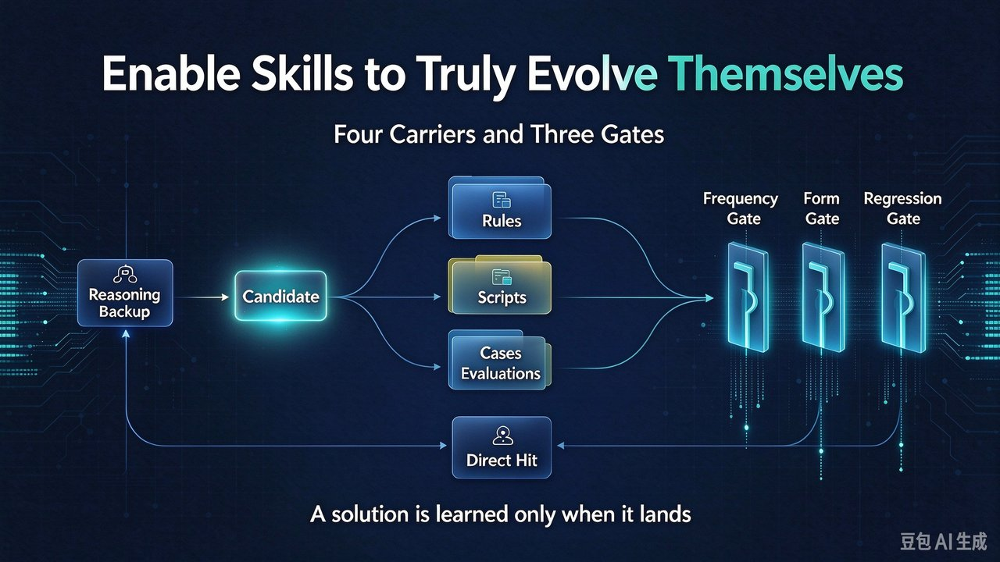

# Four Places a Skill Stores Its Lessons, and Three Gates That Keep It Honest



"Skills get smarter the more you use them" is a nice slogan — but it is not a model's built-in trait. Most skills never learn, because they are missing one action: **write-back**. The skill reasons past a bug once, the session ends, the fix evaporates, and next month the same bug triggers a full re-reasoning. The same accident keeps charging tuition.

So the question isn't "can the model learn?" It's whether you designed "learning" as a step in the flow: who triggers it, where it's written, what form it takes, how you verify it, and how you roll it back.

## Why most skills don't learn — the volatile fix

A skill differs from a tool by one layer: model reasoning. Hit an out-of-checklist exception and it doesn't error out — it reasons its way past. But that only solves *this round*. The derived fix is volatile:

- **It vanishes on session switch** — next time the same problem appears, the model doesn't know it already solved this last week.
- **The reasoning is unauditable** — nobody can later say why it went around the problem.
- **The most valuable fixes disappear first** — the gnarly exceptions are exactly the ones most worth keeping.

## Four carriers — where the lesson lands

The fix must leave the session and land on disk as one of four carriers:

- **Rules layer** (the skill's main file): judgments, order, and hard constraints that always apply. Zero retrieval cost, but most expensive — every extra line costs context every round.
- **Scripts layer**: deterministic, parameterizable actions. Cheapest tokens, most stable — the terminal form of sedimentation.
- **Cases layer**: one-off exceptions, context, and troubleshooting paths. Doesn't pollute the main flow.
- **Evals layer**: turns pitfalls into executable checks. Doesn't teach the skill how; guarantees it doesn't regress.

## Three gates — preventing "learning" from going backwards

The gates are not one but three, applied in order: a **frequency gate** blocks one-off coincidences, a **form gate** decides whether the fix becomes a script, a rule, or a case, and a **regression gate** confirms before merging that it didn't break existing ability. Any gate missed and the fix falls back to the casebook — remembered, but not auto-executed.

```text
def write_back(clue, seen_count, is_deterministic, env_specific):
    if seen_count < 2:                  # one-off, just log
        casebook.add(clue); return "case"
    if is_deterministic:                # mechanical step -> script
        return scriptify(clue)
    if env_specific:                    # env-bound, hard to reproduce
        casebook.add(clue); return "case"
    rule = propose_rule(clue)
    if not passes_evals(rule):          # would break elsewhere, don't merge
        casebook.add(clue); return "case"
    commit(rule, why=clue, counterexample=..., rollback=prev_version)
    return "rule"
```

Four invariants we enforce:

1. **A fix starts as a candidate, never a rule** — one occurrence is an accident, two is a pattern.
2. **If it can be a command, never a "please note"** — natural-language rules rely on the model's voluntary compliance; scripts don't.
3. **Every new rule carries a "why" and a counterexample** — without a counterexample, nobody dares delete or change it six months later.
4. **Rule changes must be rollbackable and verifiable** — keep the previous version and run evals before and after.

## How to tell it's actually evolving

The payoff shows up as **the same class of exception no longer being re-reasoned**. Three signals: does the repeat-trigger count of the same exception drop, does fallback reasoning shift from old problems to new ones, and does the eval suite grow with the pitfalls while staying green. The qualitative tell: a healthy skill's main file gets *thinner* while scripts and cases grow.

The mistakes we hit: dumping everything into the main file (it became an incident log), freezing a one-time environment coincidence into a rule (it misjudged another path), shipping without evals (we fixed one scenario and silently broke another), and underestimating rollback (rules could only ever grow).

## The tool we shipped — JinJinXia

**JinJinXia** turns this gate into a pipeline: via each agent platform's native hooks it collects skill-usage records with zero intrusion, and only when 3+ users hit the same class of problem does it cluster and generate a draft PR — problem description, root cause, suggested change, and a new regression test — for the owner to review and merge (auto-merge is configurable). The personal edition runs entirely on your machine; data never leaves 127.0.0.1. Verified on Claude Code, Copilot CLI, Codex, Qoder, CodeBuddy, and OpenCode. Project home: <https://github.com/KylinLabAI/JinJinXia-App>

---

## Summary

1. Self-evolution is not a model gift — it is a write-back action with triggers, sinks, and verification; an unpersisted lesson is an unlearned lesson.
2. The key tradeoff is **candidate first, rule second**: one occurrence is an accident, two is a pattern; deterministic sinks to scripts, env-bound stays in cases.
3. Next time a skill seems "smart this once," ask: **did the fix land on disk?** If not, it only learned for a single conversation.

If you've hit the "learning backwards" trap while giving skills write-back and rollback, I'd love to hear about it in the comments.
