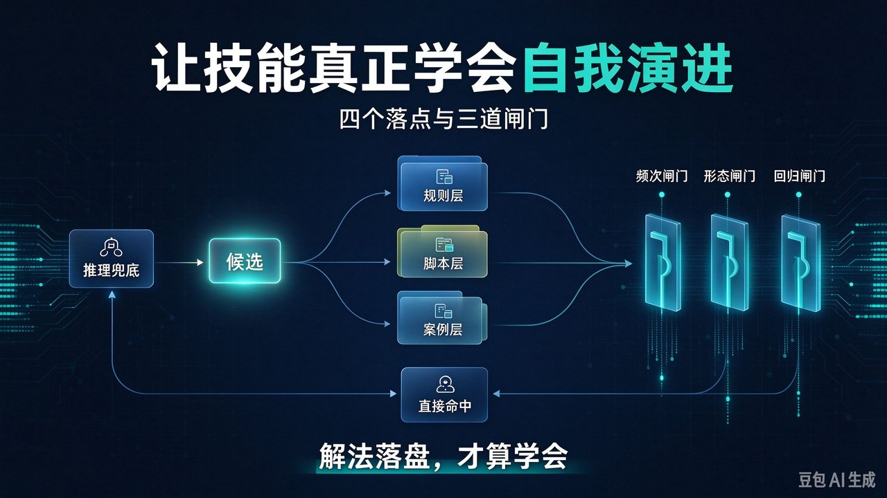

# 让技能真正学会自我演进：四个落点 + 三道闸门



"技能会自我演进、越用越聪明"这句话很好听，但把它当成模型自带的属性，就会一直等不到它发生。真实情况是：**绝大多数技能并不会自学，因为它缺一个动作——写回。** 这次用推理绕过的坑，只留在这一轮的对话里；会话一结束，经验跟着蒸发，下次同样的异常再从头想一遍。

所以问题不是"模型能不能学会"，而是**你把不把"学"这件事设计成流程里的一个步骤**：谁触发、写到哪里、写成什么形态、怎么验证写对了、怎么在写错时退回去。

## 为什么多数技能并不自学 — 易失的解法

技能和工具的差别，在于技能多了一层模型推理：遇到清单外的异常，它不会原地报错，而是想办法把任务继续推下去。这一步解决的是**这一轮**的麻烦。问题就卡在"这一轮"——推理兜底给出的解法，天然是易失的：

- **换会话就没了**：下次同类问题出现，模型并不知道自己上周已经想过一遍，只能再推理一遍，再烧一遍 token。
- **想出来的过程不可审计**：事后没人说得清当时为什么这么绕过去，于是这条经验既没法复用，也没法被质疑。
- **经验反复被低估**：越是难缠的异常，越需要现场推理；而恰恰是这类解法最值得留下来，却最容易随会话消失。

代价不在于某一次多花了几分钟，而在于**同一种意外被反复交学费**。

## 我们面对的四种方案

把"写回"做出来，有几条路，取舍点在于**可控性与成本的平衡**：靠模型在会话里"记住"（零成本但换会话即失效）；人手工维护技能文档（质量可控但慢）；技能自动改写自己的规则（闭环快但易膨胀、难回滚）；自动产出候选 + 闸门放行（有验证、有回滚、可持续）。我们选最后一条：**让技能自动提出沉淀方案，但由规则和评测来决定它能不能被合并进自身。**

## 我们构建了什么 — 四个载体

整套机制由四类载体加三道闸门组成：

- **规则层（技能主文件）**：写"每次都该遵守"的判断、顺序与硬约束。零检索成本，但也最贵——每多一行，每轮都要占上下文。
- **脚本层**：把解法里已经确定、可参数化的动作抽成命令。token 最省、结果最稳，是沉淀的终点形态。
- **案例层**：存一次性的例外、上下文与排查路径。不污染主流程，需要时按需检索。
- **评测层**：把踩过的坑变成可执行的检查。它不教技能怎么做，只保证它别退回去。

## 三道闸门 — 防止越学越笨

闸门不是一道，而是依次放行的三道：**频次闸门**挡住只出现一次的巧合，**形态闸门**决定这次解法该变成脚本、规则还是案例，**回归闸门**在合并前确认它没有踩坏已有能力。任何一道没过，解法就退回案例库——被记住，但不参与自动执行。

```text
        执行中撞上清单外异常
              │
              ▼
     推理兜底（知识 / 查文档）
              │
              ▼
     可复用吗？──否──▶ 只进案例库
              │是
              ▼
   脚本 / 规则 / 案例 / 评测  ← 闸门判定
              │
              ▼
   下次同类问题 ──▶ 直接命中
```

## 写回代码 — 分水岭

代码层面，这三道闸门就是一段判定；它短，但它决定了技能是变聪明还是变糊涂：

```text
def write_back(clue, seen_count, is_deterministic, env_specific):
    if seen_count < 2:                  # 一次是意外，先只留痕
        casebook.add(clue); return "案例"
    if is_deterministic:                # 机械步骤，下沉成脚本
        return scriptify(clue)
    if env_specific:                    # 绑环境、难复现
        casebook.add(clue); return "案例"
    rule = propose_rule(clue)
    if not passes_evals(rule):          # 会改坏别处，就别合并
        casebook.add(clue); return "案例"
    commit(rule, why=clue, counterexample=..., rollback=prev_version)
    return "规则"
```

注意第 2 行与第 9 行的分工：前者挡住"把巧合写成规则"，后者挡住"修好 A 弄坏 B"。这两行是整段代码里唯一不能省的部分。

四条我们强制执行的不变式：

1. **解法先当候选，不当规则**：一次是意外，两次才是规律。
2. **能写成命令的，绝不写成一句"请注意"**：自然语言规则要靠模型自觉遵守，脚本不需要。
3. **每条新规则必须带"为什么"和一个反例**：没有反例的规则，半年后没人敢删，也没人敢改。
4. **规则改动必须可回滚、可验证**：保留上一版，并在改动前后各跑一次评测。

## 怎么判断它真的在演进

这套机制的收益体现在**同类异常不再重复推理**上。三个信号：同类异常的重复触发次数是否下降、兜底推理的占比是否从"老问题"转向"新问题"、评测用例是否随踩坑增长且通过率稳定。一个可以自我观察的定性变化：**技能的主文件不该越写越长——真正健康的演进方向，是主文件变薄、脚本与用例变多。**

## 我们踩过的四个坑

- 一开始什么都往主文件里写，结果文件越来越长、越来越像事故流水账。
- 曾把一次环境巧合固化成规则，后来在另一条路径上造成误判。
- 早期没配评测，出现过修好一个场景、悄悄弄坏另一个场景的情况。
- 低估了回滚的价值，导致规则只能加不能减。

## 一个把这套机制跑起来的工具 — 锦鲸匣

**锦鲸匣（JinJinXia）** 把本文这套闸门跑成了流水线：它经各 Agent 平台的原生 Hook 零侵入采集技能使用记录，当 3 名以上用户撞上同一类问题时，才聚类生成一份草稿 PR——内含问题描述、根因、建议改动与新增回归用例——由 Owner 评审合并（也可配置自动合并）。个人版可完全跑在本机，数据不出 127.0.0.1。已验证支持 Claude Code、Copilot CLI、Codex、Qoder、CodeBuddy、OpenCode。项目主页：<https://github.com/KylinLabAI/JinJinXia-App>

---

## 总结

1. 自我演进不是模型送的礼物，而是一个必须有触发条件、有落点、有验证的写回动作；没落盘的经验等于没学到。
2. 最重要的取舍是**先候选、后规则**：一次是意外，两次才是规律；确定的下沉成脚本，绑环境的只留案例。
3. 下次你看到一个技能"这次挺聪明"，问自己一个问题：**这次的解法，落到磁盘上了吗？** 如果没有，那它还只是聪明了一次。

如果你在给技能做写回与回滚时踩过坑，欢迎在评论区聊聊。
