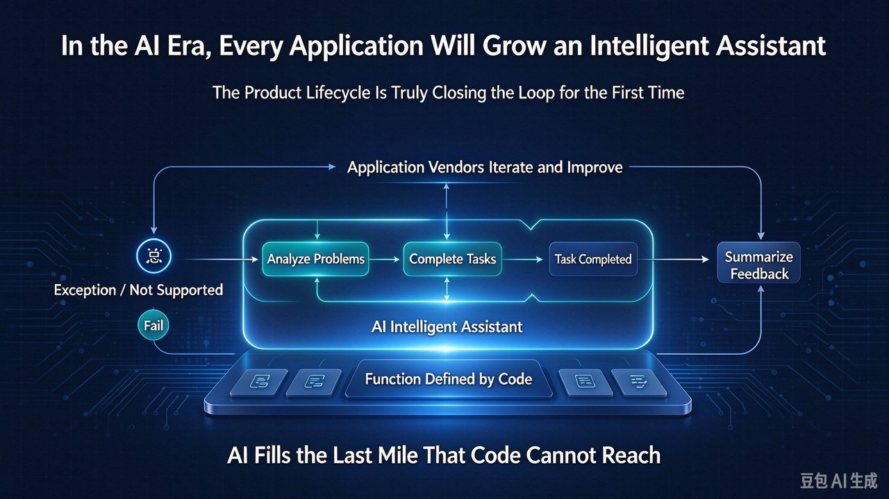

# The AI Assistant Layer That Finally Closes the App Lifecycle Loop



Most apps today are, at their core, code-defined features that execute deterministically. They do exactly what the code specified on ship day — and the moment they hit something unanticipated, they stop. An exception fails; a missing feature returns "not supported." The value of the app is locked at the moment it was written, and every real problem after that is a dead end.

The tempting move is to treat "integrate AI" as adding *one more feature* — a chatbot, a smart-fill. That puts AI inside the feature list and misses the actual change. The change is a **layer**, not a point.

> The real AI-era shift is not another feature on the list. It is an assistant layer outside the feature set that understands, analyzes, and catches the long tail — and feeds failures and needs back to the vendor as feedback.

## Judgment 1 — The app's value is still defined by code; AI fills what code can't reach

The app's functionality is written in code and executed deterministically — that is its foundation, and AI is not here to replace it. AI's role is an **assistant**: it provides understanding, analysis, and completion *outside* the features. That decides where you place it: not as one more cell on the feature list, but as a layer drawn *outside* it, covering the scenarios the features don't.

## Judgment 2 — Exceptions and "not supported" are where the assistant earns its keep

When the app hits an exception, the old result was a hard failure. With AI, the assistant can take over **analyzing** it — why did it fail, where is the problem, what's the next step. When a feature is missing, the old result was a dead end; with an AI assistant, **the task can still be completed** — the assistant understands the need on the spot and produces a result, instead of a cold "not supported."

This is the "last mile": the code defines the smooth main path; the AI covers the long tail of exceptions and gaps. For example, when a user wants an export format the app doesn't support, the assistant understands and generates it on the spot rather than turning the user away.

## Judgment 3 — AI turns every failure and need into product evolution

Exceptions and "not supported" aren't just user annoyances; they are **product signals**. The AI can conveniently summarize these signals into structured feedback and hand it back to the vendor; the vendor improves the app accordingly, creating a closed loop:

```text
  [code-defined features] --execute--> [success]
        |
     exception / not-supported
        |
        v
  [AI assistant] --analyze, complete task--> [task done]
        |
     summarize as feedback
        v
  [vendor] --iterate--> [stronger app]
        ^__________________________|
```

This way the app no longer stops at "ship day"; it is continuously pushed forward by real problems, and the lifecycle closes — letting it keep贴近 and satisfying customers.

## Three objections — answered

- **"AI errs and hallucinates — how can it catch things?"** The AI is an assistant, not the sole executor: keep human confirmation for critical actions, and fall back to the user when confidence is low. It covers the long tail, not the core.
- **"Doesn't this blur the product boundary?"** No. Core functionality remains deterministically owned by code; AI only handles exceptions and gaps. The boundary is crisp: one layer of deterministic features, one layer of intelligent fallback.
- **"Don't cost and complexity go up?"** They do — but you trade them for fewer failed dead ends, less churn, and faster need feedback. Small teams can start with just the smallest piece: exception analysis.

## What it means for you

- **Product managers**: don't just draw the feature list; design the AI assistant specifically for "exception paths" and "unsupported scenarios"; treat user failures and needs as product input, not as a bug to close out.
- **Developers**: make failures "analyzable" — record context, expose it to the assistant, instead of just throwing an error; clarify which tasks AI may complete and which require human confirmation.
- **Founders / vendors**: wire the AI-summarized feedback into the roadmap to form a "user → AI → product" loop; measure value by **task completion rate**, not just feature usage.

Four metrics to watch: assistant penetration (from "do we have a chat box" to "can it catch exceptions"), feedback回流率 (how much summarized feedback enters the next iteration), task completion rate (when unsupported, how often the assistant finishes it), and retention/support tickets after the dead ends shrink.

---

## Summary

1. AI is not another feature of the app — it is an **assistant layer** outside the code-defined features.
2. When the app hits an exception or an unsupported case, AI can analyze the problem and complete the task.
3. Feeding that feedback back to the vendor is what truly closes the product lifecycle and keeps satisfying customers.

Start with the smallest piece: pick a high-frequency failure scenario, add "AI analysis," and see if it can turn a dead end into a path.
