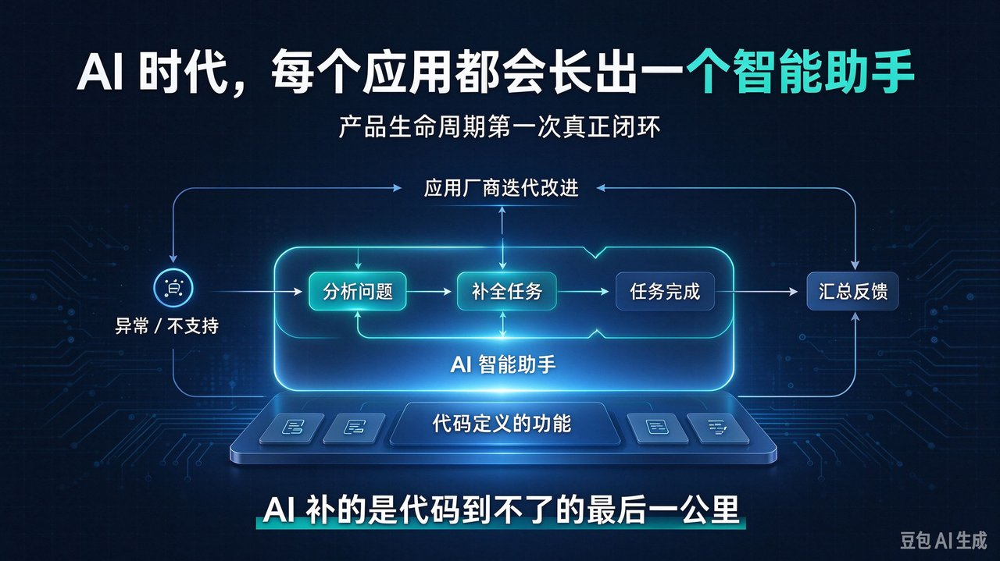

# 每个应用都该有个 AI 助手：它才是产品生命周期的闭环



今天绝大多数应用，本质上是**把功能写进代码、按确定逻辑执行**。它能做什么，在发布那一刻就被代码定义清楚了。于是出现一个反复出现的场景：应用执行到一半遇到异常，它只能失败；用户想要一个应用没有实现的功能，它只能说"暂不支持"。

很多人对"接入 AI"的理解，是再做一个 AI 功能——加个聊天框、加个智能填充。这是把 AI 当成一个**功能点**。而在 AI 时代，几乎所有应用都会集成 AI，真正的变化不是多一个功能，而是多一**层智能助手**：它不负责把已有功能重做一遍，而是补在功能之外，去理解、分析、兜底。

> 核心判断：AI 不是应用的又一个功能，而是补在代码功能之外的智能助手层——它把长尾的异常与缺口接住，并把失败与需求汇总成反馈回流给厂商，让产品生命周期第一次真正闭环。

## 反复出现的死路 — 只靠代码定义功能的应用

一个只由代码定义功能的应用，遇到它没被写过的情况，就只会停下：应用执行到一半遇到异常，只能失败；用户想要一个应用没有实现的功能，只能收到"暂不支持"。这句话的潜台词是——**应用的价值在发布那一刻就被定死，之后的真实问题它接不住。**

## 三个关键判断 — 助手层放在哪

### 判断一：应用价值仍由代码定义，AI 补的是"代码到不了的地方"

应用的功能是写进代码、按确定逻辑执行的——这是它的根基，AI 不是来替代它的。AI 的角色是**助手**：在功能之外，提供理解、分析和补全。这一点决定了你把 AI 放在哪里：它不是功能清单上多画的一格，而是画在功能清单**之外**，作为覆盖那些功能覆盖不到的场景的一层。

### 判断二：异常与"不支持"，才是 AI 助手真正发挥价值的时刻

应用执行中遇到异常，过去的结果是直接失败。接入 AI 之后，AI 可以接手**分析问题**：为什么会失败、问题出在哪、下一步该怎么办。应用没有对应功能，过去是一条死路；有了 AI 助手，**任务仍然可以被完成**——由 AI 现场理解需求、给出结果，而不是一句冷冰冰的"暂不支持"。

这就是"最后一公里"：代码定义的是顺风顺水的主路径，AI 覆盖的是长尾的异常与缺口。比如用户想要一种应用并不支持的导出格式，助手可以就地理解并生成，而不是把用户挡在门外。

### 判断三：AI 把每一次失败和需求，变成推动产品进化的反馈

异常和"不支持"不只是用户的麻烦，它们更是**产品的信号**。AI 可以顺手把这些信号汇总成结构化反馈，交回厂商；厂商据此改进应用，于是形成一个闭环：

```text
  [代码定义的功能] --执行--> [成功]
        |
     异常 / 不支持
        |
        v
  [AI 智能助手] --分析、补全任务--> [任务完成]
        |
     汇总为反馈
        v
  [应用厂商] --迭代改进--> [更强的应用]
        ^__________________________|
```

这样一来，应用不再停在"发布那一刻"，而是持续被真实问题推动着改进，生命周期由此闭合，也才能持续贴近并满足客户需求。

## 三个反对意见 — 逐一回应

- **"AI 会出错、会幻觉，怎么能让它兜底？"** AI 是助手而不是唯一执行者：关键动作保留人工确认，置信度低时回退给用户。它补的是长尾，不是接管核心。
- **"这样产品边界会不会变模糊？"** 不会。核心功能仍由代码确定性地承担，AI 只处理异常与缺口。边界很清晰：一层是确定性的功能，一层是智能兜底。
- **"成本和复杂度会不会上升？"** 会，但换来的是更少的失败死路、更少的流失、更快的需求回流。对中小团队，完全可以先从"异常分析"这最小的一块做起。

## 对你意味着什么 — 三类角色

- **对产品经理**：设计时别只画功能清单，要专门为"异常路径"和"不支持场景"设计 AI 助手；把用户的失败与诉求当作产品输入，而不是当作一个 bug 收尾。
- **对开发者**：让失败"可被分析"——记录上下文、暴露给助手，而不是只抛一句报错；明确哪些任务允许 AI 补全，哪些必须人工确认。
- **对创业者 / 厂商**：把 AI 汇总的反馈接进路线图，形成"用户 → AI → 产品"的闭环；用"任务完成率"来衡量价值，而不只是看"功能使用率"。

## 接下来看什么 — 四个观测指标

- **助手渗透率**：从"有没有聊天框"转向"异常时能不能兜底"。
- **反馈回流率**：AI 汇总的问题里，有多少真正进了下一轮迭代。
- **任务完成率**：应用不支持时，AI 助手把任务做完的比例。
- **留存与工单**：死路变少之后，支持成本和用户流失是否下降。

---

## 总结

1. AI 不是应用的又一个功能，而是补在代码功能之外的**智能助手层**。
2. 应用遇到异常或不支持时，AI 能分析问题、兜底完成任务。
3. 把这些反馈汇总回厂商，产品生命周期才真正闭环，并持续满足客户需求。

先从最小的一块试起：挑一个高频失败场景，给它接上"AI 分析"，看看它能不能把一条死路，变成一条通路。
