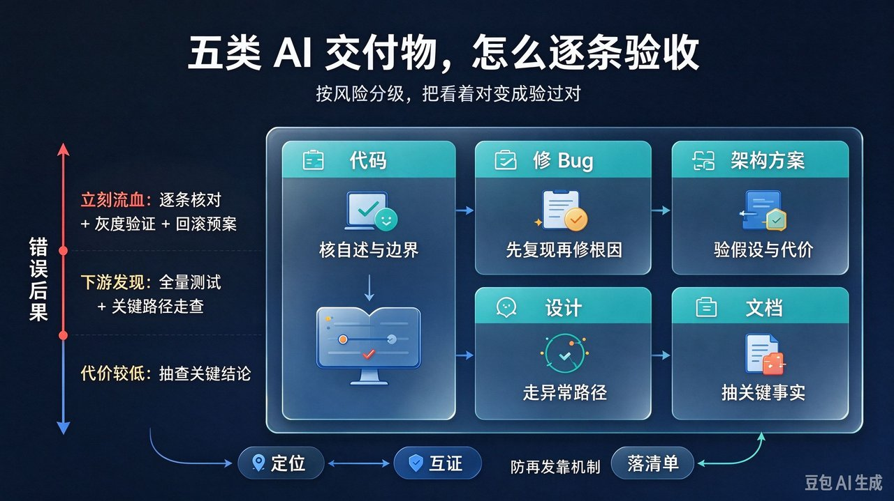

# AI 交付对不对，怎么判断？五类交付物验收清单

<!-- 封面图：正文第一张图，紧跟 H1 之后、开篇段之前 -->



进入 AI 时代，我们每天都在和 AI 一起工作：写代码、修 Bug、定架构、出方案、做设计、写文档。这件事有一个很少有人讲破的隐含意义——**你已经在做管理了**，而管理里最吃功夫的一环，不是派活，是验收。

AI 的产出不是标准答案，是待验收的交付物：它按概率生成最通顺的内容，**语气自信和正确率无关**。看着对 ≠ 验过对。

本文只回答一个最实际的问题：**代码、修 Bug、架构方案、设计、文档这五类 AI 交付，怎么逐条判断对不对。** 不涵盖 AI 工具选型、提示词技巧和团队组织设计。

---

## 一、总原则：AI 是生成器，不是验证器

AI 不维护事实、不运行验证、不为错误负责，它只负责生成。所以第一性原则只有一条：**把"看着对"降级为线索，把"验过对"升级为结论。** 三条铁律把它落成动作：

1. **能跑验证的，别用阅读理解。** 测试能跑、命令能执行、用例能复现——凡是机器能裁决的，一律让机器裁决，人只读测试过不了的那部分。
2. **能对照原始需求的，别凭印象。** 验收的对象是"交付物是否满足这次任务"，不是"交付物本身是否漂亮"。对不上原始需求的精巧改动，是范围蔓延。
3. **能构造反例的，别停在正例。** 正例只能证明它跑通了 happy path；挑一个它没考虑的输入，答不上来的就是漏洞。

验收深度按错误后果分级，而不是全量返工、也不是全量免检：

| 交付物的后果 | 例子 | 验收深度 |
|---|---|---|
| 错了立刻流血 | 线上配置、支付/权限逻辑、数据迁移脚本 | 逐条核对 + 灰度验证 + 回滚预案 |
| 错了被下游发现 | 内部工具、非核心功能、接口变更 | 全量测试 + 关键路径走查 |
| 错了代价低 | 脉络草稿、原型脚本、内部说明 | 抽查关键结论即可 |

---

## 二、代码交付：先收"变更自述"，再逐条核

代码最容易被误判的地方：**diff 读起来通顺，不等于行为正确。** 通顺是生成器的强项，正确不是。所以第一步不是读代码，是先要一份随附的自述，把它当作待核对的线索：

```markdown
## 变更自述（交付时随附）
- 对应需求：<逐条列出>
- 影响范围：<改了哪些模块、哪些调用方>
- 边界处理：<空值/并发/超时/权限，逐项声明>
- 测试情况：<跑了什么命令，结果如何>
- 未覆盖风险：<诚实声明没验证的部分>
```

自述本身也是 AI 生成的，所以验收顺序是"先核自述，再核代码"：

1. **核自述的第一行**：它声称的测试，自己跑一遍；声称"未覆盖"的风险，就是你的验收重点。
2. **全量跑测试**：含边界与异常路径。没写的补测试再合——"测试没写完"不是完成状态。
3. **逐条追需求**：拿自述的"对应需求"一对一指认原始需求；指不上的改动，要么砍掉，要么让它说清为什么。
4. **让它讲关键段**：挑 1–2 个核心函数或关键分支，让它讲清为什么这样写、不这样写会怎样。讲不清，多半是拼凑的。
5. **专查边界与异常**：空值、并发、超时、越权、超大数据量——直接问"哪些边界没处理、为什么"，答案列入你的验证清单。
6. **看范围与副作用**：diff 是否顺手改了不该改的；新增依赖是否必要；是否动了公共签名、全局状态、隐式行为。

---

## 三、修 Bug：先复现，再谈修复

AI 修 Bug 最典型的失败模式：**修症状不修根因**——吞掉异常、调大超时、加个重试、把常量改大。看着好了，根因还在，下次换个姿势再炸。验收顺序必须倒过来：

1. **先复现，后开工**：拿到稳定复现步骤和实际现象。复现不了的问题不许进入修复——你无法验收一个自己没见过的问题。
2. **逼它区分根因与症状**，问三句：
   - 哪一行改动对应根因，删掉这行问题应该以什么形式回来？
   - 为什么之前没触发？触发条件是什么？
   - 同一根因还可能在哪些地方以别的症状出现？
3. **修复后按原步骤复跑**：应不再触发；同时确认现象不是被"藏起来"（吞异常、静默降级、改阈值都是藏，不是修）。
4. **回归相关用例**，并让它列出"这次改动可能波及的调用方"——把这份名单当线索逐个查，不自动采信。
5. **防再发落盘**：复现步骤 + 根因 + 验证用例，三件套沉淀为回归用例或验收清单条目。**Bug 修复的终点是用例入库**，不是你本地跑通。

---

## 四、架构与解决方案：验收假设，不是验收排版

架构方案的误判陷阱：**排版越专业，越容易让人跳过验证。** 但方案的成立与否全在假设里，和图表画得漂不漂亮无关。验收动作：

1. **先逼出假设清单**：让它列出方案成立的全部前提——数据量级、QPS、预算、团队规模、合规约束。**有一条对不上现状，方案整体不成立**，后面的细节不用看了。
2. **用真实约束逐条量**：拿当前系统的实际数字对照它的假设，对不上的标红；再问"这个约束扩大 10 倍会怎样"，看它怎么改口。
3. **要代价和死法**：让它讲这个方案最大的三个代价、最可能的三种死法，以及降级/回退路径。只讲优点不讲代价的方案不完整，不验收。
4. **要一个更简单的对照**：让它给一个"能省则省"的最简方案，对比两者差在哪、复杂度换回了什么。换不回明确收益的复杂度，是炫技。
5. **关键假设上 POC**：所有"应该没问题"的假设里，挑风险最高的那条做最小验证——能跑压测的跑压测，能建原型的建原型。纸面合理不算数。

---

## 五、设计：走查关键路径与异常世界

设计（接口设计、详细设计、流程设计）的误判陷阱：**happy path 上完美，异常世界里裸奔。** 验收动作：

1. **走通一条核心用例**：从入口到结束逐步走一遍，每一步的输入、输出、状态、失败动作都要有定义——缺一环就是设计漏洞。
2. **把异常路径走一遍**：网络失败、下游超时、重试幂等、并发冲突、部分成功——对每条问"这时系统处于什么状态"，答不出的打回。
3. **按调用方视角挑毛病**：让它扮演最不守规矩的调用方，问"这个接口最容易被怎么误用、误用后是什么后果"，据此补防呆设计。
4. **对照现实一致性**：命名与团队既有约定是否一致？与它声称要对接的系统、文档是否对得上？让它列出所有与现状的偏离点，逐个确认是故意的还是漏的。
5. **确认能观测**：问"上线后靠什么日志/指标/告警判断它工作正常"。**没有验收手段的设计不通过验收**——先定义怎么证明它对，再上线。

---

## 六、文档：验收事实，不是验收文采

文档的误判陷阱：**流畅度产生了可信的错觉**，而文档最贵的错误是事实错误——后人会把它当依据。验收动作：

1. **抽样核查关键事实**：版本号、命令、路径、配置项、数字，抽 3–5 处到真实环境跑/查——命令能否执行、路径是否存在、配置项是否真实。
2. **代码示例跑一遍**：文档里的片段能否编译、能否跑通、示例结果是否与文档宣称一致。跑不通的段落，整段存疑。
3. **对照实现读**：文档描述的流程/字段/行为，与真实实现逐条对——尤其注意"文档描述的是设计意图还是当前行为"，两者不一致时按实际行为写。
4. **追问依据**：每一条量化结论和断言，问"依据是什么、来自哪里"。给不出依据的，要么补，要么明确标注为观点。
5. **标注时效**：文档写明适用版本与日期；内容随实现演进的，标注"以 X 为准"，防止过期信息被当成现行事实。

---

## 七、验收不过时的三步闭环

验收发现问题不可怕，可怕的是只有"退回去重做"一个动作。闭环三步：

1. **定位自己来**：先自己复现、自己看现象，拿到"问题长什么样"的事实，再让 AI 改。定位外包给 AI，等于让被告自己取证。
2. **让两个方案互相证伪**：对同一个问题让它给第二版方案，再让两版互相挑错。谁也挑不出的方案才进实现；只给一版就动手的，验证深度不够。
3. **把教训沉成机制**：这次验收发现的问题，变成下次的清单条目、回归用例或模板——**防再发靠机制，不靠记性。** 人会忘、会累、会换人，清单不会。

---

## 总结与延伸阅读

- **AI 当然不必然正确——所以人人都是管理者。** 验收是管理者的本职：把"看着对"变成"验过对"，按错误后果定验收深度。
- **五类交付五套动作**：代码先收自述再逐条核边界，修 Bug 先复现再谈修复，方案先验假设再看细节，设计先走异常路径，文档先抽事实。
- **验收不过就走三步闭环**：自己定位、两版互证、教训落清单——同样的错不出现第二次，验收才算真正完成。

延伸阅读：同系列下一篇《让 AI 交付正确，靠流程不靠复查——两段交付与两个 Agent 的实践》把验收从事后的人工复查上移到流程设计，讲如何用两个 Agent、两个模型把"评审"变成流程里的一步。

下一次 AI 交活时，先别急着读结论——挑它交付里最要命的那一条，跑一遍、复现一次、挑个反例。**这就是验收的全部起点。**

如果你在 Jekyll 或 GitHub Pages 部署中踩过类似的坑，欢迎在评论区聊聊。
