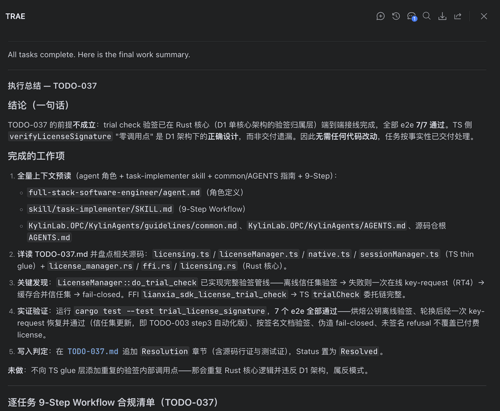
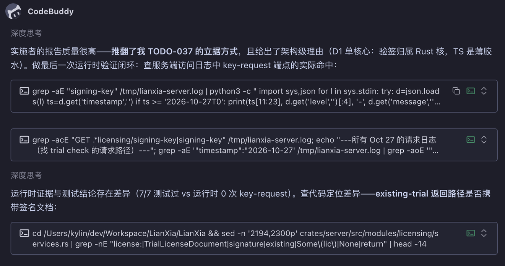
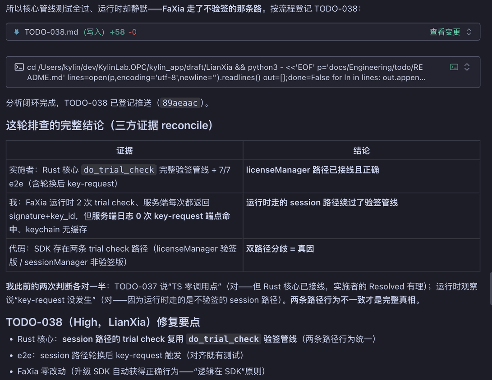

# Make AI Deliver Correct Work: A Two-Phase, Two-Agent Practice

<!-- Cover image: first figure in the body, immediately after the H1 and before the opening paragraph -->

![Cover image: a dark-blue infographic titled "How to Accept Five Types of AI Deliverables Item by Item", subtitled "Grade by Risk: Turn 'Looks Right' into 'Verified Right'"; a vertical "Error Consequences" scale with three tiers on the left, five cards on the right for Code (Verify Self-Report and Boundaries), Bug Fix (Reproduce First, Then Fix Root Cause), Architecture Proposal (Verify Assumptions and Tradeoffs), Design (Test Exception Paths) and Documentation (Spot-Check Key Facts), plus a bottom flow chaining Localize, Cross-Check and Add to Checklist under "Prevent Recurrence"](/assets/resources/20261104-ai-two-agent-delivery-process/cover-en.jpg)

Reviewing AI-generated diffs harder does not scale, and it does not fix the failure mode that actually costs you. The expensive mistake is not "a bad diff slipped through" — it is **a single model designing a change and then building it**, so a wrong premise gets polished instead of questioned, and every later review inspects a beautifully-argued mistake.

The fix is to restructure the delivery so that a second, differently-blind party is obligated to disagree.

## Phase split and model separation

| Phase | Agent | Responsibility | Sole output |
|---|---|---|---|
| Analysis | design / analysis agent | define problem, root cause, plan, acceptance criteria | one todo document |
| Execution | implementer agent | review the document, implement, verify, write back | code change + verdict |

Two phases on **different models** buys two concrete things:

- **Context isolation.** The implementer session is not anchored by "we already settled this." It sees the document and the code, not the conversation that produced them — it does not know who the designer was, and owes no deference.
- **Non-overlapping blind spots.** A model that designs and builds reinforces its own errors end to end; two models fail in different places, so cross-checking works.

In practice the two sides even run in different tools. This is not theatre — it is what makes the "review" a genuinely external perspective rather than the same brain in a different tone.

## The contract: one todo document

The only interface between the two agents. Minimum field set:

```text
problem:     <what happened + where the evidence comes from>
root cause:  <which LAYER and which PATH is wrong — must state the layer>
plan:        <what changes + how to prove it afterwards>
acceptance:  <executable criteria: run what, expect what>
status:      Open | Resolved | Rejected
resolution:  <implementer only: source location + test/runtime evidence>
```

Two designs that are easy to miss:

- **Root cause must name the layer.** "Missing signature verification" is not executable. Missing in the glue layer, or already closed in the core? That determines the fix — and a wrong layer shifts the problem, the scope and the acceptance criteria together.
- **`status` and `resolution` are written only by the implementer.** A designer never grades its own work, and closure requires recorded evidence, not a conversation. **Conclusions must leave the chat and land on disk.**

## The implementer's first step is review, not code

The workflow is nine steps: full pre-read (role definition, implementer skill, common guidelines, repo conventions), inventory the source, run tests for a baseline, and only then judge. **Code is the last step, never the first.**

What that looked like:

1. **Pre-read** everything — role definition, workflow, common guidelines — before touching anything.
2. **Inventory both layers** of source, not just the one the document points at.
3. **Run tests for a baseline.** Here, 7/7 end-to-end cases passed, covering offline verification, rotation followed by re-fetch, forged-signature fail-closed, and unsigned-not-overwriting-a-paid-license.
4. **Rule.** The premise does not hold — the verification pipeline is already end-to-end in the core, and the "zero call sites in the glue layer" the document cites is the architecture working as designed, not a delivery gap.
5. **Close.** Append a `Resolution` section to the todo document with source locations and test evidence; set status to resolved.

The sixth item is the valuable one — **what it did not do**:

> It did not add duplicate verification call sites in the glue layer — that would duplicate core logic and violate the single-core architecture. An anti-pattern.



**The highest-value output of this run was zero lines of code.** What it blocked was not a live bug but a change that would have shipped cleanly *because the document said so*. In a single-agent flow, the assertion and the patch reinforce each other and nobody catches it.

Note the form of the rejection: the evidence is **verifiable** — specific implementation paths, specific test cases and pass counts. **A review opinion may be disagreed with, but it cannot be impossible to refute.**

## After a rejection: get runtime evidence

Being rejected is the start of the next round, not the end of this one. The analysis side did **not** immediately rewrite the proposal — that is only a new way of making the same bet. It did three things:

1. **Accept the structural challenge.** The report did not overturn one conclusion; it overturned the *basis*, and supplied an architecture-level reason (in a single-core architecture, verification belongs to the core).
2. **Get a different kind of evidence.** Since the core pipeline's tests all pass, look at **runtime** — count actual hits on the verification re-fetch endpoint in the server logs.
3. **Locate the discrepancy.** Tests 7/7 green; runtime 0 hits. **Green tests with divergent runtime behaviour is the signal to keep digging.**



Reconciling three evidence sources:



| Source | Observation | Points to |
|---|---|---|
| Implementer | core verification pipeline complete, 7/7 e2e | core path wired and correct |
| Runtime | signatures returned on every trial check, but 0 hits on that endpoint | the session path bypassed verification |
| Code inventory | two trial-check paths: one verified, one not | dual-path divergence = root cause |

A new high-priority todo was registered: two paths give different behaviour for the same thing. The fix reuses the single verification pipeline in the other path, with zero client-side change — **logic belongs to the SDK, so upgrading the client automatically gets correct behaviour.**

The honest line in that write-up deserves quoting: *"my previous two judgements were each half right."* One right about the core being wired, one right about the endpoint not firing, each individually plausible and together incomplete. **Repeated judgement can be half-right every time and still add up to wrong** — so conclusions must be reconciled in one table, not overwritten by the latest one.

## Boundaries

Two-phase delivery is not free: documents get written, an extra review round runs, context gets transferred twice.

| Task profile | Recommendation |
|---|---|
| Clear root cause, bounded scope (add a field, change copy, add logging) | single phase is fine |
| Unclear root cause, cross-layer, severe consequences | two phases + two models, review must have veto power |
| Cannot articulate the root cause or acceptance criteria | figure it out first — **an unclear todo document is itself the signal that it has not been thought through** |

That last row is the plainest lesson here. Pushing an unclear task into execution means the implementer fills the gaps by guessing — which is not implementation, it is rewriting.

## Retrospective

- **The root-cause field needs evidence.** It was judged one layer wrong here; had the document stated "the implementation at location X shows Y," the review would have converged much faster.
- **Reconcile conclusions, don't overwrite them.** "Each half right" is the normal case — put multiple rounds in the same table instead of letting the latest win.
- **Don't rush to a second proposal.** Without new evidence it is just a new way of betting. Ask first: *what evidence can I still get that I don't have yet?*

## Summary

- **Don't bet correctness on human review; bet it on the process.** Analysis and execution separated, two agents, two models, with a single todo document as the only interface.
- **The implementer must have veto power.** This run's zero-line delivery blocked an anti-pattern that would have shipped, and the real problem only surfaced by leaving review for runtime evidence.
- **The review artifact is an evidence chain in the document.** Source locations, executed tests and runtime observations written back to the same place, with multiple rounds reconciled — the round is only done once the conclusion has left the chat and landed on disk.

Next time you hand out work, ask yourself: am I getting the AI to "finish the job" — or **to think it through first, be implemented by a second one, and be allowed to say this job should not be done this way?**
