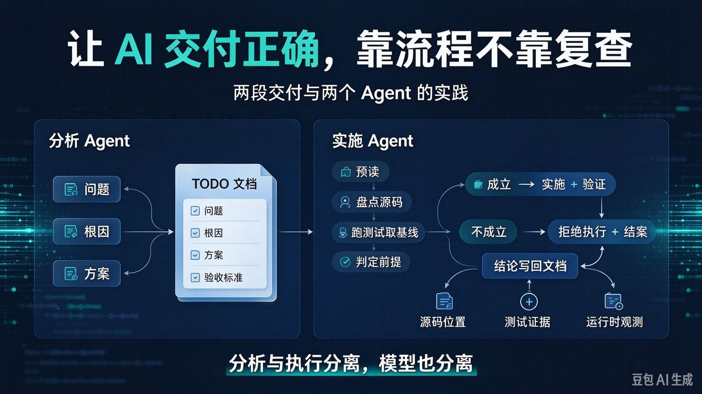
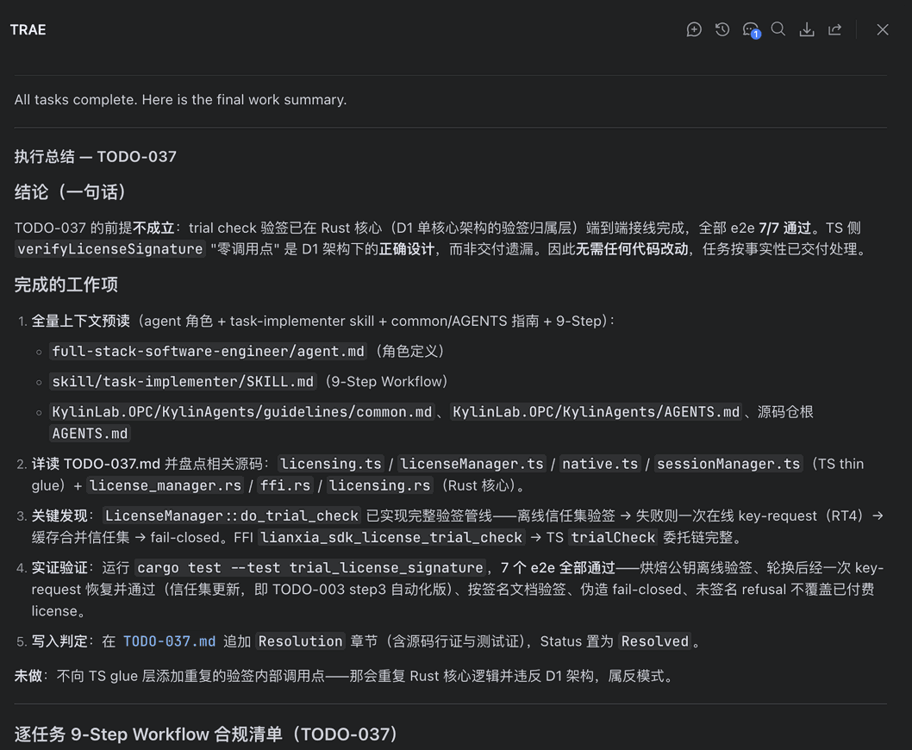
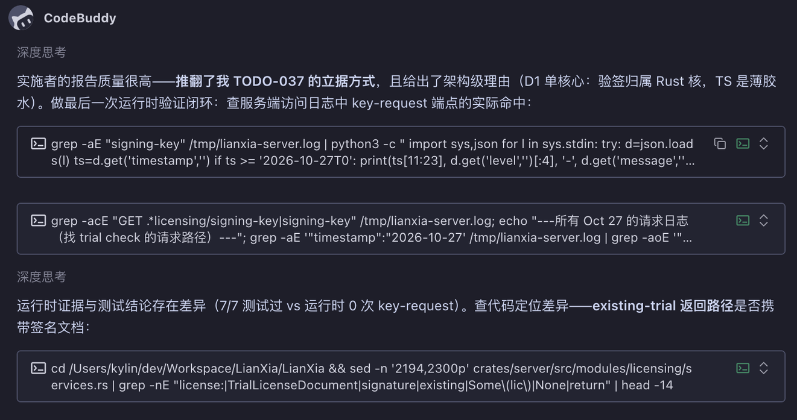
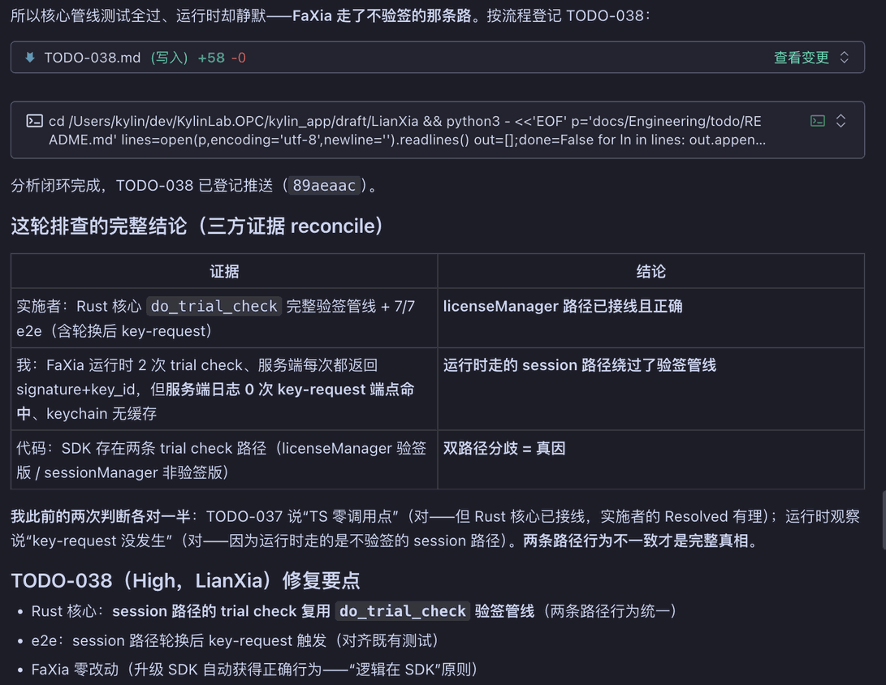

# 怎么让 AI 交付正确的活？两段交付与双 Agent 实践

<!-- 封面图：正文第一张图，紧跟 H1 之后、开篇段之前 -->



上一篇讲的是"人怎么验收 AI 交付"：五类交付物各有一套验收动作。但那套清单有一个没写破的前提——**人愿意看、看得动、看得出问题。**

真实情况是：AI 交上来的改动有几千行，自述写得条理分明，而你只有几分钟。更糟的是，**同一个模型既当设计者又当实现者，等于自己出题自己答卷**——错在根上，后面每一步都在替它遮羞。

所以本文换个方向：不再指望人在事后看出问题，而是**把评审本身变成流程里的一步。** 做法是把一次任务交付拆成两段——分析段只产出"问题 / 根因 / 方案"的文档，执行段只照文档实现；两段跑在不同的 Agent 和不同的模型上，而且**执行者动手之前必须先评审这份文档，前提不成立时有权拒绝执行。**

---

## 一、为什么人复查这条路会走到头

三个结构性障碍：

- **篇幅不对称**：AI 一次产出几千行 diff 加一份结构完整的自述，人的注意力只有几分钟。交付物越长，人越倾向于"看起来挺专业，应该没问题"。
- **语境衰减**：人不在现场。一条任务当初的上下文、约束、论证过程，如果不落在纸面上，评审的人根本没有判断依据。
- **错误的自我强化**：同一个模型既出题又答卷时，实现阶段会默认设计前提正确，顺着错误的前提把细节做得很漂亮。**环节越多，遮羞的成本越高。**

更关键的是，事后复查的全部手段都只能作用于"已经写完的东西"，而**正确的成本最低的阶段是写之前。** 所以要做的是把验收从"人复核交付物"上移到"流程本身的设计"。

---

## 二、核心机制：两段交付、两个 Agent、两个模型

| 阶段 | Agent | 职责 | 唯一产出 |
|---|---|---|---|
| 分析段 | 设计 / 分析 Agent | 定问题、找根因、出方案、写验收标准 | 一份 TODO 文档 |
| 执行段 | 实施 Agent | 评审文档、实现、验证、回写结论 | 代码改动 + 判定 |

用不同模型的两个具体收益：

- **上下文隔离**：实施会话没有被"我上一轮已经这样想了"锚定，它读到的只有文档和代码——**它不知道设计者是谁，也不需要照顾设计者的面子。**
- **盲区不重合**：同一个模型既设计又实现，错误会自我强化；两个模型犯错的位置不同，交叉验证才真正成立。

在真实实践里，两边甚至跑在不同的工具里：分析侧用一类助手做深度推理，实施侧用另一类助手执行。**这不是炫技，是为了让"评审"成为一次真正的外部视角，而不是同一颗大脑换个语气。**

两条路都可以走：**成立就实施，不成立就拒绝。** 拒绝不是流程故障，是流程在正常工作。

---

## 三、契约：一份能评审、能驳回的 TODO 文档

两端之间唯一的接口。最小字段集：

```text
问题：<发生了什么 + 证据来自哪里>
根因：<哪一层、哪条路径错了——必须写清层级>
方案：<改什么 + 改完怎么证明>
验收标准：<可执行的判据：跑什么、期望看到什么>
Status: Open | Resolved | Rejected
Resolution（仅实施者写）：<源码位置 + 测试/运行证据>
```

两个容易忽视的设计：

- **根因必须写明在哪一层。** "缺验签"这句话本身没有可执行性——缺在哪一层、哪条路径上缺，决定了该改哪里。**根因判错一层，方案、范围、验收全部跟着错。**
- **Status 与 Resolution 只由实施者写。** 设计者无权给自己判通过；实施者必须把源码位置和实跑证据写进文档才能结案。**结论必须离开对话，落到磁盘上。**

---

## 四、实施者的第一步不是写代码，是评审

九步工作流：先做全量预读（自身角色定义、实施技能、通用指南、仓库约定），再盘点相关源码，再跑测试拿基线，最后才下判定。**代码是最后一步，不是第一步。**

本次实施者的动作逐条看：

1. **预读**：开工前把角色定义、实施工作流、通用指南全部加载，再动手。
2. **盘点两层源码**：不只看文档点名的那一层——薄胶水层与核心层两边都过。
3. **跑测试拿基线**：实跑验签相关的端到端测试，7 个用例全部通过，覆盖离线验签、轮换后重新拉取、伪造签名 fail-closed、未签名不得覆盖已付费授权等路径。
4. **给判定**：这份 TODO 的前提不成立——验签管线在核心侧已经端到端闭环，胶水层"零调用点"是架构设计的正确结果，不是交付遗漏。
5. **结案**：在 TODO 文档追加 Resolution 章节，写清源码位置与测试证据，状态置为已解决。

第六条最值钱——**未做的事**：

> 不向薄胶层添加重复的验签内部调用点——那会重复核心逻辑、违反单核心架构，属于反模式。



**本次最有价值的产出是零行代码。** 它防住的不是一个已经发生的 bug，而是一个"照文档执行就会顺利上线"的反模式。交给同一个 Agent 全包的话，设计者断言缺失、实现者顺势补上，大概率就把重复调用点加进去了——双方都觉得自己在解决问题。

注意驳回依据是**可被核对的**：具体到源码实现路径，具体到跑过的测试用例与通过数。**评审的意见可以不同意，但不能反驳不了。**

---

## 五、驳回之后：分析者拿运行时证据闭环

被驳回不等于结束，而是下一轮的起点。分析者拿到实施者的报告后，**没有直接重写一版方案**——那样只是换个说法再赌一次。它做了三件事：

1. **先接受结构性质疑**：报告推翻的不是单个结论，是"立据的方式"，并且给出了架构级理由（单核心架构下，验签归属核心层）。
2. **补一份别的证据**：既然核心管线测试全过，那就去看**运行时**——查服务端日志里验签重取端点的实际命中次数。
3. **定位差异**：测试 7/7 通过，运行时却是 0 次命中。**测试全过和实际行为不符，这才是该继续往下挖的信号。**



三方对账表：

| 证据来源 | 观测 | 指向 |
|---|---|---|
| 实施者 | 核心侧验签管线完整，端到端 7/7 通过 | 核心路径已接线且正确 |
| 运行时观测 | 客户端每次试用校验都拿到签名，但服务端该端点 0 次命中 | 运行时绕过了验签管线 |
| 代码盘点 | 两条试用校验路径：一条带验签，一条不带 | 双路径分歧 = 真因 |



按流程登记下一个高优先级 TODO：两条路径对同一件事给出不同行为。修复要点是让另一条路径复用同一条验签管线，客户端侧零改动——**逻辑归属 SDK，客户端升级即自动获得正确行为。**

这轮排查有一句值得抄下来的自我评价：**"我此前的两次判断各对一半。"** 一处对在"核心已接线"，一处对在"端点没被命中"，但两次都只摸到了同一条真相的一半。**单人反复判断哪怕每次都沾边，加起来仍然可能是错的——所以结论要互相 reconcile，而不是只记最后一次。**

---

## 六、边界与反思

**边界**：根因清楚、范围明确（加字段、改文案、补日志）单段执行即可；根因不清、跨层、后果严重（线上缺陷、架构变更、数据迁移）才值得两段 + 双模型；**说不清根因、写不出验收标准的，先想清楚**——一份说不清楚的 TODO 本身就是"还没想清楚"的信号，硬要执行，实施者只能靠猜补全，那不再是实施，是二创。

**反思**：根因字段必须带证据；结论要对账、不要覆盖；被驳回后别急着要第二版方案——没有新证据的第二版只是换个说法再赌一次，**先问"我还能拿到什么之前没有的证据"。**

---

## 总结与延伸阅读

- **别把正确性押在人的复查上，把它押在流程里。** 分析与执行分离、两个 Agent、两个模型，接口只有一份 TODO 文档——谁也不能替对方想。
- **实施者必须有拒绝权。** 本次零行代码的交付，防住了一个照文档执行就会上线的反模式；而真问题（双路径分歧）只有走出评审、去运行时取证才浮得出来。
- **评审的产物是文档里的证据链。** 源码位置、实跑测试、运行时观测写回同一处，多轮结论互相 reconcile——结论离开对话落到磁盘，这一轮才算干完。

延伸阅读：同系列上一篇《AI 的交付对不对，怎么判断？——五类交付物验收清单》（`blogs/Tech/20261102-ai-delivery-acceptance-checklist/`）。

尚未做量化采集的，如实登记：因前提不成立而被拒绝的任务占比、首轮评审即驳回 / 即通过的比例变化、两段交付的额外耗时与"照单执行后返工"的耗时对比。

下一次派活之前，先问自己一句：我是在让 AI"把活干完"，还是在让它**先想清楚、再由另一个它去执行、并且允许它说这活不该这么干**？
