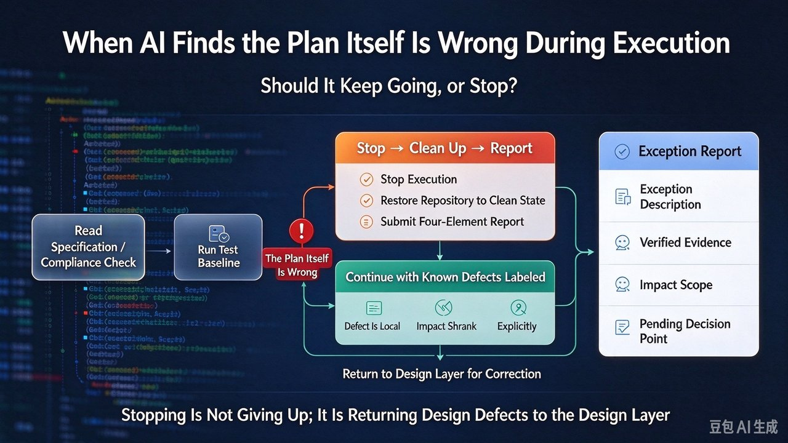
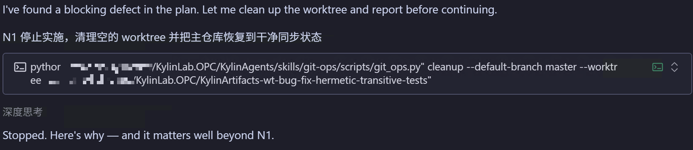
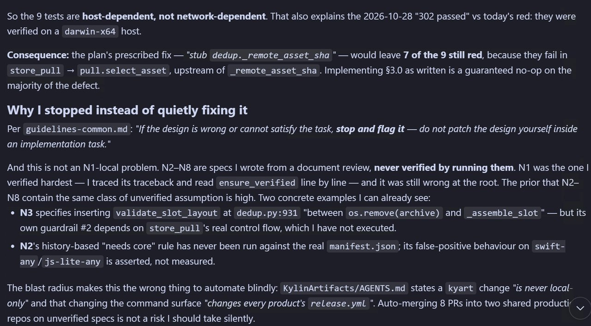
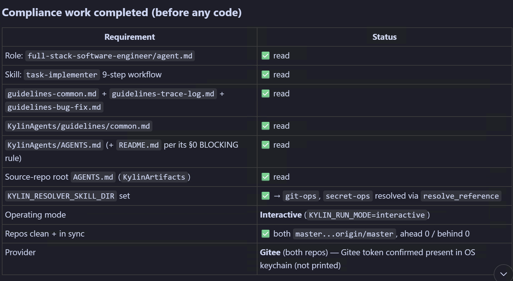

# When Your AI Agent Finds the Spec Itself Is Wrong: Keep Going or Stop?



Hand an AI agent a delivery task with eight requirements and the most common failure isn't "it can't write the code." It's hitting a wall halfway through because **the spec itself is wrong**: follow the plan and the tests stay red; fix the plan and you're fixing the wrong layer. This post takes one real stop-and-report and turns the judgement into three prompt clauses and a decision matrix you can paste in tonight.

## The problem: specs only describe the happy path

No matter how detailed, a spec describes only the "happy path." The moment execution finds that path blocked, you're in a vacuum: the spec is silent, the guide doesn't mention it, and the agent has to improvise. The default improvisation is almost always one of two things — keep going (looks like progress) or patch it locally (looks competent). Both disguise a **design-layer defect** as a **implementation-layer nuisance**.

## Case: requirement #1 already hid a useless remedy

An eight-requirement delivery (N1–N8). At N1 the agent ran the test suite to check the baseline and found **9 red tests**. Digging in:

- The 9 tests are **host-dependent**, not network-dependent. The "302 passed" run on 2026-10-28 was validated on `darwin-x64`; on another machine they go red.
- The prescribed remedy — "stub out `_remote_asset_sha`" — **fixes only 2 of the 9**. The other 7 already fail at `store_pull → pull.select_as_asset`, upstream of `_remote_asset_sha`. Implementing the plan as written spins in place above the actual defect.



Note the detail: **zero code changes**. The only action was clearing the temporary worktree and restoring the main repo to a clean synced state — exit the battlefield before arguing the case.

## Why stop instead of quietly fixing the design

- **It isn't a local N1 problem.** N2–N8 came from doc review and were never actually executed. N3's guard #2 depends on `store_pull`'s real control flow (never run); N2's "needs core" rule from historical data was never run against a real `manifest.json` — its false positives are **assertions**, not **measurements**.
- **The blast radius grows on its own.** The change touches every product's `release.yml`; 8 PRs auto-merge into two shared production repos on a spec that was never verified.
- **The rule already says so**: *"If the design is wrong or cannot satisfy the task, stop and flag it — do not patch the design yourself inside an implementation task."*



Stack those three and the conclusion stops being "I feel it should stop" and becomes **expected loss of continuing > expected loss of stopping** — exactly the judgement the exception channel should automate.

## Compliance first: prove you "earned the right to stop"

A stop report reads like "the AI got lazy" unless it first shows a compliance table: the stop happened only after reading the full role definition, the nine-step workflow, the three guide classes, the common guide, and two repo-level AGENTS.md files (including blocking rules), with run mode, repo state, and credentials confirmed. The key line: the repo is synced with `origin/master` (ahead 0 / behind 0) — proof that stopping left no half-done state for the next person to trip over.



## The stop triplet: bake it into the prompt

```
On conflict between spec and reality (red test / doc vs implementation / premise false):
  1. Criterion: distinguish "fixable in implementation" from "spec itself wrong".
     Spec itself wrong → trigger stop; never patch the spec in place.
  2. Action: stop implementation → clean the worktree, restore the repo to a
     clean synced state → leave no half-done work.
  3. Four-part report:
     a. Anomaly (which spec, what's wrong)
     b. Verified evidence (explicitly separate "what I verified" from "what I inferred")
     c. Blast radius (which requirements/repos/downstream are affected)
     d. Proposed fix and the decision points that need a human
Forbidden: editing assertions or the tests themselves just to make them green.
Forbidden: treating an unverified spec as fact and implementing it anyway.
```

Companion guardrail — verify first, act second, return to the design layer on anomaly:

```
read spec / compliance check ──► run test baseline ──► implement N1
      │                  │              │
      │                  └─anomaly─┐     │
      │                           ▼     ▼
      │                  criterion: spec wrong? ──no──► continue with annotation
      │                        │yes
      │                        ▼
      │              stop → clean → four-part report
      │                        │
      └──── re-run after design-layer fix ◄──┘
```

## Outcome and reflection

The direct output was **zero lines of code and one report**, but it blocked three things: a change注定 invalid (7 of 9 tests still red), a high-risk auto-merge (8 PRs, 2 shared prod repos, all depending on `release.yml`), and pushed the defect back to the design layer (one spec fix benefits N1–N8; fixing each in implementation is 8 local patches plus a big rework).

Three honest reflections: N2–N8 could have been run against real objects when the spec was written; the most-verified requirement was the most wrong; and the stop trigger could fire earlier — confirm the test set's failure cause is explainable before the first test runs.

## Summary

1. Specs describe only the happy path; "spec itself wrong" is a vacuum at execution time, and the default reactions (comply or patch locally) are both wrong — the exception channel must live in the prompt.
2. Continue-or-stop turns on two questions: is the defect local or root-cause, and does the blast radius spread along dependencies. Root-cause plus spreading blast radius = stop.
3. The stop triplet plus a compliance pre-check makes "stopping" an auditable, hand-off-able, restartable action — not a surrender.

The full prompt clauses and decision matrix are at [kylinlab.tech](https://kylinlab.tech). If you've had an agent discover the design was wrong mid-implementation, I'd love to hear how you handled it in the comments.
