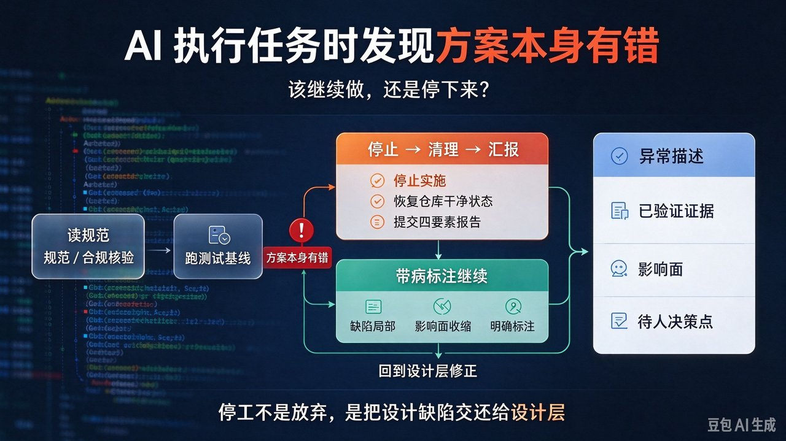
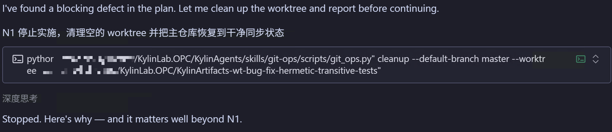
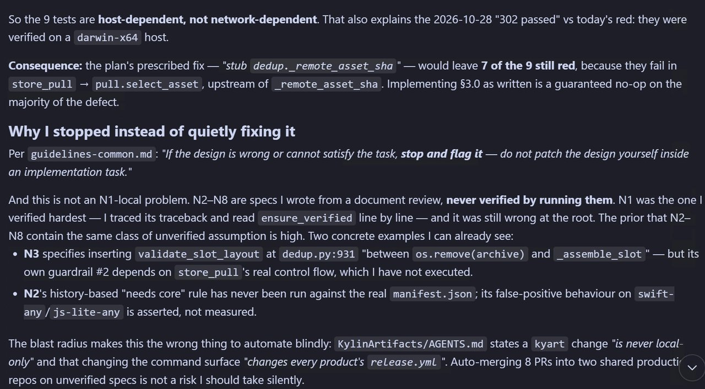
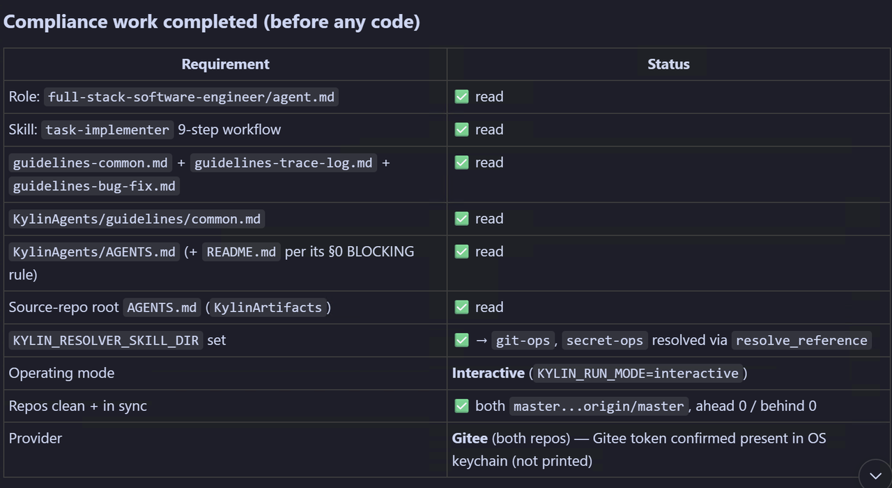

# AI 执行任务发现方案本身有错：该继续做，还是停下来？



给 AI 一份含 8 条需求的交付任务，最怕的失败不是"写不出代码"，而是执行到一半发现**规范本身就是错的**：按方案写下去测试还是红，按方案修又修不到病灶。本文用一次真实停工，把判断拆成可直接写进提示词的三条条款与一个决策矩阵。

## 问题：规范只描述正常路径

规范写得再细，也只描述"正常路径"。一旦执行端发现正常路径走不通，就进入真空：规范没说、指南没提，AI 只能临场发挥。临场发挥的默认倾向几乎总是两种之一——继续做（进度好看）或就地修（显得能干），两种都会把一个**设计层缺陷**伪装成一个**实施层小问题**。

## 案例：第 1 条需求就撞见无效药方

一个 8 条需求（N1–N8）的交付任务，做到 N1 时先跑测试用例复核现状，发现 9 个测试红。追查结论：

- 这 9 个测试是 **host-dependent（依赖主机环境）**，不是 network-dependent。2026-10-28 那轮"302 passed"是在 `darwin-x64` 主机上验证的，换机即红。
- 方案药方"stub 掉 `_remote_asset_sha`"**只救活 2/9**；其余 7 个在 `store_pull → pull.select_as_asset` 上游就已失败，按方案实现等于在缺陷主体上空转。



停工时**没有任何代码变更**，唯一动作是清理临时 worktree、把主仓库恢复到干净同步状态——先退出战场，再谈判断。

## 为什么停，而不是悄悄改对

- **非 N1 局部问题。** N2–N8 来自文档评审、从未真正执行验证。N3 护栏 #2 依赖 `store_pull` 真实控制流（没跑过）；N2 的"needs core"规则从没在真实 `manifest.json` 上跑过，其误报是**断言**而非**测量**。
- **爆炸半径扩散。** 改动牵动每个产品的 `release.yml`，8 个 PR 自动合入两个共享生产仓库，依据却是一套从未验证的规范。
- **规则本就写明**：*"If the design is wrong or cannot satisfy the task, stop and flag it — do not patch the design yourself inside an implementation task."*



三条叠加后，结论不再是"我觉得该停"，而是**继续执行的期望损失明确大于停工的期望损失**。

## 合规前置：把"停"变成可审计决定

停工报告先做一张合规表：读完角色定义、九步工作流、三类指南、公共指南、两份仓库级 AGENTS.md（含阻塞规则）后才停，运行模式/仓库状态/凭证已确认。关键一行是 `origin/master` 同步（ahead 0 / behind 0）——证明没留半成品状态。



## 停工三件套：固化进提示词

```
发现规范与事实冲突时（测试红/文档与实现不符/前提不成立）：
  1. 判据：区分「实施可补救」与「规范本身错误」。
     规范本身错误 → 触发停工，禁止就地修补规范。
  2. 动作：停止实施 → 清理工作树、把仓库恢复到
     干净同步状态 → 不留半成品。
  3. 汇报四要素：
     a. 异常描述（哪条规范、错在哪）
     b. 已验证证据（明确区分「我验证过的」与「我推断的」）
     c. 影响面（哪些需求/仓库/下游会被牵动）
     d. 建议方案与需要人来决策的点
禁止：为让测试变绿而修改断言或测试本身。
禁止：把未验证规范当成事实继续实现。
```

配套流程护栏——先核验、再动手、异常回到设计层：

```
读规范/合规核验 ──► 跑测试基线 ──► 实施 N1
      │                  │              │
      │                  └─异常─┐        │
      │                        ▼        ▼
      │                 判据：规范本身错？──否──► 带病标注继续
      │                        │是
      │                        ▼
      │              停止 → 清理 → 汇报四要素
      │                        │
      └──── 设计层修正后重跑 ◄──┘
```

## 成效与反思

直接产出是**零行代码、一份报告**，但拦下：一个注定无效的变更（7/9 仍红）、一次高风险自动合并（8 PR、2 共享生产仓库、全依赖 `release.yml`）、并把缺陷移回设计层（改一次方案，N1–N8 全受益）。

三条反思：N2–N8 本可在写方案时就跑真实对象；验证得最狠的一条反而错得最狠；停工触发点还能更早——跑首个测试前先确认失败原因可解释。

## 总结

1. 规范只描述正常路径，"规范本身错误"是执行端真空地带；填它的默认倾向（照做/就地修）都错，例外通道必须写进提示词。
2. 判继续还是停看两问：缺陷局部还是根上、影响面是否顺依赖扩散。根上错误 + 扩散影响，就是停。
3. 停工三件套 + 合规前置，让"停下来"成为可审计、可交接、可随时重来的动作，而非一次放弃。

完整提示词条款与决策矩阵见 [kylinlab.tech](https://kylinlab.tech)。如果你在 AI 交付里也遇到过"实现端发现设计错了"，欢迎在评论区聊聊。
