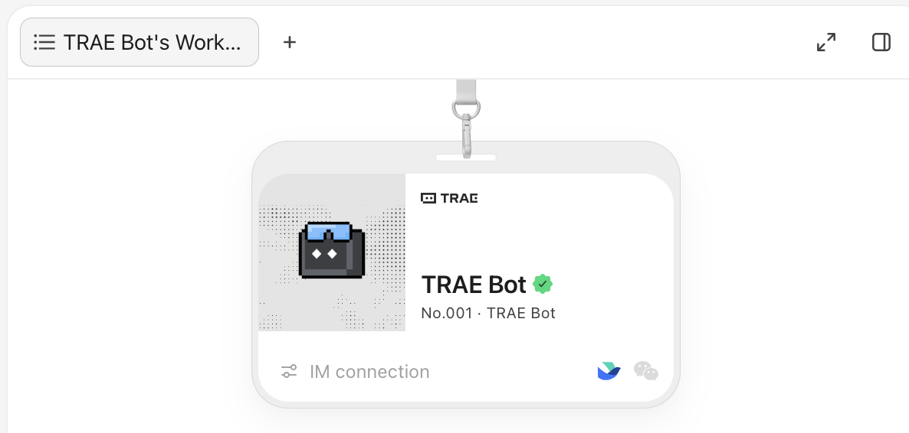
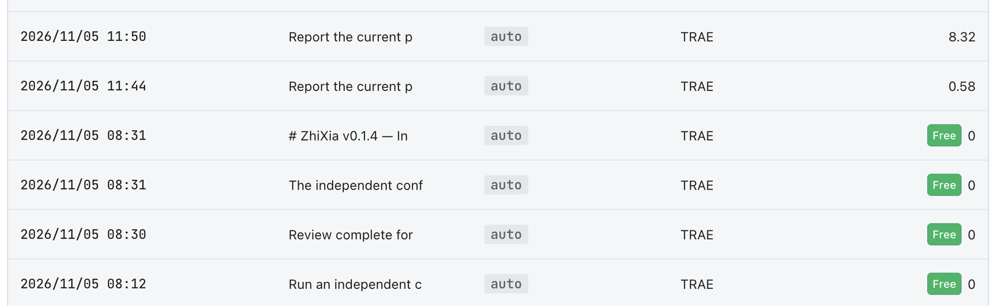
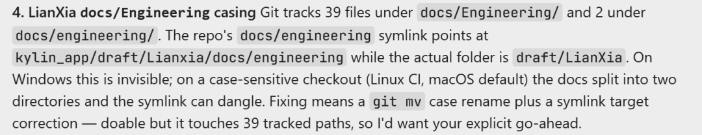
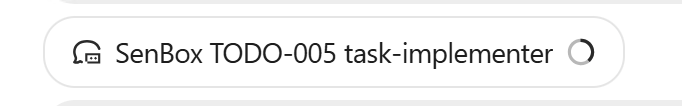
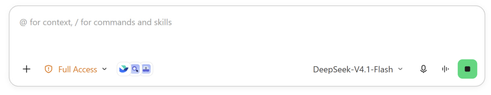
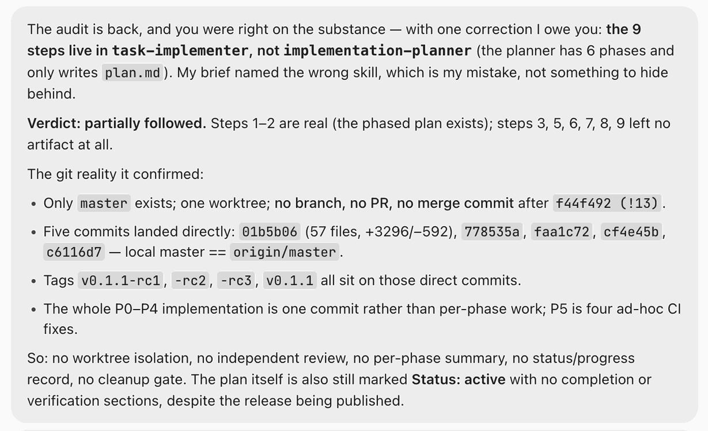
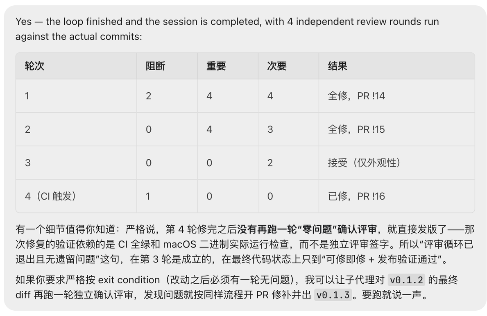

# TRAE Bot Hands-On Review: Control, Model Choice, and Delivery Limits


A pop-up introduced TRAE Bot with a simple promise: **Limited-time Free for All**, plus a Try Free Now button. I gave it two real tasks — one documentation sync, one coding implementation. The docs task went well. The coding task was merely OK.

The more interesting story is not the quality split. It is the two decisions the product made on my behalf: **which model to use, and whose workflow to follow.**

## The short version

- **Good fit:** documentation cleanup, research, repository audits, code skeletons. The lighter and more auditable the task, the better.
- **Bad fit:** complex coding. Even after I forced a nine-step workflow, four review rounds ended without a final zero-issue confirmation.
- **Model:** the task-level model was `DeepSeek-V4.1-Flash` both times, with no model picker in the UI. The orchestration-layer model is not visible, so I do not guess.
- **Free boundary:** only Bot tasks are free. Asking for status through Feishu IM costs credits — my two queries were charged 8.32 and 0.58 credits.
- **The selection question:** do you want a clean delivery, or a delivery path you can audit afterwards?

## Three tiers of control

This is not an official segmentation. It is the mental model I use to decide which entry point to open:

| Entry point | Who it is for | Control left to the human |
|---|---|---|
| TRAE IDE | Technical experts, complex tasks | Most: every detail is controllable |
| TRAE Agent | Domain users with limited AI knowledge who still want some control | Some: model choice and prompt rules still apply |
| TRAE Bot | Non-technical users, simple everyday tasks | Least: state the goal, inspect the result |

`TRAE IDE (most control, highest barrier) → TRAE Agent (some control) → TRAE Bot (least control, lowest barrier)`

TRAE Bot aims at a pure outcome: smart enough, efficient enough, good enough, with a barrier low enough that users do not need to learn model selection, workflow design, or tool configuration first. Taking away model choice and workflow control is the product trade-off for this tier, not an accident.

## Entry point and the free boundary

I previously found xWork (TRAE Work, CodeBuddy Work) too easy to escape the sandbox, so I mostly stayed in the IDE. This time I made an exception for the new feature.

The entry point is a pop-up: “TRAE Bot: Limited-time Free for All”, with “Try TRAE Bot for free and turn ideas to actions” and a Try Free Now button. The pixel robot in the corner holds a “desktop limited-time free” bubble.


According to the public description, the Chinese interface calls it “TRAE Bao”, a personal assistant for developers with global and project-level assistants. It can read historical tasks, conversations, and artifacts across projects. The badge card also exposes an IM connection entry that users can bind if they want.



One boundary is easy to misread: the current free offer covers **Bot tasks only** — you assign a task, it runs to delivery, and that path is free. IM connectivity works, but it is not free. After binding Feishu, asking “what is the status of the current task?” in chat is a conversational call that consumes credits. I hit that boundary while checking status remotely: two queries were charged 8.32 and 0.58 credits, while the Bot task records from the same day were all Free 0.



So the accurate statement is “Bot tasks are free”, not “the whole Bot is free”.

## Two real tasks, two different outcomes

Both tasks ran with almost zero interaction. The first was a documentation task, `Docs sync: CeXia + LianXia`, and it went well. The second was a coding task, `SenBox TODO-005 task-implementer`, and it was merely OK.

For documentation cleanup and code skeletons, TRAE Bot is genuinely efficient: the structure is simple, acceptance is clear, and mistakes are easy to spot. Complex coding involves multiple rounds of change, release validation, and blocker-level defects — exactly where a low-control agent is most likely to leave risk behind. **The conclusion is blunt: do not use it for complex coding. Let it write a skeleton, at most.**

The bigger gap is in process. It skips most of the guidelines and rules in your prompt and follows its own internal harness rules, skills, and tools instead. I explicitly asked for my nine-step workflow; it did not follow it. That is not a capability failure. It is a different objective: the Bot optimizes for producing a result without interruption, not for leaving behind a process you can audit.

## The docs task’s best find: a case-only directory conflict

The docs task earned its “good” rating not because the writing was tidy, but because it found a risk I had never noticed while reading the repository: two documentation directories that differ only by the case of their first letter. `docs/Engineering/` tracks 39 files; `docs/engineering/` has 2 files plus a symbolic link.



Why had I never seen it? Because **I had never cloned this repository on Linux.** On a case-insensitive local filesystem, the two directories always merge into one, and everything looks normal.

- **Git is case-sensitive:** the two paths are genuinely different in the repository, and both sets of files are stored. GitHub’s backend is case-sensitive too, so both folders appear on the website.
- **Windows NTFS and macOS APFS are case-insensitive by default (but case-preserving):** the operating system treats them as one folder, merges their contents on checkout, and shows a single directory in Finder or Explorer.
- **Linux filesystems such as ext4 are case-sensitive:** a CI runner really creates two side-by-side directories. The original symlink may then point at the wrong one, or dangle entirely.

This is a problem that only appears on a case-sensitive Linux or CI checkout. The fix is not hard: use `git mv` for a proper case rename, then repair the symlink target. But it touches 39 tracked paths, so it requires human approval. The Bot did not act on its own; it surfaced the issue and the proposed fix and waited for confirmation.

**The real value here is not the pages of generated text. It is that the agent was willing to walk the whole repository and translate an obscure filesystem-semantics issue into a risk a human can understand.**

## Finding 1: the model field never changes

To produce a result without interruption, the Bot also takes away the “what to build it with” decision. TRAE Bot has no model picker: there is nowhere in the UI to choose a model, only a display of what the current task is using.

The model name is not shown on the task cards. The Bot chat window first shows a list of task cards:




Double-click a card to open that task’s chat window; only then does the bottom-right corner of the input box show the model actually used by the task. TRAE Bot does not offer model selection — this field is display-only. There is a dropdown arrow next to it, but no alternative model to choose. For both of my tasks, coding and documentation, the field read `DeepSeek-V4.1-Flash` and never changed:



One caveat matters: this field labels the **task-level AI model** — the model used by this task conversation. Which model the Bot Orchestration layer uses for decomposition, dispatch, and scheduling is not visible in the UI, and I do not know. Every claim below about “always DeepSeek-V4.1-Flash” refers to the task level only.

My read is that task execution here is tuned around DeepSeek-V4.1-Flash, which is also cost-friendly. For the docs task that produced a good result; for the coding task it was barely usable. Locking a model is not possible inside the Bot either: TRAE’s Auto mode schedules models per task and overrides manual selection. To pin a model, turn off Auto and use TRAE Agent, or use a custom agent that fixes both model and toolset.

So the more accurate version of “you cannot choose a model” is: **the task layer is pinned to `DeepSeek-V4.1-Flash`, and the product does not want you to spend attention on model choice.** For most users that is a feature. For technical experts who tune models, it is the part of this tier that takes the most adjustment: on this path, “what to build it with” is not your decision.

One more detail: the `Full Access` permission tier in the bottom-left of the input box deserves a second look, especially if you already have sandbox concerns.

## The workflow: nine steps became two

I asked for a nine-step workflow. It took its own route. The post-hoc audit was blunt: only steps 1 and 2 left any artifacts; steps 3, 5, 6, 7, 8, and 9 left nothing. Git contained only `master` and one worktree. Five commits landed directly on the default branch — no branch, no PR, no independent review, no per-stage summary, no cleanup gate.



Compare that with TRAE Agent, which follows prompt rules, and the contrast is obvious: the result was delivered, but the process could not be audited. For a documentation task that may be acceptable. For code headed to the main branch, it is a gap.

## Forcing nine steps: four review rounds, no final sign-off

I later forced it to follow all nine steps, and it complied. The independent sub-agent code review at step 5 did catch several key defects and found a missing feature implementation. But looking at the coding task as a whole, the result was still just OK: **“everything is done” does not mean “there are no problems.”** Problems kept surfacing, and round one alone found two blocker-level issues.

The trail shows four independent review rounds. Round 1 found 2 blockers, 4 major issues, and 4 minor issues, all fixed. Round 2 cleared 4 major and 3 minor issues. Round 3 accepted 2 minor issues as cosmetic. Round 4 fixed 1 more blocker triggered by CI.



The note below the table is the important part: after round 4, there was no additional “zero issues” confirmation review before release. The fix was validated by a green CI run and an actual macOS binary execution check, not by an independent reviewer’s sign-off. So the statement “the review loop exited with no remaining issues” was true only after round 3. The final code state was “fix what can be fixed + release validation passed.”

The workflow did catch real defects, but an implementation that needs four review rounds and still ships without a final confirmation signature is not reassuring. The same Bot behaves visibly better when the workflow is enforced — **but the improvement has a ceiling.** The smallest way to turn a wish into a constraint is:

```text
Wish: Please use my nine-step workflow for this task.
Constraint: Follow all nine steps exactly. Every step must produce
            an artifact that can be checked. A missing step counts
            as incomplete and must be redone. Step 5 must be an
            independent sub-agent review, and any code change must
            trigger a new review.
```

The two delivery paths look like this:

```text
Default: goal → Auto routing → internal rules/skills/tools → direct delivery
                              (no branch, no PR, no review trail)

Enforced: goal → 1 read context → 2 write plan → 3 isolated implementation
                 → 4 self-validation → 5 independent sub-agent review
                 → 6 single summary → 7 push branch and open PR
                 → 8 update status → 9 cleanup check → auditable delivery
                 (human sign-off still required at the end)
```

After this run, I set four invariants for myself:

- A good-looking result is not process compliance. Count artifacts, not claims.
- Model choice and workflow orchestration are separate decisions. Auto being more stable is no reason to hand over the workflow too.
- Any change headed for the default branch needs a fresh zero-issue confirmation review after the last edit. A green CI run is not a signature.
- Complex coding does not go to the lowest-control tier. A skeleton is the maximum.

## How the four usage modes compare

The first table groups by user. This one groups by what I can actually choose:

| Mode | Model | Human involvement | Workflow | Best for |
|---|---|---|---|---|
| TRAE IDE (side chat, Auto off) | Manually selectable | Every step controllable | Follows prompts | Small edits, Q&A, research |
| TRAE Agent (formerly TRAE Work) | Selectable | Interaction points remain | Follows prompt rules | Domain users who want partial control |
| TRAE Bot, default | Auto (task level measured as DeepSeek-V4.1-Flash) | Almost none | Internal harness rules | One-off docs, exploratory tasks |
| TRAE Bot + enforced workflow | Auto (task level measured as DeepSeek-V4.1-Flash) | Low | Numbered steps leave artifacts | Code tasks that need a trail; human sign-off still required |

The middle two rows make the difference clear: TRAE Agent leaves both model choice and prompt rules with the human. Bot’s default mode takes both away, along with the interaction points, and replaces them with internal harness rules. The “Model” column refers to the task level throughout; the orchestration-layer model is not visible, so I do not speculate. I only opened the Agent entry to try the new feature and did not run a task through it, so I record its capability boundary without judging its delivery quality.

The selection question is therefore simple: **do you want a clean delivery, or a delivery path you can audit?** Use the default for the former. For the latter, write the workflow into constraints — but this coding task also shows that even with constraints, the last gate for complex implementation still needs a human signature.

## When not to use it

- Complex coding: four review rounds still surfaced 2 blocker-level issues, and the release lacked a final confirmation review. Use it for skeletons only.
- You are a technical expert with a complex engineering task that needs detail-level control: go back to TRAE IDE instead of forcing the Bot into a controllable mode.
- The task must land on the default branch, open a PR, and leave an auditable record, but you have not enforced the workflow.
- You need to pin a specific model for comparison testing, reproduction, or cost evaluation: TRAE Agent and the Auto-off IDE side chat both allow model selection.
- Your team rules exist only in a prompt, with no script or artifact to verify them. The Bot will probably ignore them.
- You already have workspace and sandbox concerns. Do not widen permissions just because “Bot tasks are free”.
- You plan to treat the free offer as unlimited: only Bot tasks are free. Conversational status checks through Feishu IM consume credits.
- Your acceptance criterion is “it looks done”, with no itemized artifact list to check.

## The numbers

Both tasks used `DeepSeek-V4.1-Flash` at the task level. The results:

| Scenario | Result | Key numbers |
|---|---|---|
| Documentation task | Good; found a case-only directory conflict | 39 + 2 tracked files, 1 symlink; the fix touches 39 paths |
| Coding task (default path) | Merely OK | Only 2 of 9 steps left artifacts; 5 commits straight to master, no branch, no PR, no independent review |
| Coding task (enforced nine steps) | Usable, but the ending was not closed out | 4 review rounds; round 1 had 2 blockers / 4 major / 4 minor, all fixed; no zero-issue confirmation after round 4 |

Three follow-up signals are worth tracking: the rework count for the same task under the default and enforced paths; the ratio of skipped steps to required steps per delivery; and the number of blocker-level issues discovered after delivery. Until the last number reaches zero, complex coding should not be handed over.

## Bottom line

The three entry points are not replacements for one another; they are a staircase of control handed away. TRAE Bot buys near-zero-interaction delivery by taking model choice and workflow orchestration in-house. On simple tasks that is a feature; on complex coding it is the gap.

Before adopting it, ask two questions: which tier am I in, and do I want a faster result or one I can later prove was built correctly? If the latter, turn the workflow into checkable artifacts before letting go. If the task is complex coding, do not let go at all — return to a controllable entry point, and let the Bot write a skeleton at most.

Try it on a documentation cleanup or a code skeleton first, and let it audit the repository while it is there. For complex coding, this run made the answer clear: not yet.
