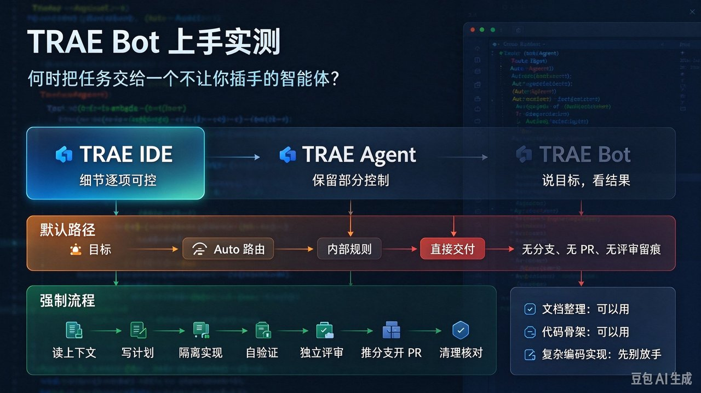
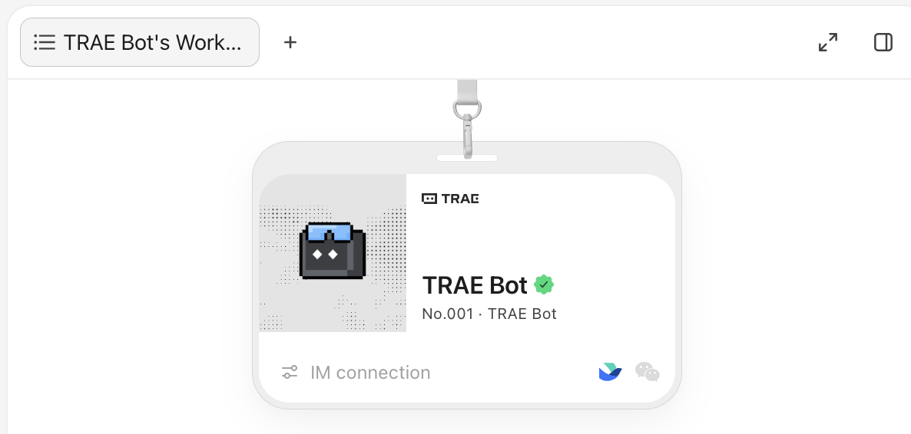
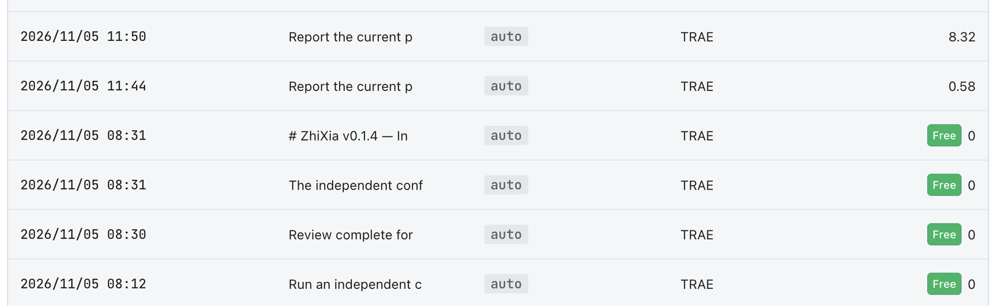
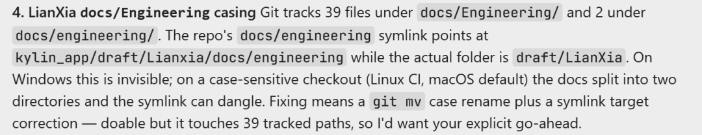
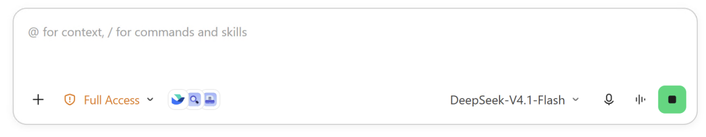
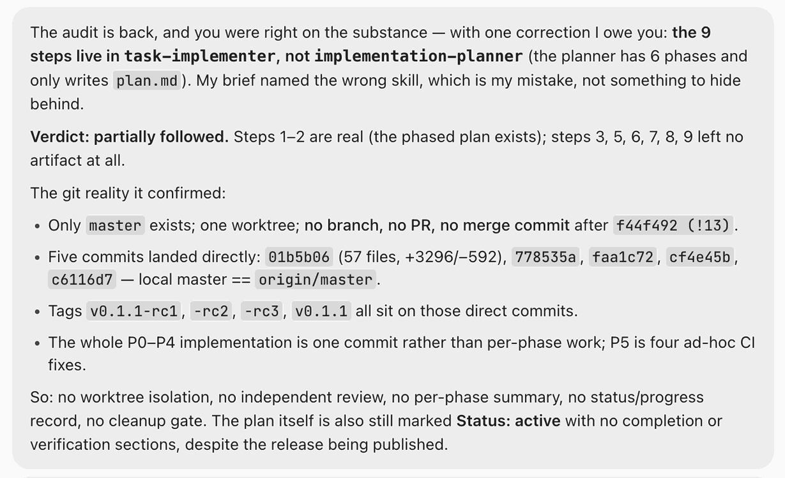
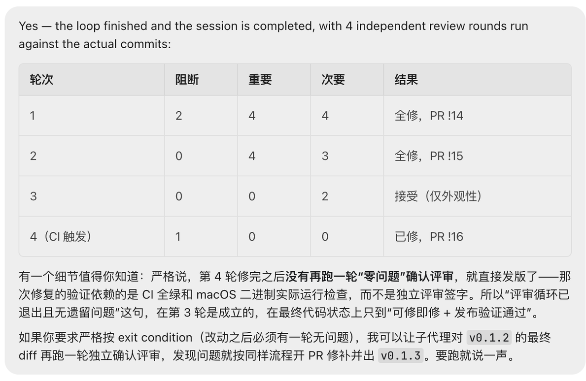

# TRAE Bot 上手实测：三档控制权、固定模型与两条交付路径



TRAE 弹窗推荐了新的 TRAE Bot：**Limited-time Free for All**，按钮 Try Free Now。我拿它交付了两个任务：文档整理不错，还翻出一个我从不知道的边角问题；编码实现只能算 just so so。更值得记的是它替我做掉的两个决定：**用哪个模型，按谁的流程走。**

## 先说结论

- **能用**：文档整理、资料梳理、仓库巡检、代码骨架。任务越轻、越不需要事后审计，它越合适。
- **别用**：复杂编码实现。这次强制九步、跑了四轮评审，最后仍缺一轮「零问题」确认就发版。
- **模型**：任务层固定 `DeepSeek-V4.1-Flash`，界面上没有可选模型；编排层用什么模型，看不到，也不猜。
- **免费边界**：免费只覆盖 Bot 任务。绑定飞书后在 IM 里问状态会扣 credits，我两次查询分别扣了 8.32 和 0.58。
- **选型问题**：你要的是一次干净的交付，还是一条能被复查的交付路径？

## 三档控制权：先认清你该开哪个入口

这不是官方划分，是我决定「开哪个入口」的心智模型：

| 入口 | 面向谁与任务 | 留给人的控制 |
|---|---|---|
| TRAE IDE | 技术专家，复杂任务 | 最多：细节逐项可控 |
| TRAE Agent | 领域用户，AI 技术了解有限，仍想管一部分 | 一部分：能选模型、能让提示词规则生效 |
| TRAE Bot | 普通用户，不要求技术背景，简单日常任务 | 最少：说目标、看结果 |

TRAE Bot 把「用哪个模型」和「按谁的流程走」一起收走，是这一档的产品取舍：普通用户要的是结果，不是可调参数。

## 入口与免费边界：限免只覆盖 Bot 任务

我之前写过 xWork 的复盘，因为它容易跑到沙箱之外，所以一直只用 IDE；这次是为了试新功能才破例。

入口是一个弹窗——「TRAE Bot: Limited-time Free for All」，配一句 Try TRAE Bot for free and turn ideas to actions，按钮 Try Free Now，左上角的像素机器人还举着「桌面端限免」的气泡。


据公开介绍，中文界面叫「TRAE 宝」，分全局助理与项目助理两层，能跨项目读历史任务、对话与产物；工牌下方还有 IM 连接入口。



但「限免」只覆盖 **Bot 任务**——派一条任务、它跑完交付，这条路径免费。IM 连接可以用，但不免费：绑定飞书后在聊天里问一句「当前任务什么状态」，这种对话式调用会扣 credits。我这次两次查询分别扣了 8.32 和 0.58 credits，同一天的 Bot 任务记录则都是 Free 0：



所以更准确的说法是「Bot 任务免费」，不是「整个 Bot 免费」。

## 两个真实任务：一个不错，一个 just so so

两件任务都在几乎零交互下跑完了。文档任务 `Docs sync: CeXia + LianXia` 结果不错；编码任务 `SenBox TODO-005 task-implementer` 只能算勉强可用。

文档整理、代码骨架这类任务结构简单、验收清楚，错了也容易看出来。复杂编码牵扯多轮改动、发布验证和阻断级缺陷，正是它最容易留下隐患的地方。**结论很直接：复杂的 coding 不要用，写骨架可以。**

落差还在流程上。它会略过提示词里的大部分规范，按内部 harness 的规则、技能、工具自己走。我明确要求用九步工作流，它没照做——它优化的是「不被打断地把结果做出来」，不是「按你规定的路径把过程留下来」。

## 文档任务最值钱的一幕：翻出大小写目录冲突

文档那件之所以给「不错」，是它在通读仓库时顺手翻出一个我完全没意识到的隐患：仓库里同时存在两个只差首字母大小写的目录——`docs/Engineering/` 跟踪 39 个文件，`docs/engineering/` 2 个文件加一个符号链接。



我一直没发现，原因就一句话：**我从来没在 Linux 上 clone 过这个仓库。** 日常在大小写不敏感的本地文件系统上看，两个目录永远合并成一个。

- **Git 大小写敏感**：两个目录是两条不同路径，两套文件都存着；GitHub 后端也大小写敏感。
- **Windows NTFS 与 macOS 默认 APFS 大小写不敏感（但保留大小写）**：系统眼里是同一个文件夹，checkout 时内容被合并。
- **Linux（ext4 等）大小写敏感**：CI runner 上会生成两个并列目录，符号链接的指向可能对不上，变成悬空链接。

修法是用 `git mv` 重命名再修正符号链接；但会碰到 39 个已跟踪路径，必须人工点头——它没擅自动手，而是把问题和建议摆出来等我确认。

**这类任务真正值钱的地方，不是生成了几页文字，而是它愿意把整个仓库翻一遍，把「文件系统语义差异」翻译成一句人能看懂的风险提示。**

## 关键发现一：模型栏永远是 DeepSeek-V4.1-Flash

为了在没有人打断的情况下把结果做出来，它把「用什么做」也收走了。TRAE Bot 没有选模型的入口，你能看到的只是当前任务正在用哪个。

模型名不直接显示在任务卡片上。Bot 的聊天窗口里先看到的是一张张任务卡片：


双击卡片进入该任务的聊天窗口，输入框右下角才会显示这条任务实际使用的模型。这个位置只用于显示；旁边虽然有个下拉箭头，但没有可切换的模型。我这两个任务，不管编码还是文档，那个框里都是 `DeepSeek-V4.1-Flash`，一次都没换过：



需要说明的是，这个位置标的是**任务级（task）的 AI 模型**。至于 Bot 编排层（Bot Orchestration）用什么模型来做拆解、派发与调度，界面上看不到，我们并不知道。所以这里说的「恒为 DeepSeek-V4.1-Flash」，指的都是任务层。

想锁定模型也不在 Bot 里：TRAE 的 Auto 模式会按任务自动调度并覆盖手动选择；真要指定模型，得关掉 Auto、回到 TRAE Agent，或改用自定义智能体。

所以「模型不给选」更准确的版本是：**任务层默认钉在 `DeepSeek-V4.1-Flash` 上，不打算让你为选模型分心。** 对习惯自己调参的技术专家，这正是三档里最需要适应的地方。

顺带一句，左下角的 `Full Access` 权限档位值得多看一眼——对本来就有沙箱顾虑的我来说，这是要留神的地方。

## 流程：默认九步只剩两步

我让它按九步工作流执行，它走了自己的路。事后审计显示：只有第 1、2 步留下了痕迹，第 3、5、6、7、8、9 步没有任何工件；git 里只有 master、一个工作树，五次提交直接落在默认分支上，没有分支、没有 PR、没有独立评审，也没有逐阶段小结与清理门禁。



对照 TRAE Agent 那一档会遵循提示词规范，这个反差更明显：结果交出来了，过程却没法复查。对文档类任务这也许可以接受，对要进主分支的代码，这就是缺口。

## 强制九步：四轮评审仍缺最后一签

我后来强制它必须按九步走，它照做了。第 5 步的独立子代理代码评审确实揪出了几个关键缺陷，还找出一处被漏掉的功能实现。但通盘看，结论只能算 just so so：**「全部做完」并不等于「没有问题」**，第 1 轮就翻出 2 个阻断级问题。

留痕显示一共跑了四轮独立评审：第 1 轮 2 个阻断项、4 个重要项、4 个次要项全部修掉，第 2 轮又清掉 4 个重要项与 3 个次要项，第 3 轮的 2 个次要项按外观性问题接受，第 4 轮由 CI 触发又补掉 1 个阻断项。



更值得注意的是：第 4 轮修完后没有再跑「零问题」确认评审就直接发版；那次修复靠 CI 全绿和 macOS 二进制运行检查，不是独立评审签字。所以「无遗留问题」只在第 3 轮成立，最终状态只到「可修即修 + 发布验证通过」。

流程确实挖出了关键缺陷，但四轮评审后还缺确认签字就发版，谈不上让人放心。强制与否有明显差别，**但差别有上限**。把「愿望」改成「约束」的最小写法是：

```text
愿望：请用我的九步工作流执行这个任务。
约束：严格按九步执行；每步必须产出可核对的工件，缺一步
      即视为未完成并回到该步重做；第 5 步必须由独立子代理
      评审，改码之后重新评审。
```

这次之后，我给自己定了四条不变式：

- 结果好看不等于过程合规——用工件数判断流程有没有走，别用汇报。
- 模型选择和流程编排是两件事，不因为 Auto 更稳，就把流程也一起交出去。
- 任何要进默认分支的改动，改完之后必须再跑一轮「零问题」确认评审；只靠 CI 全绿不算签字。
- 复杂编码实现不交给控制最少的这一档；最多让它写骨架。

## 四种用法怎么选

| 方式 | 模型 | 人工介入 | 流程 | 适合 |
|---|---|---|---|---|
| TRAE IDE（侧边对话，关掉 Auto） | 手动可选 | 每步可控 | 听提示词 | 小改、答疑、调研 |
| TRAE Agent（原 TRAE Work） | 可选模型 | 留有交互点 | 遵循提示词规范 | 领域用户想留一部分控制 |
| TRAE Bot 默认 | Auto（任务层实测 DeepSeek-V4.1-Flash） | 几乎为零 | 内部 harness 规则 | 一次性文档、探索型任务 |
| TRAE Bot ＋ 强制流程 | Auto（任务层实测 DeepSeek-V4.1-Flash） | 少 | 按编号步骤留痕 | 需要留痕的代码任务，收尾仍需人工 |

TRAE Agent 把模型选择和提示词规范都留给人，Bot 默认态则把这两样连同交互点一起收走。表里「模型」一栏说的都是任务层；Bot 编排层用什么模型，界面上看不到，这里不做猜测。

所以选型问题很简单：**你要的是一次干净的交付，还是一条能被复查的交付路径？** 前者用默认态，后者必须把流程写进约束——但这次的编码任务也说明，流程写进去了，复杂实现的最后一道门还是得有人签字。

## 什么时候别用它

- 复杂的编码实现；写写代码骨架可以。
- 技术专家、复杂工程、需要逐项控制细节——回 TRAE IDE。
- 任务要落到默认分支、开 PR、留下可审计记录，而流程还没强制回去。
- 需要锁定模型做对比测试、复现实验或成本评估。
- 团队规范只写在提示词里、验收只靠「看起来完成了」——都别用。
- 对沙箱边界有顾虑，却想因为「限免」放宽权限范围。
- 把限免当无限额度——IM 对话式查询会扣 credits。

## 数字速览

| 场景 | 结果 | 关键数字 |
|---|---|---|
| 文档任务 | 不错，翻出大小写目录冲突 | 39 + 2 个跟踪文件，1 个符号链接；修复触及 39 个路径 |
| 编码任务（默认路径） | just so so | 9 步只留 2 步工件；5 次提交直落 master，无分支、无 PR、无独立评审 |
| 编码任务（强制九步） | 可用，但收尾未兜住 | 4 轮评审；首轮 2 个阻断 / 4 个重要 / 4 个次要全修；第 4 轮后缺一轮「零问题」确认 |

## 总结

1. 用「三类用户、三档控制权」记住三个入口：IDE 给技术专家抠细节，Agent 给想留一部分控制的领域用户，Bot 给不要求技术背景的普通用户。
2. 代价是模型决定权和流程编排一起被收走：两次任务的任务层模型都停在 `DeepSeek-V4.1-Flash` 上（编排层未知），提示词规范大多被内部 harness 规则覆盖。
3. 采用前先问：我属于哪一档？这次要的是更快拿到结果，还是事后能证明它是怎么做出来的？

不妨先拿文档整理或代码骨架试一次；复杂编码先别交出去。

这也是我这次实测最想留下的一句话：结果可以交给它，签字权先别交。
