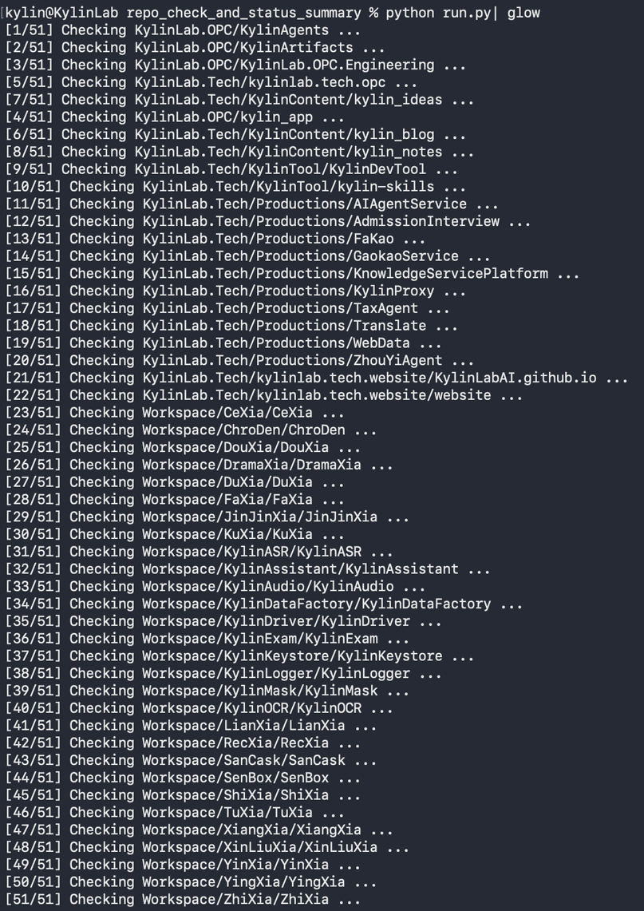
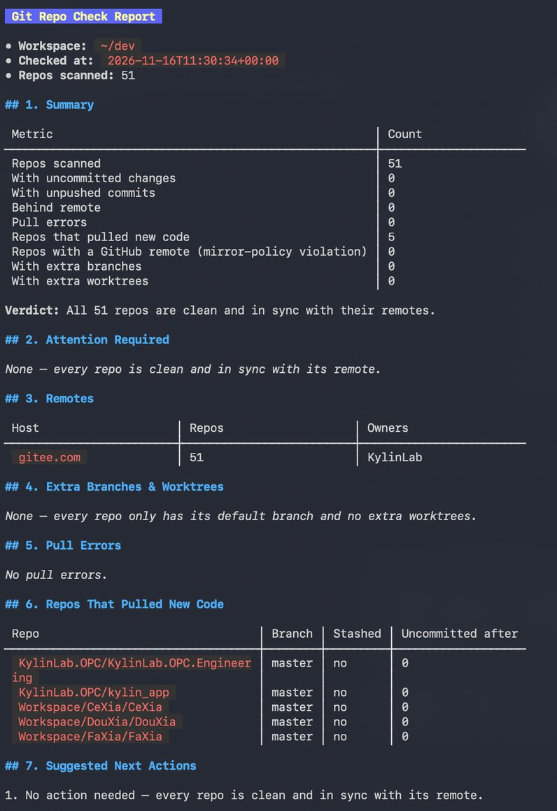
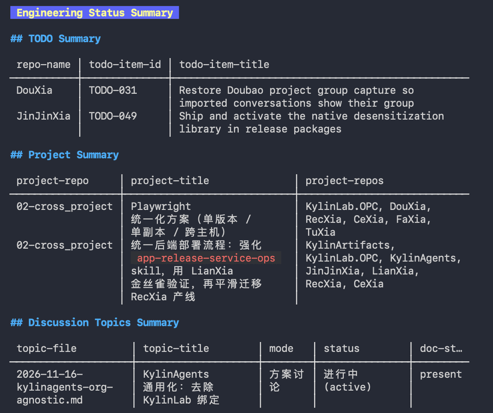

# Pay AI Only Once: Save Tokens with Scriptable Tasks


Free AI tokens and credits are shrinking, but repeated fixed checklists still consume a model call on every run. Paying reasoning tokens for an answer with an identical structure to yesterday's is the most avoidable waste in a modern engineering workflow.

This article gives one rule — the first AI call on a simple, repeated task should produce a reusable script, not a one-off result — and a real 51-repo sync that makes the rule concrete.

## The problem: reasoning repeating a checklist

We maintain dozens of git repos across several workspace trees and ask two questions constantly: is any repo dirty (untracked/uncommitted files, unpushed commits, unmerged branches, extra worktrees, pull errors)? And which TODO, project plan or discussion topic needs attention in each repo?

Both have fixed inputs and fixed output shapes. Invoking an AI skill to scan, compare and print exceptions worked, but cost a model call every time — daily, sometimes hourly. The task required no judgment; the reasoning layer was repeating a checklist.

## The rule and the decision boundary

1. **First call**: ask AI for a deterministic, re-runnable script with an explicit output format — not for the task result.
2. **Boundary**: can you specify the next step before starting? If yes, script it (scanning, comparing, counting, formatting). If no (judgment, unknowns, surprises), keep it in AI reasoning.
3. **Reuse**: store the script and its short spec in the repo; let a human run it; schedule it on cron or CI. Call AI again only when requirements change — regenerate the script, not the answer.

| Option | Upside | Downside | Fits |
|---|---|---|---|
| Call the AI skill every run | Zero setup | Tokens burned each run, slow | Rare checks with real uncertainty |
| AI writes a script once, human runs it | Pay once, free and diff-able later | Upfront authoring cost | High-frequency, rule-clear tasks |
| Script scans, AI reviews exceptions | Low token use, judgment only when needed | More moving parts | Noisy repos with frequent surprises |

We chose option 2: the common case — "everything clean" — should cost zero tokens.

## Implementation: one entry point, two reports

`repo_check_and_status_summary` walks the workspace and emits a git report plus an engineering status summary. After authoring, running it needs no model:

```bash
# Day 1: ask AI to write the script (one AI call)
# Day 2 onward: run it yourself — no model, no credits
python run.py | glow
```

Success signal: the terminal prints `[n/51] Checking <repo>` for each repo and two Markdown files appear. Failure signal: errors collect in the pull-error list and the "Attention Required" section.



Three design invariants:

- The model's responsibility ends when the script exists; it is not on the runtime path.
- Output is plain Markdown, diff-able across runs, not a temporary chat answer.
- A human runs it and reviews; exceptions trigger further judgment.

## Results

| Metric | Result |
|---|---|
| Repos scanned | 51 |
| Uncommitted / unpushed changes | 0 / 0 |
| Behind remote / pull errors | 0 / 0 |
| Extra branches / worktrees | 0 / 0 |
| Repos with new code | 5 |
| TODO / project plans / active topics | 2 / 2 / 1 |
| Token cost per run after authoring | 0 |





The same run surfaced two TODO items, two cross-project plans and one active discussion topic (KylinAgents org-agnostic migration) — no separate AI query.

## Mistakes, tradeoffs, alternatives

1. We kept asking AI to "check the repos" for weeks before noticing the answer shape never changed. The first request should have been "write a script."
2. Our first script tried to handle every git edge case in code; an exception list plus a human glance was enough.
3. Plain Markdown output beat an AI-skill-only flow — diffing between runs became trivial.

Not recommended when inputs are messy and each run needs fresh contextual understanding; that is exactly where reasoning pays for itself.

## Conclusion & further reading

- The boundary is "can the next step be specified before starting," not "is the task simple or complex."
- Our 51-repo sync now costs zero tokens per run and answers both "is anything wrong" and "what needs doing."
- Let exceptions — not the clean case — trigger any further AI reasoning.

More articles: https://kylinlab.pages.dev/knowledge

Did you hit a different gotcha while moving a repeated task off the AI call path? Drop it in the comments — I reply to every one.
