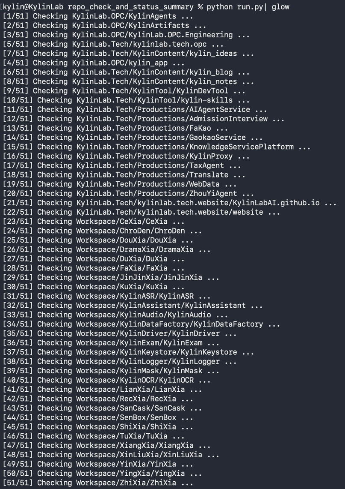
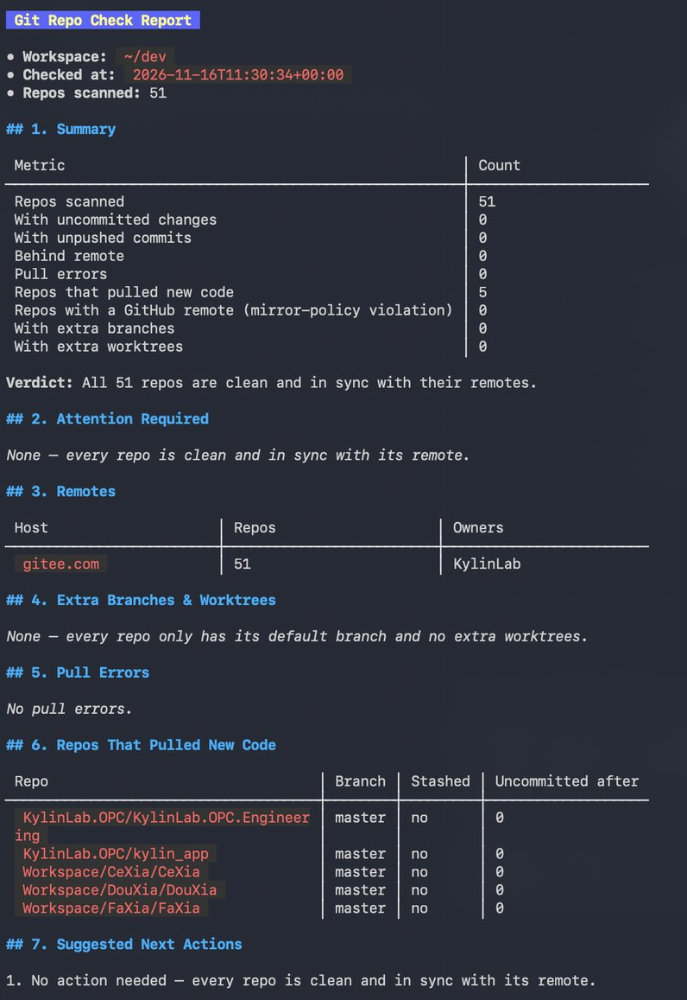
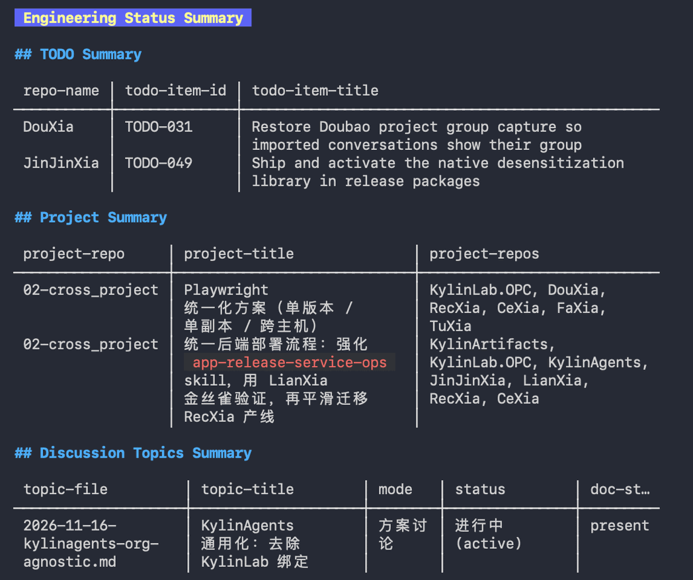

# 把重复任务变成脚本：AI 只付费一次的省 token 工作流


免费 AI 额度和 token 正在变少，但每天、每小时调用 AI 跑同一份固定清单的习惯没变。用模型推理执行步骤永不变化的任务，是当下最容易察觉的浪费：**每次运行都为一份结构相同的答案付费。**

本文给出一条规则——第一次用 AI 做简单重复任务时，让 AI 写脚本而不是执行任务——以及一个扫描 51 个仓库的真实案例。读完后你会拿到决策边界和可复用清单。

## 问题：推理层在重复一份清单

我们维护几十个 git 仓库，长期追问两件事：有没有未提交改动、未推送提交、未合并分支、多余工作树或拉取报错？每个仓库接下来该关注哪个 TODO、项目计划或讨论话题？

输入与输出形态都固定。过去靠 AI 技能扫描、比对、打印异常，任务本身不需要判断。推理层只是在重复清单——这是脚本形状的活儿，却在按次消耗推理预算。

## 方案：首次调用规则与决策边界

规则拆成三步：

1. **首次调用**：让 AI 产出确定性的可重复脚本，而不是任务结果。
2. **决策边界**：开始前能写死下一步（扫描、比对、统计、格式化）→ 脚本；写不死（判断、未知、意外）→ AI 推理。
3. **长期复用**：脚本进仓库，人运行，挂 cron / CI；需求变化才重新生成脚本。

| 方案 | 优点 | 缺点 | 适合 |
|---|---|---|---|
| 每次调用 AI 技能 | 零搭建 | 每次烧 token、慢 | 极少且有不确定性的检查 |
| AI 写一次脚本、人运行 | 一次付费、之后免费可 diff | 前期编写成本 | 高频、规则清晰的任务 |
| 脚本扫描、AI 看异常 | token 低 | 接线复杂 | 异常多、经常有意外的仓库 |

我们选第二条：最常见的"一切干净"应该是零成本的。

## 实现：一个入口、两份报告

脚本 `repo_check_and_status_summary` 遍历工作区，产出 git 报告与工程状态报告。编写之后只需自己运行：

```bash
# 第 1 天：让 AI 写出脚本（一次 AI 调用）
# 第 2 天起：自己运行它——不用模型，不花积分
python run.py | glow
```

成功标志：终端逐行打印 `[n/51] Checking ...`，最终生成两份 Markdown 报告。失败信号集中在拉取报错与 Attention Required 段落。



三条设计不变量：

- 模型职责在脚本生成时结束，运行路径上不再依赖模型。
- 输出是纯 Markdown 文件，可跨次 diff，而不是对话里的临时答案。
- 人运行并过目，异常才触发进一步判断。

## 结果验证

| 指标 | 结果 |
|---|---|
| 扫描仓库 | 51 |
| 未提交改动 / 未推送提交 | 0 / 0 |
| 落后远端 / 拉取报错 | 0 / 0 |
| 多余分支 / 工作树 | 0 / 0 |
| 有新代码的仓库 | 5 |
| 同次输出的 TODO / 项目 / 话题 | 2 / 2 / 1 |
| 编写后每次运行 token 成本 | 0 |





同次运行还给出两条待办（DouXia TODO-031、JinJinXia TODO-049）、两条跨项目计划和一个进行中的讨论话题（KylinAgents 通用化：去除 KylinLab 绑定），不必再单独问 AI。

## 坑与取舍

1. 我们连续几周让 AI"查一下仓库"而非"写个脚本查"——第一次请求就该要脚本。
2. 第一版脚本试图覆盖所有 git 边界情况；异常清单加人工扫一眼就够了。
3. 输出保留为纯 Markdown 比挂在 AI 技能里更简单，也让 diff 轻而易举。

不推荐的场景：输入混乱、每次都要重新理解上下文的任务——那正是推理的价值区间。

## 总结与延伸阅读

- 分界线是"开始前能否写死下一步"，不是"任务简单还是复杂"。
- 51 仓库同步每次运行零 token，一条命令同时回答"有无异常"与"该做什么"。
- 把异常当注意力的入口，别让"一切正常"消耗推理预算。

更多完整文章见全站知识库：https://kylinlab.pages.dev/zh/knowledge

如果你也在为重复任务的 token 开销头疼，欢迎在评论区聊聊你的边界划分方式 🙌。
