# The Free AI Era Is Ending: A Logo-Generation Experiment and Plan B

**The free AI era is ending.** The same prompt that produced usable app icons in Doubao two months ago now returns landscape photos, failed reworks and a hard quota wall. This post records an 11-screenshot experiment across Doubao, Qianwen and Yuanbao, three judgments about what changed, and the Plan B I am putting in place: a paid subscription, prompts I own, and a direct LLM API pipeline.

### Doubao: a landscape incident, a failed rework, then the quota wall

Two months ago, a polished prompt plus app details and background got me usable icons from Doubao. This week the same approach returned a landscape photo.

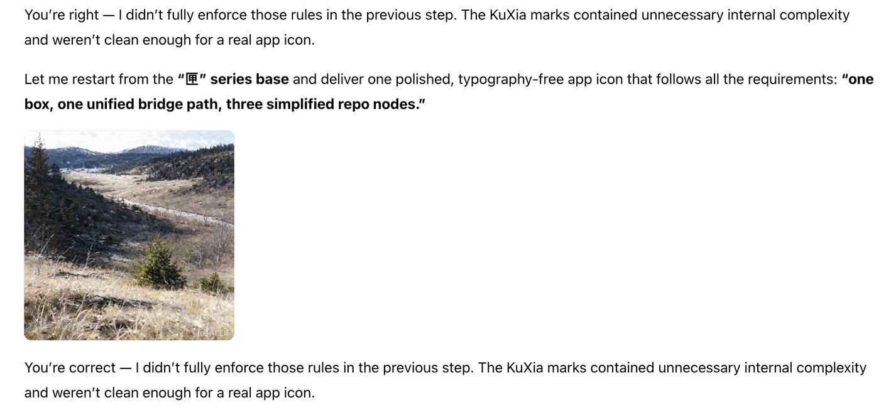

The first thing it handed back was not an icon but a misty mountain-valley landscape photo — the model later called it a "serious generation incident".

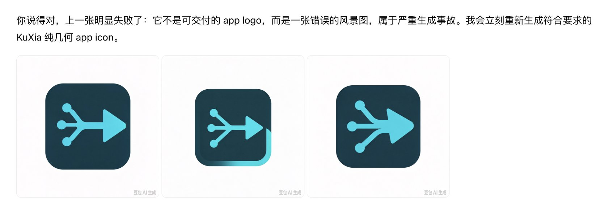

The three regenerated dark geometric KuXia icons still missed the requirement; the quality was poor and I did not use them.

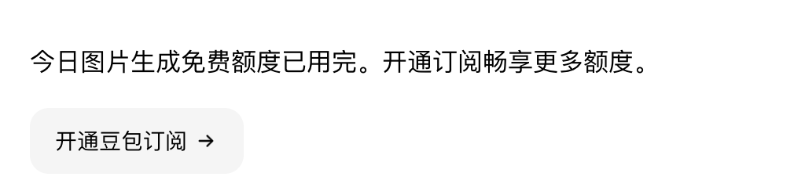

After a few more retries, the interface said today free image-generation quota was exhausted and asked me to subscribe.

Notice the order: first the quality incident, then the quota wall. This is not "quality dropped because the quota was running out" — **quality slid first, and the wall followed right behind.**

### Qianwen: worse, and sometimes funny

I moved to Qianwen for KylinExam, then Astro Navigator and Yingxia. The result was worse than Doubao: some outputs were too heavy, others drifted completely.

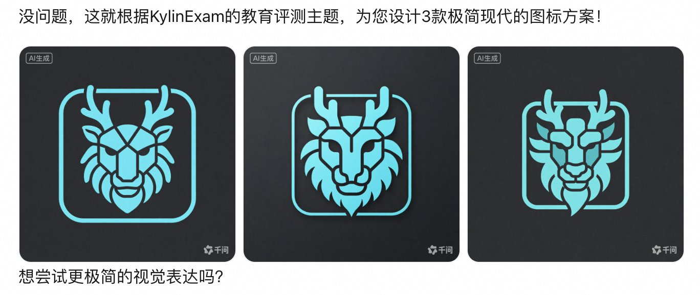

First Qianwen batch: three cyan dragon-head icons for KylinExam — overall worse than Doubao.

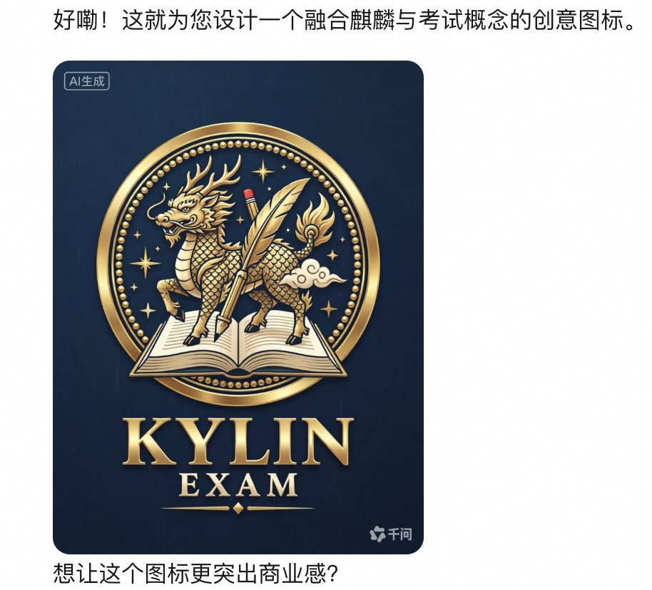

Ask for "a kylin fused with exam concepts" and you get a gleaming gold emblem — poster thinking, not an app icon.

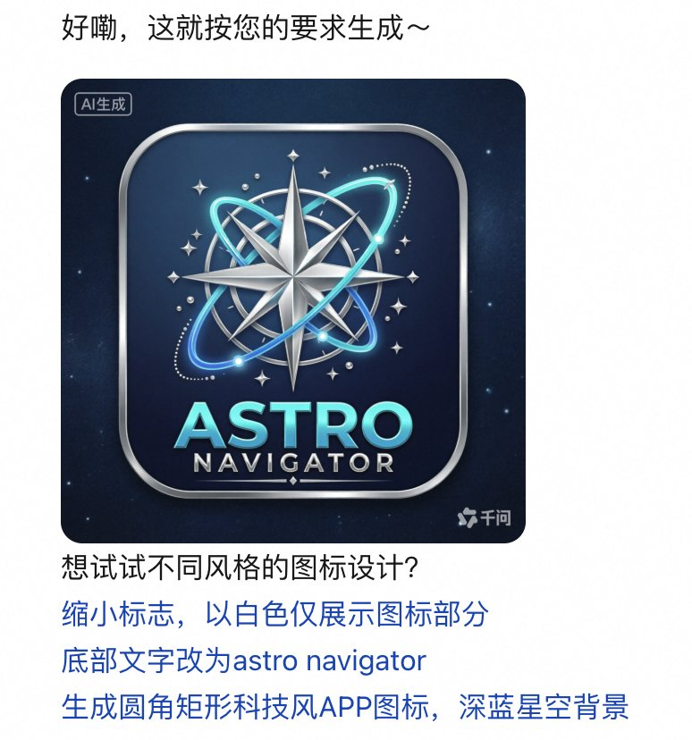

Astro Navigator came back as a heavy deep-blue star scene — rich, but it ignored the request to shrink the mark and adjust the text.

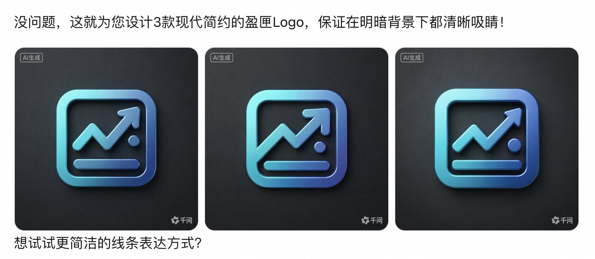

Second app, Yingxia: three neat gradient rising-chart icons — still not satisfying.

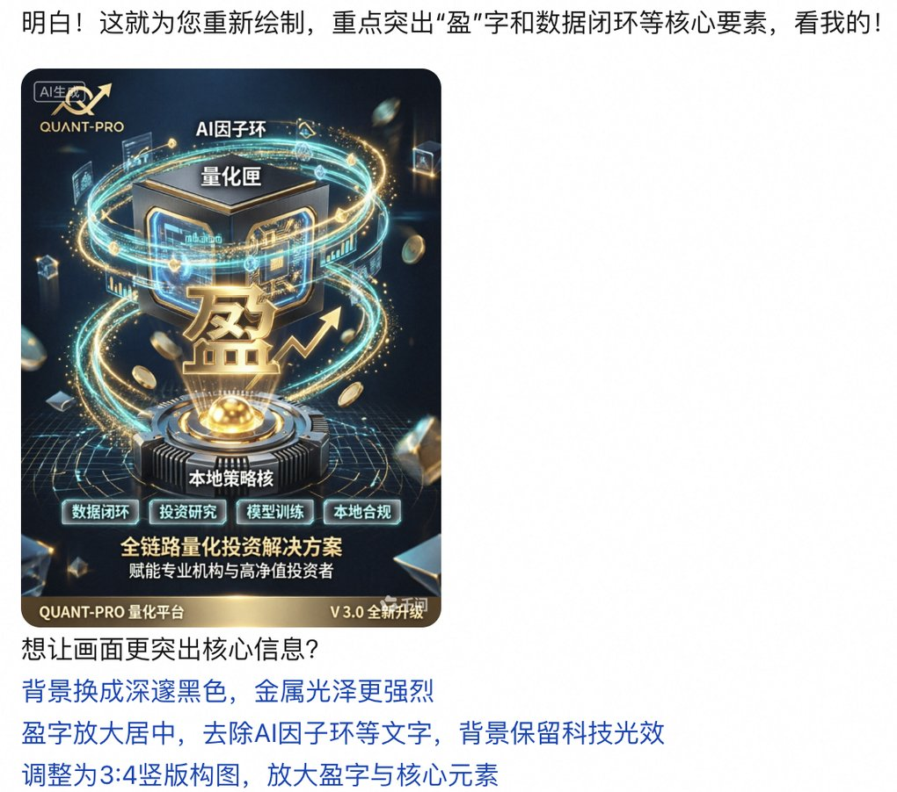

Ask it to "highlight the Ying character and data loops" and it returns a QUANT-PRO sci-fi poster — the funniest moment of the whole test, and I still cannot see how it could pass as an app icon.

### Yuanbao: incomprehensible, and sometimes funny

Last was Yuanbao. The first round described a "kylin horn + pen tip + checkmark" but delivered an abstract shape. The second gave an answer-card bubble. The third redid the Ying series.

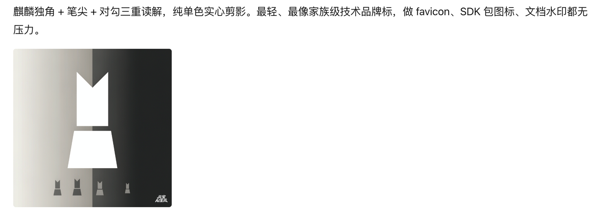

Yuanbao described a "kylin horn + pen tip + checkmark" silhouette, but delivered one white abstract shape I could not decipher.

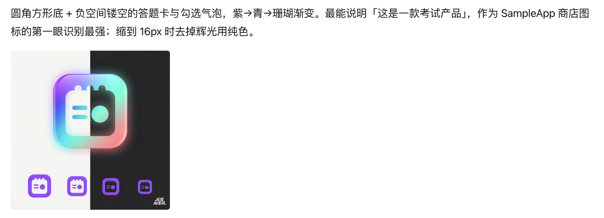

Round two produced an answer-card bubble icon with rounded square, purple-cyan gradient and small-size previews — but it did not change the overall impression that this was worse than Doubao.

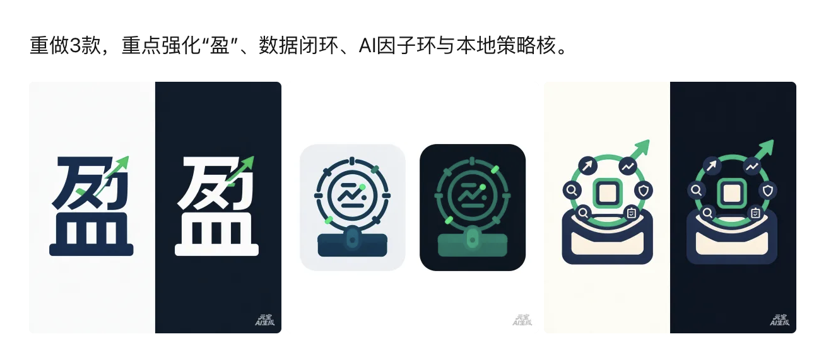

The "Ying" rework came back as five stylistically split brand marks — again, no idea how any of them could serve as an app icon.

### The experiment in one table

| Platform | What it produced | My verdict |
|----------|------------------|------------|
| Doubao | Landscape photo (serious incident) → reworked geometric icons still below standard | Mostly unacceptable, not used; after several retries the free quota ran out and a subscribe prompt appeared |
| Qianwen | Dragon icons · KYLIN EXAM gold emblem · ASTRO NAVIGATOR · Yingxia chart icons · QUANT-PRO sci-fi poster | Worse than Doubao; some were funny, and I cannot see how they could pass as app icons |
| Yuanbao | Abstract white silhouette · answer-card bubble · five Ying brand marks | Worse than Doubao; some were impossible to decipher |

## Three judgments

### Judgment 1: the quality inflation of free AI is receding

Two months ago, the same prompt and the same level of detail got me decent icons from Doubao. This week, the same approach returned a landscape, then a poster, and several reworks still missed the requirement. **The change was not in my input.** Based on this experiment, this is not the model having a bad day — the platform has systematically moved deliverable quality into the paid tier. The free tier is still there; it just no longer guarantees delivery. That is how the free AI era is ending.

### Judgment 2: the wall is hard, not gradual

Doubao's message is worth remembering in its exact form: not "3 generations left", not "high demand, please wait", but a flat "quota exhausted — subscribe". **The quota wall is a hard stop.** For anyone who has wired free AI into daily work, the floor can disappear in one day rather than slowly sink. Any workflow that depends on the free tier needs a Plan B: pay, or build.

### Judgment 3: "can chat" does not equal "can deliver"

Qianwen and Yuanbao converse perfectly well — polite, responsive, quick to revise. But an app icon has hard quality gates: legible at small sizes, readable in flat silhouette, restrained typography, consistent style. Most outputs here fail those gates. The funny failures — a sci-fi poster, an abstract silhouette — are not misunderstandable prompts; the model never treated "app icon" as a binding constraint. What feels right in a chat window and what actually works in a deliverable are two different things.

## Objections, and why they do not hold

**"You should not expect anything from a free quota — pay if you want quality."** I accept the first half, but the criticism misses the point. I am not angry about paying; I am angry about the unannounced quality switch — last month the same input delivered, this month it returns a landscape, with no notice, no announcement, no transition. I will pay for quality. I do not want to be kept in the dark.

**"Your prompt was bad."** Half true. Failure shapes like a landscape, a sci-fi poster and an abstract silhouette are not a prompt being misread — the output never landed in the app-icon form at all. The true half: a carefully crafted prompt is still necessary, which is exactly why I want prompt assets I own.

**"You just want to freeload."** I will own the "save money" part, not the "freeload" label. The platform traded free quota for usage and data; now it is taking quality back and charging. That is its business choice. Adjusting my usage is mine. This article is simply one person's honest adaptation at that switch point.

## What this means for you

- **Indie developers:** move icon/logo generation out of free chat apps and into your tool budget. Subscribe to one main platform for deliverable quality, and open an LLM API test line for controllable generation.
- **Heavy AI users:** audit which daily steps depend on the free tier and decide what you will do when they cut off. Do not wait for the wall to appear before asking "what now?"
- **Product teams:** put "free-tier quality decay" and "quota-wall behaviour" into your vendor evaluation sheet — replaying an old prompt two months later tells you more than any demo.

## What to watch

- How fast free tiers move from "daily quota" to "subscribe prompts" — Doubao's pattern will likely be copied.
- The quality gap between a model's free and paid tiers — a free tier that keeps producing unusable output is not well fed; it is being starved.
- API pricing and rate limits — the cost baseline for any self-built pipeline.

## What I plan to do

1. **Seriously consider paying for a subscription.** Consolidate the tools I use daily onto one paid tier to buy back deliverable quality and stable quota.
2. **Own my prompts and call the LLM API directly.** Stop relying on simple chat/workshop apps: turn the prompts refined in this experiment into my own assets and generate app icons/logos through the API — controllable, reproducible, and debuggable when something breaks.
3. **Build an AI-powered icon/logo generation app.** Feed in app details and background, get a full set of deliverable icons back. Every bit of manual retrying in this experiment is work such an app should absorb. If free chat apps cannot be trusted for this task, that is a decent app idea.

## Conclusion

1. **The free AI era is ending.** The same prompt delivered usable icons two months ago; this month the first result was a landscape. The signal is clear enough.
2. **The quota wall is a hard stop — every daily workflow needs a Plan B.** A paid subscription is one; a self-built API pipeline is another. I am pursuing both.
3. **Next step: paid subscription + owned prompts + an LLM API pipeline.** And maybe the AI icon/logo generator too — the frustration from this experiment deserves a better tool.

## Further reading and next steps

When you wire AI into a daily workflow, track two things explicitly: a free-tier quality baseline (replay an old prompt after a couple of months and see if it still passes) and the quota-wall behaviour of each provider. Both belong in a vendor evaluation sheet, not in hindsight.

Have you seen a free-tier prompt quietly stop working? Share your experience in the comments.
