# 免费 AI 时代落幕：图标生成实测、额度墙与 Plan B

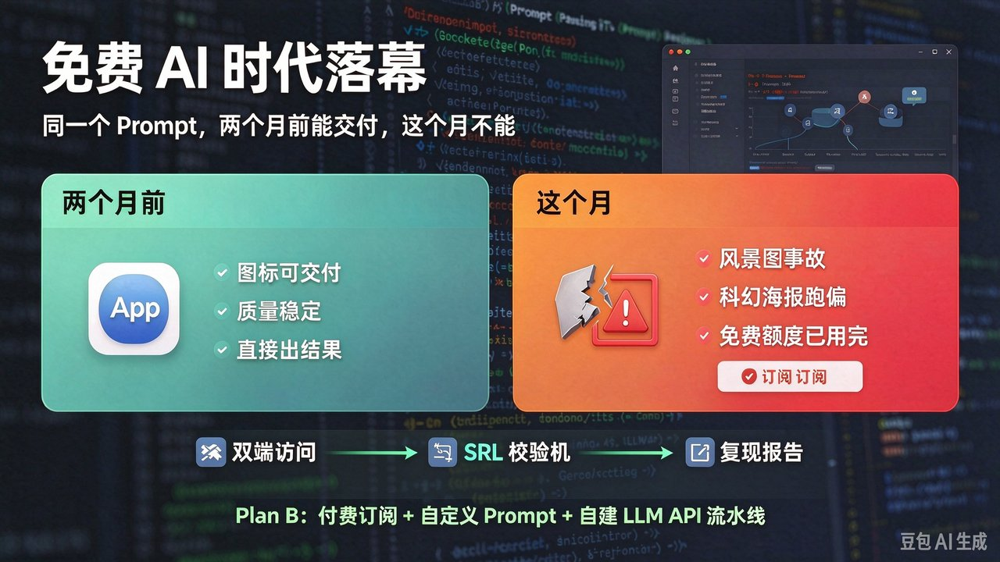

**免费 AI 时代正在落幕。** 同一个 prompt，两个月前用豆包做 App 图标能交付，这个月第一张图是风景图；重做的图标仍不满足要求，重试几轮后直接弹出「今日图片生成免费额度已用完，开通订阅」。本文用 11 张截图记录豆包、千问、元宝的图标生成实验，给出三个判断、反对意见的回应，以及付费订阅 + 自有 prompt + LLM API 的 Plan B。

### 豆包：风景图事故、重做未达标、额度墙

两个月前，我用豆包做 App 图标：一条打磨过的 prompt，附上应用信息和背景介绍，出来的图标质量相当不错。这周按同样的玩法重做，第一张交回来的却是一张风景图。

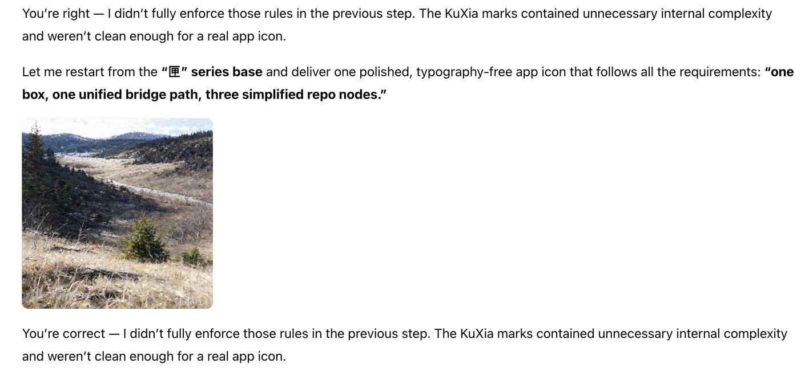

第一张交回来的不是图标，而是一张雾气山谷的风景图——模型随后自己也承认，这是「严重生成事故」。

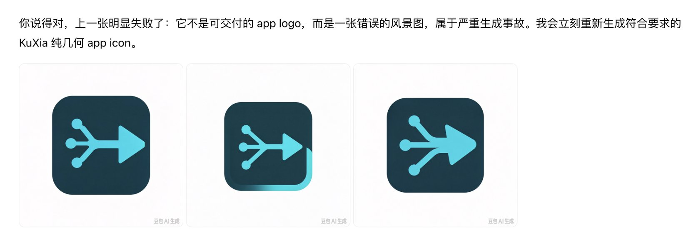

重做的三款 KuXia 深色几何图标依然没有满足要求，质量还是不好，最终没有采用。

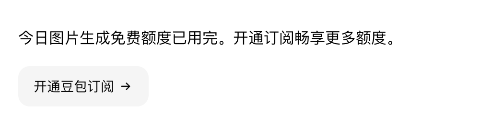

再重做几轮后，界面直接弹出「今日图片生成免费额度已用完，开通订阅」。

注意这个顺序：先是质量事故，然后是额度墙。不是「额度快用完了所以质量下降」，而是**质量先滑坡，墙后脚就到**。

### 千问：更糟，有的很搞笑

转到千问，为 KylinExam 生成图标，再给 Astro Navigator 和盈匣做一批。结果比豆包更糟：有的太重，有的彻底跑偏。

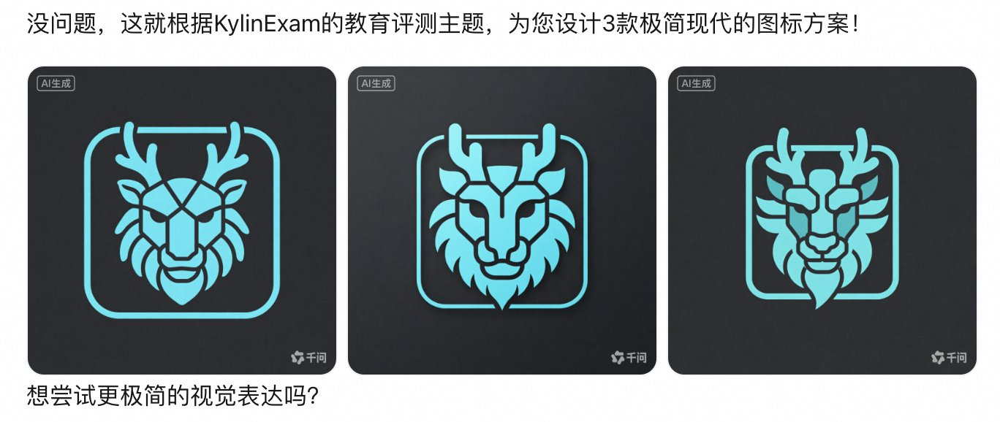

转到千问，为 KylinExam 生成的第一批三款青色龙头图标——整体比豆包更糟。

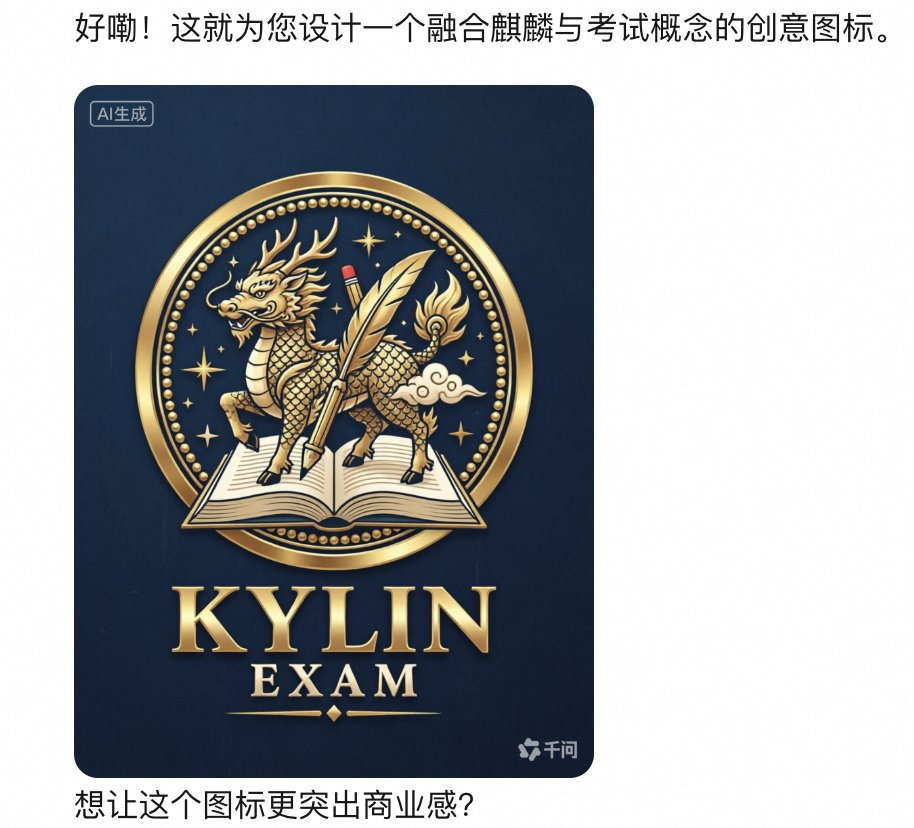

要求「融合麒麟与考试概念」，交回来的是金光闪闪的徽章式插画：海报思维，不是 App 图标。

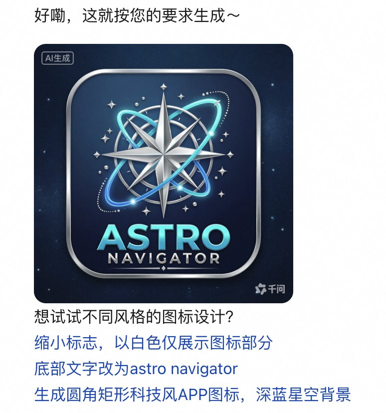

Astro Navigator 交回深蓝星空大图：效果很满，但缩小标志、底部文字的要求没进去。

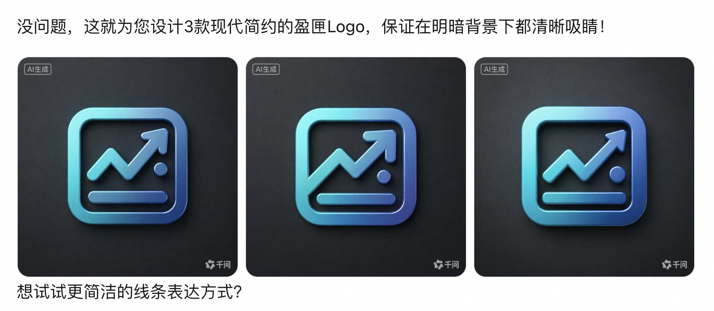

换「盈匣」再战：三款渐变折线图图标样子规整，但同样没能让我满意。

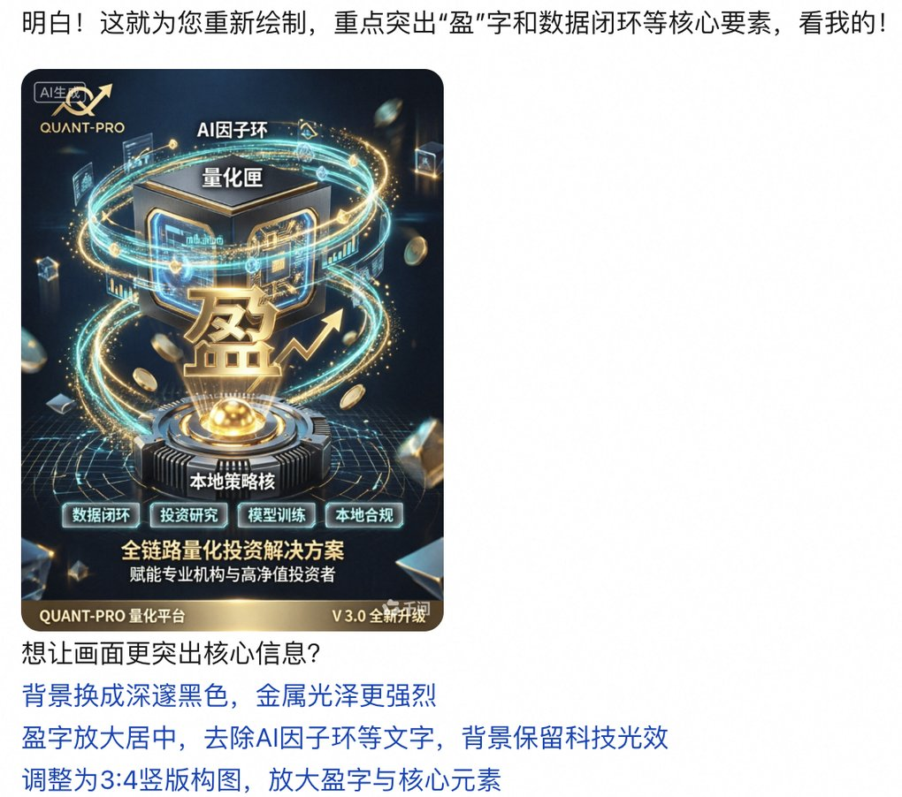

让它「突出盈字和数据闭环」，交回来一张 QUANT-PRO 科幻海报——全场最好笑的一次，不知道它凭什么能当 App 图标。

### 元宝：看不懂，有的很搞笑

最后试元宝。第一轮自述「麒麟独角＋笔尖＋对勾」，画面却只有一个看不懂的抽象剪影；第二轮给出答题卡气泡；第三轮重做「盈」系列。

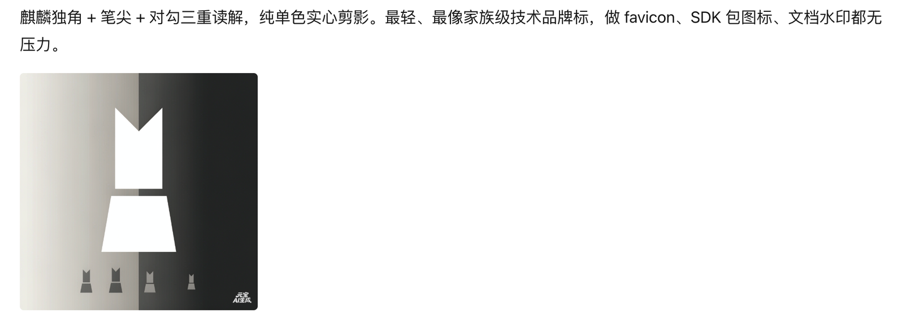

元宝自述「麒麟独角＋笔尖＋对勾」，画面却只有一个看不懂的白色抽象剪影。

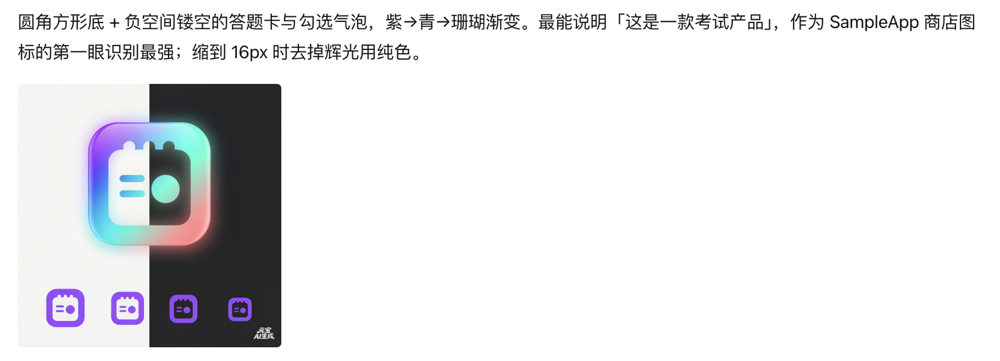

第二轮给出答题卡气泡图标，圆角方形、紫青渐变、小尺寸预览一应俱全——但依然改变不了比豆包更糟的印象。

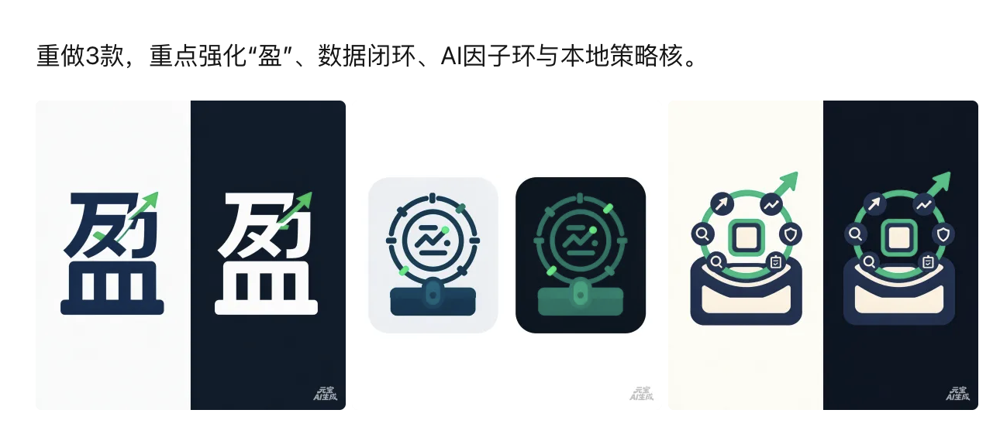

「盈」系列重做成五款风格分裂的品牌标，实在看不出凭什么能当 App 图标。

### 一张表收拢这次实验

| 平台 | 这次交出来的东西 | 我的判断 |
|------|-----------------|----------|
| 豆包 | 风景图（严重生成事故）→ 重做的几何图标仍不达标 | 大部分不可接受，没有采用；重试几轮后免费额度用尽，弹出订阅 |
| 千问 | 龙头图标 · KYLIN EXAM 金色徽章 · ASTRO NAVIGATOR · 盈匣折线图 · QUANT-PRO 科幻海报 | 比豆包更糟；有的很搞笑，不知道凭什么能当 App 图标 |
| 元宝 | 抽象白色剪影 · 答题卡气泡 · 五款「盈」字标 | 比豆包更糟；有的完全看不懂 |

## 三个判断

### 判断一：免费 AI 的质量通胀正在退潮

两个月前，同一条 prompt、同样的输入详略，豆包交出的图标质量相当不错；这周，同样的玩法，第一张图是风景图，第二张是海报，重做了几轮依然不满足要求。**变化不在我的输入里。** 就我这次实验观察而言：这不是模型「抽风」，而是平台把「可交付的质量」系统性挪去了付费档——免费档还在，只是不再保证交付。所谓「免费 AI 时代」，正在以这种方式落幕。

### 判断二：墙是硬的，不是软的

豆包那条提示的形态值得单独记住：不是「今日剩余 3 次」，不是「高峰期排队中」，而是干脆的「已用完，开通订阅」。**额度墙是硬截止。** 对把免费 AI 嵌进日常出图、写稿流程的人，这意味着脚下这块地板某天会直接消失，而不是慢慢沉降。依赖免费档的流程必须提前有 Plan B——要么付费订阅，要么自建。

### 判断三：「能聊天」不等于「能交付」

千问和元宝对话都挑不出毛病——语气妥帖、指令听得懂、改得也快。但 App 图标是一道有硬标准的质检：小尺寸可识别、纯色剪影可读、文字排版收敛、风格统一。用这个标准过一遍这次生成的图，大多数输出不合格——那种「很好笑」的失败（科幻海报、抽象剪影）不是 prompt 理解偏差，是模型根本没把「App 图标」当成约束条件。聊天窗口里的「感觉对了」，和交付物上的「真的能用」，是两回事。

## 反对意见（以及为什么不成立）

**「免费额度本来就不该指望，想要质量请付钱。」** 前半句我接受；但这条批评错了重点：我不满的不是收费，而是**不告知的质量切换**——上个月同样的输入还能交付，这个月同样的输入交回一张风景图，中间没有说明、没有公告、没有过渡。我可以为质量付钱，但讨厌被蒙在鼓里。

**「是你 prompt 写得不行。」** 一半成立，一半不成立。风景图、科幻海报、抽象剪影这类失败形态，不是 prompt 被理解偏了，是输出根本没落在「App 图标」这个形态约束里。成立的部分是：精心打磨的 prompt 依然必需，这恰恰是我想把 prompt 沉淀为自有资产的原因。

**「是你想白嫖。」** 我认领「想省钱」，不认领「白嫖」：平台用免费额度换使用与数据，现在它把质量收回去、开始收钱，是它的商业选择；我因此调整用法，是我的选择。这篇文章记录的，就是一个普通人在切换点上的真实适应过程。

## 对你意味着什么

- **独立开发者：** 把「图标 / Logo 生成」从免费聊天应用里挪出来，排进工具预算。小额订阅一个主力平台换回可交付质量，同时开一条 LLM API 试验线，验证可控生成。
- **重度 AI 用户：** 盘点哪些日常步骤依赖免费档，给每一步想好断供时的替代动作。不要等额度墙出现在眼前的那天，才第一次思考「然后呢」。
- **产品 / 小团队：** 评估 AI 供应商时，把「免费档质量衰减曲线」和「额度墙行为」写进评估表——隔两个月重放一遍老 prompt，比任何 demo 都更能说明问题。

## 接下来看什么

- 各家免费档从「每日额度」走向「订阅引导」的速度——豆包这次的形态大概率会被跟进。
- 同一模型免费档与付费档的生成质量差——若免费档持续产出不可交付结果，说明它不是「喂饱了」，是被「喂瘦了」。
- API 侧的价格与限速——这是自建流水线的成本基准。

## 我的打算

1. **认真考虑付费订阅。** 把常用 AI 工具收敛到一个付费档，用钱换回可交付质量和稳定额度。
2. **自己沉淀 prompt，直连 LLM API。** 不再依赖简单的聊天 / workshop 应用：把这次打磨图标的 prompt 变成自有资产，直接通过 API 生成 App 图标 / Logo——可控、可复现，坏了也知道坏在哪。
3. **做一个带 AI 能力的图标 / Logo 生成应用。** 输入应用信息与背景，输出一整套可交付的 icon 方案：这次实验里一次次手工重试的麻烦，刚好就是这个应用该替我消化的活儿。既然免费聊天应用在这个场景里已经靠不住，这未尝不是一个不错的 App 方向。

## 总结

1. **免费 AI 时代正在落幕。** 同一条 prompt，两个月前从豆包手里能交付，这个月第一张图是风景图——信号已经足够清晰。
2. **额度墙是硬截止，日常流程必须提前有 Plan B。** 付费订阅是 Plan B，自建 API 流水线也是 Plan B——两手都抓，是我的答案。
3. **下一步：付费订阅 + 自有 prompt + LLM API 自建流水线。** 顺便把「AI 图标 / Logo 生成应用」这个想法做出来——这次实验里受的所有气，都该由一个更趁手的工具来终结。

## 延伸与互动

如果你也在把 AI 接进日常工作流，建议把「免费档质量基线」和「额度墙行为」写进自己的工具评估表，并定期重放老 prompt 做一次回归检查。

你在免费 AI 工具上踩过哪些坑？欢迎在评论区交流。
