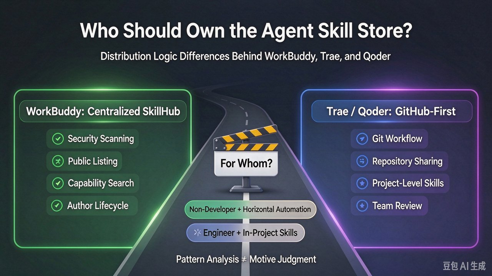

# Agent Skill Distribution: WorkBuddy Skill Store vs GitHub-First

AI is for every industry; GitHub is for a technical minority. Agent skill distribution has split into two models: WorkBuddy makes skills a trusted, discoverable first-class citizen through a public store, while the Trae and Qoder communities organize around GitHub. Which fits better depends on who the user is and what the skill is.

## The recurring question

WorkBuddy ships a first-class, self-service **SkillHub / public skill store** with a publish CLI, security scanning, versioning, public discovery, metrics, and an author dashboard. Any engineer can run `workbuddy skills publish .`, pass automated checks, and make a skill searchable and installable by every user.

Trae's local upload lands only in a private workspace; public listing is curated, invite-style, manually reviewed. Qoder has a formal submission path, but its community culture is GitHub-first: share a repo URL or zip, import directly, and treat the official store as optional.

So: **is WorkBuddy's dedicated store a meaningful moat or expensive overhead?** Why Trae and Qoder do not build the same thing is not knowable from outside — maybe they are working on it, maybe it isn't a priority. This article compares observable models, not motives.

## What the WorkBuddy store delivers

### Trust and security gate

Skills are executable workflows: shell scripts, local file reads, API calls, cloud resources. Unvetted skills are a real attack surface. WorkBuddy requires automated security scanning before public listing; combined with author identity, version history, install counts, and feedback, users get a baseline signal that a skill was scanned and is tracked — not an anonymous gist.

Most WorkBuddy users are not engineers. They will not audit a `SKILL.md` or read commit history. The store turns "install" from a risky git clone into a low-friction, trusted action.

### Discovery and signal layer

GitHub searches repo names, not capabilities: no filtering by compatibility, success rate, install count, last update, or scenario tag, and it naturally fits technical users rather than ordinary ones. WorkBuddy categorizes, tags, ranks by usage, presents standardized metadata, and recommends by intent: installs → ranking → more authors → richer catalog.

### First-class author lifecycle

A formal release flow — version bump, re-scan, update the public listing, see analytics — gives maintainers a reason to keep updating instead of publishing one-off gists.

This is my own publishing record on the WorkBuddy open platform. The publish-management menu also covers Buddy apps, experts, connectors, third-party and hardware integrations, share-feature integrations, and points redemption — skills are one asset type in a unified publishing system. Publishing different tools interactively brings different people together: vitality, stickiness, and good promotion. The flywheel: supply (authors) → consumption (users) → signal (metrics) → more supply.

### Product-positioning fit

WorkBuddy is a general-purpose agent workbench, not only a coding IDE: office automation, document processing, browser workflows, SaaS connectors, business automation. Many workflows are reusable across teams and non-technical users. A centralized marketplace is a natural feature for that audience, and richer skills expand what the agent can do, improving retention and fitting deeper into enterprise workflows and connectors such as WeCom, cloud APIs, and internal business tools.

## Observable differences on the Trae / Qoder side

1. **Engineer users, GitHub as source of truth.** AI is for every industry; GitHub is for technical users, a small share of all industries. Ordinary users won't install capabilities with git clone and repo links. For engineers, GitHub already provides version control, diff, commit history, fork, PR, review, README, examples, issues, and releases. A duplicate marketplace means another registry, manifest schema, review queue, and compatibility rules. The common pattern: `SKILL.md` → GitHub → share URL → import into the IDE.
2. **Coding skills are project-scoped.** They bind to tech stack, architecture rules, code style, team conventions, CI/CD scripts, repo linters, private tooling, internal MCP servers, and proprietary APIs. Trae explicitly separates global skills from project-level skills; much usage is local or team-internal. If most demand is private, the ROI of a heavy public marketplace drops. WorkBuddy's skills are more horizontal and cross-project, better suited to public circulation.
3. **Real operating cost.** Scanning-rule tuning, human review of ambiguous high-risk skills, takedown and dispute workflows, compatibility testing as runtimes and skill APIs evolve, and anti-spam / duplicate / low-quality moderation. From outside, IDE speed, code generation quality, MCP integration, and local developer experience are the directions these coding tools emphasize; whether a marketplace competes for those resources is not something we can judge. The lighter model pushes vetting outward: authors host on GitHub; consumers decide whether to trust the repo.
4. **Marketplace as a curated showcase.** Both have marketplace tabs, but they lean toward official, verified, first-party or partner skills rather than an open community registry. Trae's listing path is invite / curated; Qoder's submission route exists but is not the community default — a small, high-quality showcase rather than a mass open ecosystem.

## Comparison table — features, not motives

| Dimension | WorkBuddy skill store | Trae / Qoder GitHub-first |
|---|---|---|
| Trust boundary | Platform-owned: scan + review + metrics | GitHub-owned: user / repo reputation |
| Discovery | Native capability search, ranking, recommendation | GitHub search + community sharing; weak capability discovery |
| Author workflow | CLI publish, versioning, analytics dashboard | Git + README; marketplace submission secondary |
| Best fit | Horizontal automation, non-dev users, reusable office workflows | Coding, project rules, engineers, team-internal reuse |
| Operating cost | High (security, moderation, registry, signals) | Low; reuse GitHub's infrastructure |
| Audience | Public and broad | Often private / team / project-scoped |

## Nuance: GitHub-first is not "no ecosystem"

It is a decentralized ecosystem, not a platform-curated one. But its reach is narrower: technical users are a small share of all industries. A centralized marketplace offers better trust and discovery at higher operating cost and suits non-technical consumers; GitHub-native distribution has lower overhead and a git-native workflow, suits engineers, and offers weaker discovery and trust guarantees. Neither is universally superior.

## Conclusion and signals

- AI is for every industry, GitHub for a technical minority; WorkBuddy's store serves ordinary users with trust and discovery, and interactive publishing adds vitality, stickiness, and promotion.
- Trae and Qoder present a GitHub-first distribution model. We can describe the difference; we cannot know the reason, and pattern analysis is not motive judgment.
- Match the channel to the audience: curated marketplace for horizontal automation and non-developers; GitHub-native sharing for project-specific skills and engineers.

Signals to watch: if Trae or Qoder opens self-service public listing, treat it as a clue rather than proof of motive; a cross-agent skill registry standard would erode per-platform moats; a marketplace security incident would reprice everyone's trust model.

Which model wins long term — one cross-agent registry, or every agent with its own distribution pattern? Share your view in the comments.
