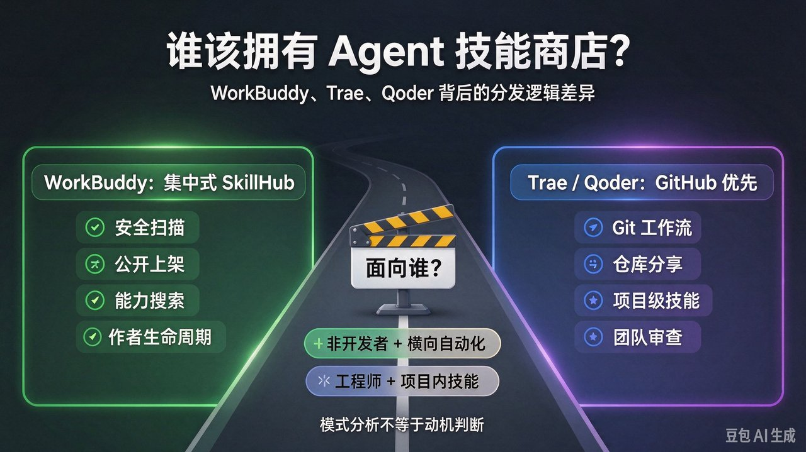
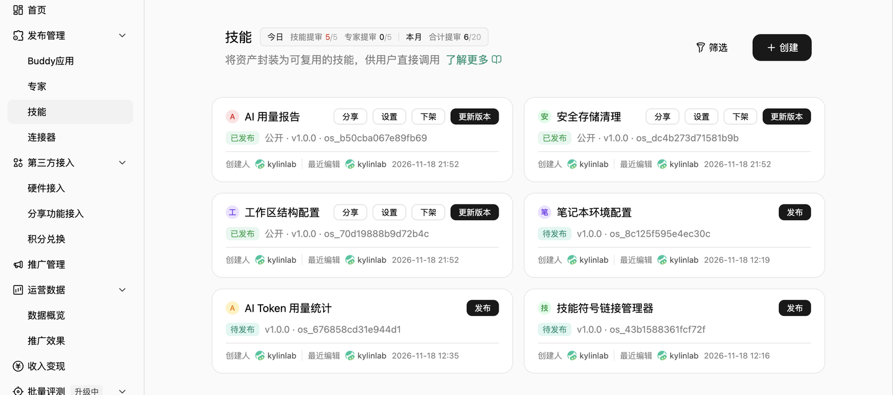

# Agent 技能分发模式对比：WorkBuddy 技能商店与 GitHub 优先

AI 要服务的是所有行业，而 GitHub 面向的是技术人员，在全部行业中占比相对很少。Agent 技能的分发因此分成两条路：WorkBuddy 把技能做成可信任、可发现的一等公民；Trae 与 Qoder 的社区围绕 GitHub 组织。**哪种更合适，取决于用户是谁、技能是什么。**

## 反复出现的问题

WorkBuddy 提供自助式 **SkillHub / 公开技能商店**：发布 CLI、安全扫描、版本管理、公开发现、指标统计、作者后台。运行 `workbuddy skills publish .` 并通过自动检查后，技能即可被所有用户搜索安装。

Trae 的本地上传只进私有工作区，公开上架是策展式、邀请制、团队人工审核；Qoder 有正式提交路径，但社区文化 GitHub 优先——写 `SKILL.md`、托管 GitHub、通过仓库 URL 或 zip 包导入，官方商店不是默认渠道。

于是问题来了：**WorkBuddy 的技能商店是有意义的护城河，还是昂贵的额外负担？** 至于 Trae / Qoder 为什么这么做，从外部无从确知——也许正在做，也许尚未排上优先级。本文只拆解可观察的差异，不推断动机。

## WorkBuddy 技能商店的四层价值

### 信任与安全闸门

技能可执行 shell 脚本、读本地文件、调 API、访问云资源，未审核就是攻击面。强制自动化扫描后才公开上架，叠加作者身份、版本历史、安装计数、用户反馈，给普通用户一个"被扫描、可追踪"的基础信号。多数 WorkBuddy 用户不是工程师，不会审计 `SKILL.md` 或看提交历史——市场把"安装"从有风险的 git clone 变成低门槛、可信任操作。

### 发现与信号层

GitHub 按仓库名搜索，无法按兼容性、成功率、安装量、最后更新、场景标签筛选，且天然贴合技术用户。WorkBuddy 按能力搜索、分类打标、按使用量排名、标准化元数据，并在意图匹配时推荐：安装 ↑ → 排名 ↑ → 作者 ↑ → 目录 ↑。

### 作者生命周期

版本 bump → 重新扫描 → 更新公开列表 → 查看分析数据。维护者获得稳定激励，而非一次性 gist。

这是我在 WorkBuddy 开放平台发布技能的真实记录。左侧「发布管理」还覆盖 Buddy 应用、专家、连接器、第三方接入、硬件接入、分享功能接入、积分兑换——技能只是统一资产发布体系中的一种。**通过互动方式发布各种工具，可以把不同人聚起来，增加活力与粘性，也是好的推广方式。** 飞轮：供给（作者）→ 消费（用户）→ 信号（指标）→ 更多供给。

### 产品定位契合

WorkBuddy 是通用 Agent 工作台，覆盖办公自动化、文档处理、浏览器工作流、SaaS 连接器、业务自动化，工作流可跨团队、跨非技术用户复用。集中式市场对这类受众顺理成章，也支撑生态导向的商业模式：扩展 Agent 能力、提升留存、融入企微（WeCom）/ 云 API / 内部业务工具等连接器系统。

## Trae / Qoder：可观察到的差异

只描述现象与模式差异，不推断动机。

1. **核心用户是工程师。** AI 面向所有行业，GitHub 面向技术人员，不是大多数普通用户，技术用户在全部行业中占比相对很少。对工程师，GitHub 已提供版本控制 / diff / 提交历史、Fork / PR / 评审、README / 示例 / issue、Release；再加一套市场意味着另一套注册表、manifest schema、审核队列、兼容规则。常见模式：`SKILL.md` → GitHub → 分享 URL → IDE 导入。
2. **编码技能项目内化。** 绑定技术栈 / 架构 / 代码风格、团队约定 / CI/CD / linter、私有工具 / 内部 MCP / 专有 API。Trae 区分**全局技能**与**项目级技能**；大量技能是本地或团队内部使用。需求若多私有，重型公开市场 ROI 下降。WorkBuddy 技能更横向、跨项目，适合公开流通。
3. **运营成本结构。** 扫描规则调优、高风险人工审核、下架 / 申诉 / 作者管理、兼容测试、反垃圾 / 重复 / 低质治理。从外部看，IDE 速度、代码生成、MCP 集成、本地体验是两款编码工具被反复强调的方向；是否争夺资源无从判断。客观事实：更轻模式把审查责任推给作者和消费者。
4. **市场偏官方精选。** 有市场标签页，但主要是官方、经过验证的官方自研 / 合作伙伴技能，不是开放社区注册表。Trae 邀请 / 策展制；Qoder 有正式提交路径但非社区默认。呈现上接近"小而精的展示橱窗"。

## 对比表（只比模式，不判动机）

| 维度 | WorkBuddy 技能商店 | Trae / Qoder GitHub 优先 |
|---|---|---|
| 信任边界 | 平台自有：扫描 + 审核 + 指标 | GitHub 自有：用户 / 仓库声誉 |
| 发现 | 能力搜索、排名、推荐 | 仓库名搜索 + 社区分享，弱能力发现 |
| 作者工作流 | CLI 发布、版本、分析后台 | Git + README；市场提交次要 |
| 最适合 | 横向自动化、非开发者、办公 / 业务复用 | 编码、项目规则、工程师、团队内复用 |
| 运营成本 | 高（安全 / 治理 / 注册表 / 信号） | 低；复用 GitHub 基础设施 |
| 技能受众 | 公开广泛，含非技术人员 | 私有 / 团队 / 项目内；技术人员占行业少数 |

## 边界：GitHub 优先不等于没有生态

它们有**去中心化生态**。但 GitHub 技术用户在全部行业中占比相对很少，覆盖面有门槛。集中式市场：信任 / 发现更好、成本更高、更适合普通用户；GitHub 原生：开销更低、更贴合 git、更适合工程师，发现与信任更弱。两种模式都不普适。

## 结论与延伸

- AI 面向所有行业，GitHub 只覆盖技术人员少数；WorkBuddy 商店为普通用户提供信任与发现，互动发布还能聚集人气、粘性，也是推广方式。
- Trae / Qoder 的 GitHub 优先模式只能描述差异，原因无从确知；模式分析 ≠ 动机判断。
- 分发匹配受众：横向自动化配策展市场，项目专用技能配 GitHub。

值得追踪的信号：开放自助上架只是观察线索；跨 Agent 注册表标准会削弱平台护城河；市场安全事件会重定价信任模型。

哪种模式会长期胜出？会收敛到跨 Agent 注册表标准，还是各自分裂？欢迎在评论区讨论。
