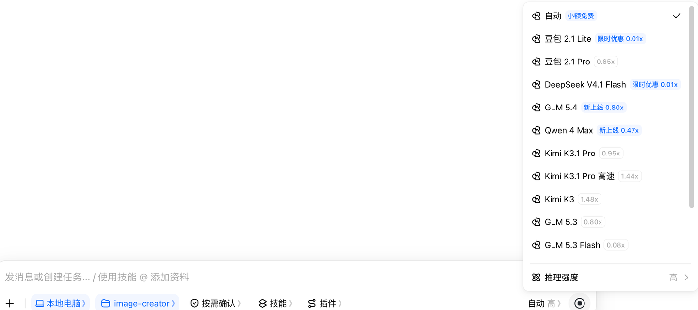
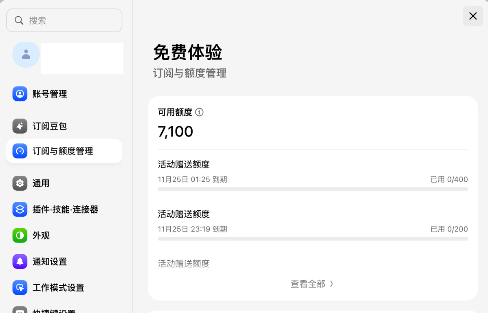
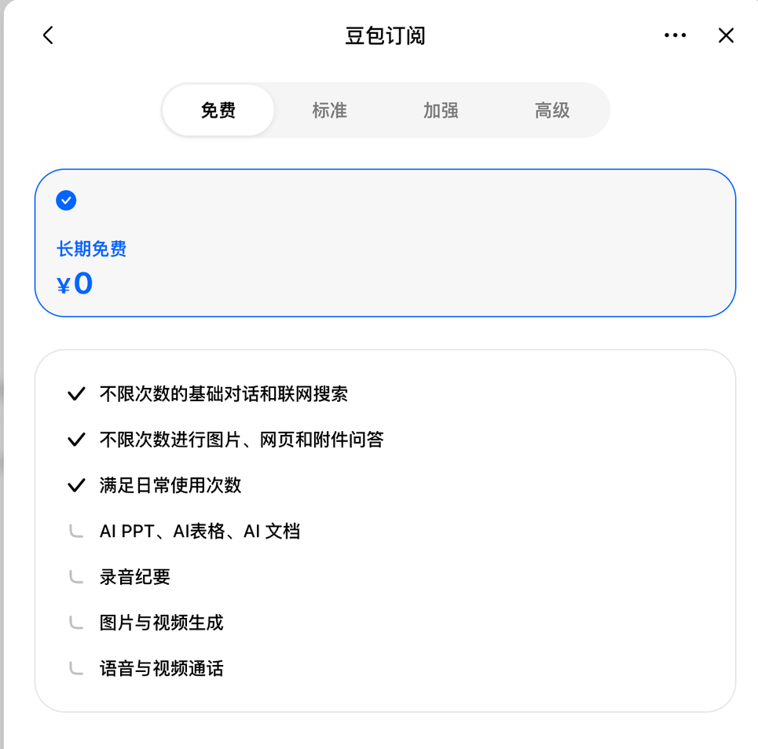
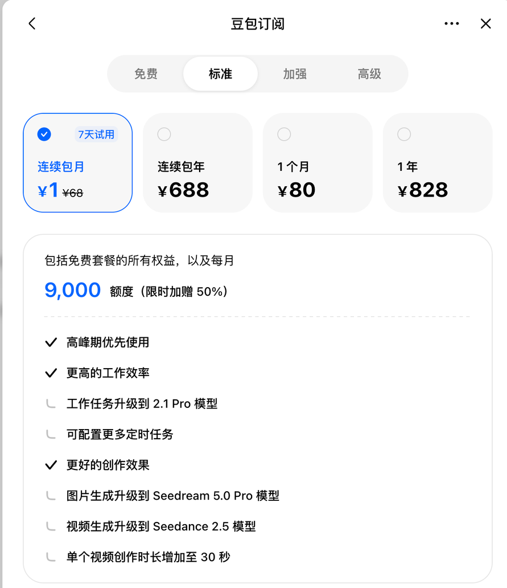
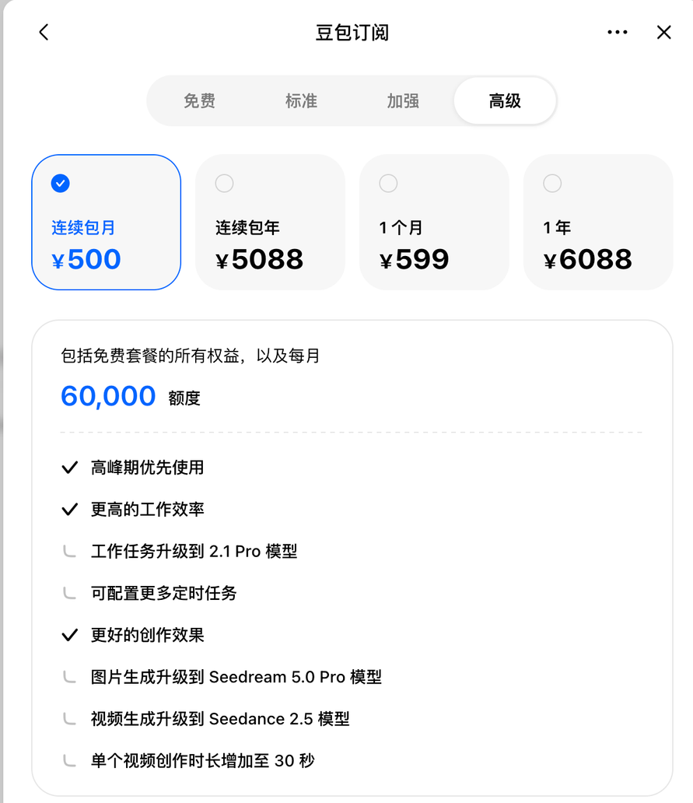

# Doubao Multi-Model Upgrade: From Chat App to AI Agent

Most chat assistants quietly decide the model for you. Doubao's latest upgrade hands that choice back to the user: a model list mixing first-party and third-party engines, a credit meter, and four subscription tiers. That is not a chat-app feature — it is agent-product plumbing. In this post I read the shipped UI as evidence of a category shift, and keep the strategic question about ByteDance's two agent products clearly separated as speculation.

The timing matters. ByteDance has spent months folding Feishu, TRAE and Coze into the Doubao system, merged TraeWork and TraeCode into a single TRAE, and now given Doubao the same multi-model shape used by peer agents including TRAE, WorkBuddy and Qoder. Two products from the same company increasingly look like the same product.

Scope: this is an observation, not an insider account. No architecture deep-dive, no model benchmarking, no ranking of which product is "better."

## Three takeaways

1. **The multi-model picker is the tell.** A consumer app that lets you switch among Doubao, DeepSeek, GLM, Qwen and Kimi models and set reasoning strength has crossed from chat into an agent workbench.
2. **Metering and tiers belong to the same shift.** Credits and a four-step price ladder say agent work is now metered work, and the ladder shows which capabilities ByteDance treats as premium.
3. **Two scenarios are worth tracking, not believing.** Both readings of the Doubao/TRAE relationship are plausible from public signals and neither is confirmed — watch product labels and migration notices rather than rumors.

## Background: TRAE consolidated first

The useful starting point is TRAE's own consolidation. TRAE — formerly Doubao MarsCode, launched in 2024 — announced on October 9, 2026 that TraeWork (its office AI agent) and TraeCode (its coding tool) were being merged into one unified TRAE, a "full-link development platform" with an Agent mode for cross-project task management and an IDE mode for coding and debugging. The standalone TraeWork service was scheduled to shut down on October 23, with chat history and local data migratable through an in-app upgrade.

Reporting puts the sequence like this: July 30 — Feishu's product team folded into Doubao's product team; August 24 — TRAE and Coze teams fully incorporated into Doubao; August 25 — Doubao Work launched as a separate office product; September 15 — ByteDance's CEO announced the integration of Doubao, Feishu and Volcano Engine with increased enterprise investment.

Put together, the strategy is hard to read. Teams were consolidated into Doubao while products were consolidated into TRAE. One public description says TraeWork and Coze capabilities are integrated with Doubao in work scenarios, while TRAE IDE and CLI continue as the programming line under the Doubao brand — yet unified TRAE now spans both Agent and IDE modes. Which layer is the real product, and which one owns "work"? Public information does not settle it.

## The model picker

Here is the clearest evidence of the change. Doubao's model picker now offers a list of selectable models rather than a single fixed engine:

Three things carry the lesson:

- **First-party and third-party models sit side by side.** Doubao 2.1 Lite and Pro are joined by DeepSeek, GLM, Qwen and Kimi. The app is no longer a wrapper around one model.
- **There is an "Auto" option with a cost hint.** Routing is becoming a product feature rather than an internal decision — the same pattern seen in Qoder's model selector, which offers automatic routing and direct model selection.
- **Reasoning strength is a user-facing knob.** That is an agent-runtime control, not a chatbot setting.

> Model selection + metering + task controls is now the baseline definition of an agent product.

The metering screen reinforces it:

7,100 available credits plus two bonus pools with expiry dates — usage is counted, not unlimited.

## Four subscription tiers

The pricing screen has four tabs — Free, Standard, Enhanced and Advanced. Treat the numbers as a snapshot of packaging, not a permanent price list.

| Tier | Price shown | Monthly credits | Notable |
|------|-------------|-----------------|---------|
| Free | ¥0, long-term | — | Unlimited basic chat and web search; premium rows unavailable |
| Standard | ¥1 with 7-day trial badge; ¥688/year continuous, ¥80/month, ¥828/year | 9,000 (limited-time +50%) | Peak-priority access, higher efficiency |
| Enhanced | ¥200/month continuous; ¥2,048/year, ¥240/month, ¥2,488/year | 24,000 | Same benefits, larger quota |
| Advanced | ¥500/month continuous; ¥5,088/year, ¥599/month, ¥6,088/year | 60,000 | Same benefits, largest quota |

Two observations. First, the paid tiers mostly buy **quota and priority**, not a different model — the "work task upgraded to 2.1 Pro model" row appears unchecked on all three paid screens, as do more scheduled tasks and image/video generation upgrades. Packaging is still settling. Second, a product selling credits, priority and agent capabilities is priced like an agent platform, not a chat app.

## Judgment one: a change in kind

The picker, credit meter and tier ladder together support a narrow but firm conclusion: Doubao is no longer positioned as a place to chat. It is positioned as a place to do work with models — the user chooses the model, the system meters the work, and higher tiers buy more of it.

TRAE, WorkBuddy and Qoder all let users pick models; the Doubao upgrade puts it in the same category. The practical lesson is not which model to pick but recognizing that a tool hardcoding one model behind a chat box is playing the previous game.

## Judgment two: the strategy is not legible externally

This judgment is about ambiguity, and it is a reading of public material rather than an official position. ByteDance consolidated teams under Doubao, products under TRAE, launched Doubao Work for office scenarios, and gave Doubao an agent-style multi-model interface. Public descriptions say TraeWork's and Coze's capabilities are folded into Doubao for work scenarios while TRAE IDE/CLI continues under the Doubao brand — yet unified TRAE spans both modes.

Doubao is becoming an agent; TRAE already is one; both sit under one organizational roof; and "work" now appears on both sides. Saying the strategy is unclear from outside is reasonable. Claiming we know the internal plan is not.

## Two possible directions — speculation, not a roadmap

**Everything in this section is speculation based on public information. It is not a confirmed official roadmap.**

**Scenario one: TRAE folded into Doubao.** The premise is user scale. Doubao is publicly described as China's most widely used AI app and reporting cites very large daily token volumes; TRAE's developer/office audience is much narrower. A single consumer entry point for agent work would be cheaper than two overlapping products, especially after the team merger. Supporting: Doubao absorbing former TRAE agent capabilities and migration notices pointing TRAE users to Doubao. Weakening: continued investment in TRAE as a distinct brand with its own IDE/CLI line.

**Scenario two: Doubao takes over TraeWork's original positioning.** The premise is functional overlap. TraeWork was ByteDance's office AI agent ("Let TRAE work for you") before merging into unified TRAE on October 9; Doubao Work had launched on August 25. Here Doubao takes the general office-agent role while TRAE keeps IDE and CLI. Supporting: Doubao's Work mode gaining TraeWork's task-planning and content-creation features, with TRAE messaging narrowing to developers. Weakening: unified TRAE promoting Agent and IDE modes equally.

Both fit the public record; neither is confirmed. Hold both and watch which label changes.

## Objection and response

A fair objection: multi-model selection may be table stakes in this market, not a merger signal. Every serious agent is adding model choice, so Doubao may simply be catching up. On that reading, two products are intentional — Doubao for consumers and general work, TRAE for developers, both under the Doubao organization with separate surfaces.

The response is modest: the ambiguity is in the product labels, not necessarily the org chart. No claim is made that ByteDance decided to kill either product — only that two surfaces now offer overlapping capabilities, which makes the boundary worth watching.

## What to watch

- Whether the picker and credit system appear inside TRAE, or Doubao's work-mode features appear in TRAE's Agent mode.
- Whether official copy assigns "work" to one product and "code" to the other.
- What happens to TraeWork features after the October 23 shutdown.
- Whether the unchecked capability rows (2.1 Pro upgrade, more scheduled tasks, image/video generation) become enabled in paid tiers.
- Any official statement after the Doubao/Feishu/Volcano Engine integration naming a single agent entry point.

## Conclusion

Doubao's multi-model picker, credit meter and four tiers mark its move from chat application to full-fledged AI agent. The Doubao/TRAE strategy remains unreadable from public information; the two scenarios are hypotheses, not a roadmap. The question to keep asking: which product will own "work" — and which label will change first?

External references: [TechNode](https://technode.com/2026/10/10/bytedance-merges-traework-and-traecode-into-unified-trae-platform/), [TRAE docs](https://docs.trae.ai/solo/solo-coder?_lang=en), [36Kr](https://eu.36kr.com/en/p/4019692292904841), [Qoder docs](http://docs.qoder.com/user-guide/chat/model-tier-selector), [Reuters](https://www.reuters.com/world/asia-pacific/chinas-bytedance-releases-doubao-20-ai-chatbot-2026-02-14/).

If you want the screenshots behind this reading, they are collected in the `resources/` folder alongside this post. Did I miss a signal — a tier rename, a migration notice, a capability row finally switching on? Let me know in the comments.
