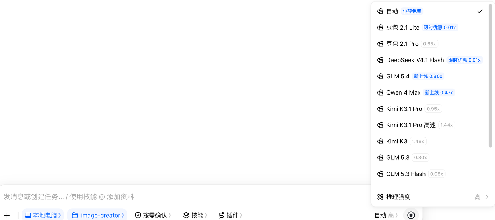
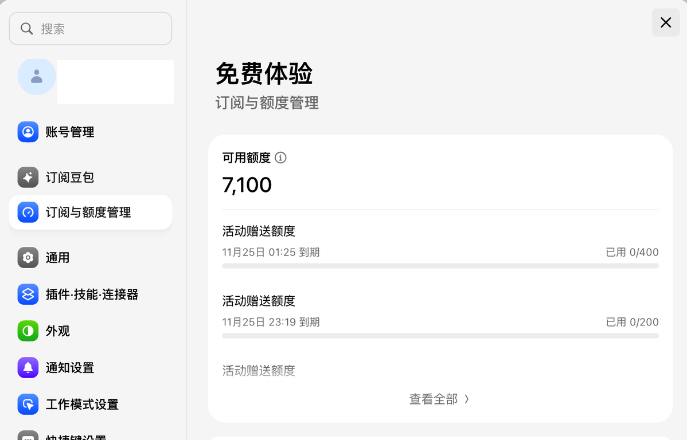
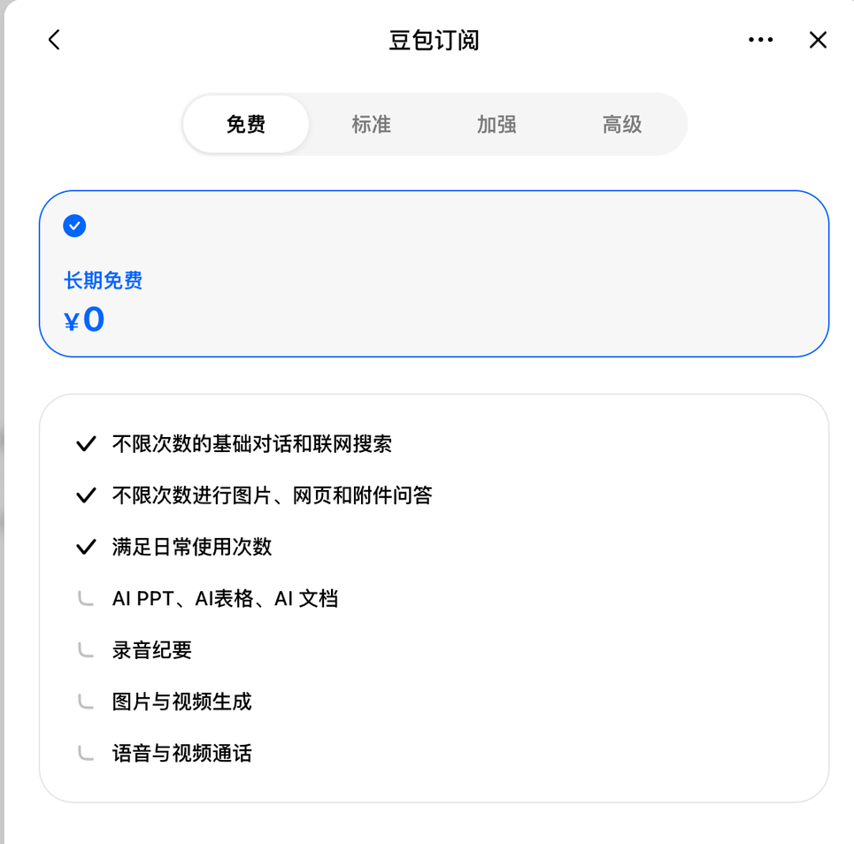
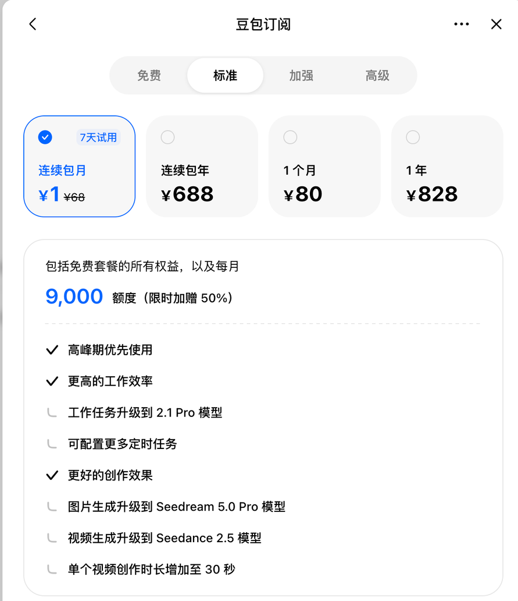
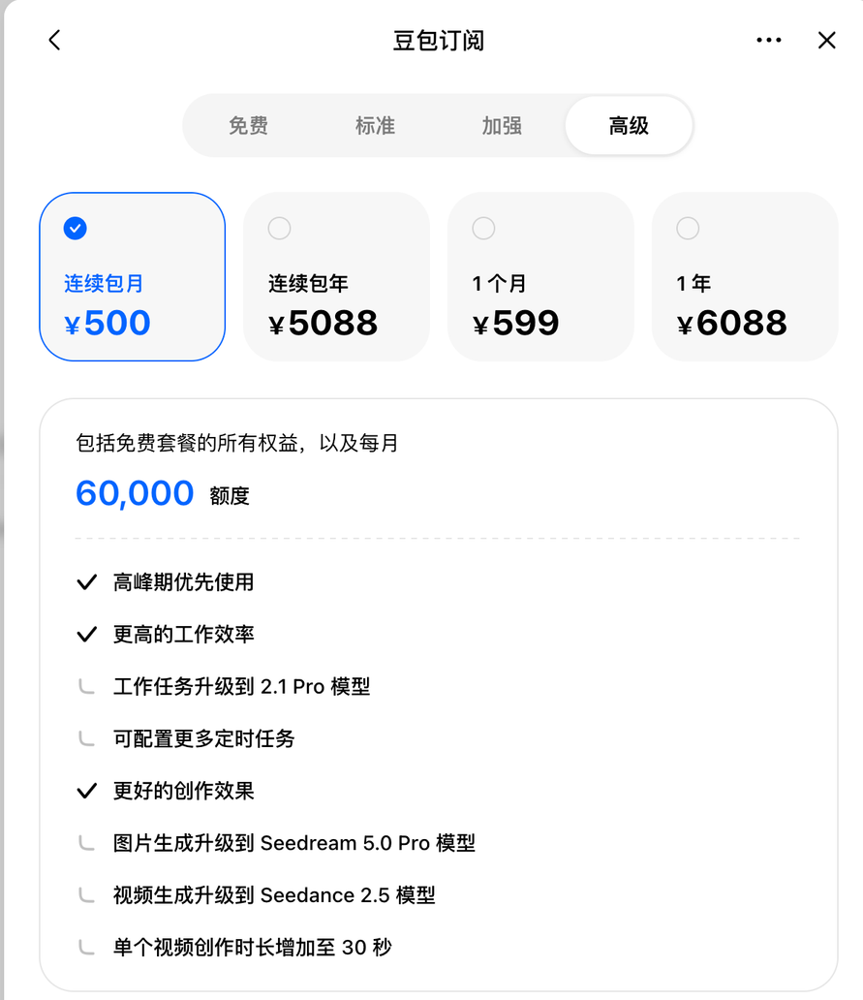

# 豆包多模型升级解析：从聊天应用到 AI Agent 的转身

大多数聊天助手都会悄悄替你选好模型。豆包最新的升级把这个选择权交回用户手里：一份混合了自研与第三方模型的列表、一个额度计量器，以及四档订阅。**这不是聊天应用的功能，而是 Agent 产品的底层构件。** 本文用界面截图作为证据，解读这次升级带来的形态转变，并明确区分哪些是公开观察、哪些只是推测。

时机让它更值得看。过去几个月，字节把飞书、TRAE 和 Coze 陆续并入豆包体系，把 TraeWork 与 TraeCode 合并为统一的 TRAE，现在又让豆包用上了与 TRAE、WorkBuddy、Qoder 等同类 Agent 一样的多模型形态。同一家公司的两个产品，越来越像同一个产品。

范围说明：这是一次观察，不是内部爆料。不做架构深挖、不做模型跑分，也不给哪个产品"更好"排名。

## 你将学到三点

1. **多模型选择器就是那个信号。** 当一个面向大众的应用允许你在豆包、DeepSeek、GLM、Qwen、Kimi 之间切换，还能调节推理强度，它就已经从"聊天"跨进了"Agent 工作台"。
2. **计量与分档属于同一次转变。** 额度和四级价格梯度说明 Agent 工作已经是"按量计费的工作"——而这道梯度也标出了字节把哪些能力当作高阶能力。
3. **两种走向值得跟踪，但不值得当真。** "TRAE 被并入豆包"和"豆包接手 TraeWork 原本的定位"都是对公开信号的合理读法，但都未被证实。盯产品标签和迁移公告，别盯传闻。

## 背景：TRAE 先把两个产品合成了一个

更合适的起点是 TRAE 自己的那次合并。TRAE——前身是 2024 年上线的豆包 MarsCode——在 2026 年 10 月 9 日宣布，把办公 AI Agent TraeWork 与编程工具 TraeCode 合并为一个统一的 TRAE：一个"全链路开发平台"，既有负责跨项目任务管理的 Agent 模式，也有负责编码调试的 IDE 模式。独立的 TraeWork 服务于 10 月 23 日停止，聊天记录与本地数据可通过应用内升级迁移。（[TechNode](https://technode.com/2026/10/10/bytedance-merges-traework-and-traecode-into-unified-trae-platform/)、[TRAE 文档](https://docs.trae.ai/solo/solo-coder?_lang=en)）

这不是孤立事件。公开报道给出的时间线是：7 月 30 日，飞书产品团队并入豆包产品团队；8 月 24 日，TRAE 与 Coze 团队完全并入豆包体系；8 月 25 日，独立的办公产品"豆包 Work"上线；9 月 15 日，字节 CEO 宣布豆包、飞书与火山引擎整合，并加大企业侧投入。（[36Kr](https://eu.36kr.com/en/p/4019692292904841)）

把这些放在一起，策略其实很难读。团队被整合进豆包，产品却被整合进 TRAE。一种公开说法是：TRAE Work 与 Coze 的能力在工作场景下并入豆包，而 TRAE IDE 与 CLI 继续作为豆包品牌下的编程线存在——可统一的 TRAE 现在同时覆盖 Agent 与 IDE 两种模式。哪一层才是真正的产品，谁又拥有"工作"？公开信息没有给出答案。正是这种模糊，构成了本文后面推测的基础。

## 现在轮到豆包：模型列表说了什么

最清楚的证据在这里。豆包的模型选择器现在给出的是一份可选模型列表，而不是单一固定的引擎：

*图：豆包的模型选择器，顶部选中"自动·小额免费"，下方列表包含豆包 2.1 Lite/Pro、DeepSeek V4.1 Flash、GLM 5.4/5.3 多个版本、Qwen 4 Max 与多个 Kimi K3 版本，另有一个推理强度调节项。*

这份列表里有三点值得留意：

- **自研与第三方模型并列。** 豆包 2.1 Lite 和 Pro 旁边就是 DeepSeek、GLM、Qwen 和 Kimi。这个应用不再是某个单一模型的外壳。
- **有一个带成本提示的"自动"选项。** 路由正在从内部决策变成产品功能——同类 Agent 里也能看到同样的做法，比如 Qoder 的模型选择器同时提供自动路由与直接选模型。（[Qoder 文档](http://docs.qoder.com/user-guide/chat/model-tier-selector)）
- **推理强度成了面向用户的旋钮。** 这是 Agent 运行时的控制项，不是聊天机器人的设置。

这些加在一起，正好对上本文背后的那个用户级观察：豆包现在支持多模型选择，与 TRAE、WorkBuddy、Qoder 等同类 AI Agent 站到了同一形态上。这次升级是一次"种类"上的转变——豆包从简单的聊天应用，演变成了完整的 AI Agent。

额度页面进一步印证了这一点：

*图：订阅与额度页面显示可用额度 7,100，另有两组带到期时间的赠送额度——用量是被计数的，不是无限的。*

## 四档订阅：钱花在哪些能力上

价格页面有四个标签页——免费、标准、加强、高级。下面的数字就是页面显示的；请把它当成一次包装方式的快照，而不是永久价目表。

| 档位 | 页面价格 | 每月额度 | 要点 |
|------|-------------|-----------------|---------|
| Free 免费 | ¥0，长期 | — | 基础对话与联网搜索不限次；高阶项目未开放 |
| Standard 标准 | ¥1（带 7 天试用标记）；连续包年 ¥688/年，¥80/月，¥828/年 | 9,000（限时 +50%） | 高峰期优先使用、更高效率 |
| Enhanced 加强 | 连续包月 ¥200；¥2,048/年，¥240/月，¥2,488/年 | 24,000 | 权益相同，额度更高 |
| Advanced 高级 | 连续包月 ¥500；¥5,088/年，¥599/月，¥6,088/年 | 60,000 | 权益相同，额度最高 |

*图：免费档长期 ¥0，基础对话、联网搜索，以及基于图片/网页/附件的问答都不限次；AI PPT/表格/文档、会议纪要、图片与视频生成、语音/视频通话不包含在内。*

*图：标准档——¥1 带 7 天试用标记、每月 9,000 额度——勾选了高峰期优先使用和更高工作效率。*

*图：加强档把每月额度提到 24,000，连续包月 ¥200。*

*图：高级档把额度提到 60,000，连续包月 ¥500。*

有两点值得留下。第一，付费档买到的主要是**额度与优先级**，而不是不同的模型——三个付费页面上，"工作任务升级到 2.1 Pro 模型"这一行都未勾选，更多定时任务、图片/视频生成升级同样未勾选。包装方式还在调整中。第二，一个售卖额度、优先级和 Agent 能力的产品，定价方式已经像一个 Agent 平台，而不像聊天应用了。

## 判断一：这是一次「聊天应用 → AI Agent」的转身

把模型选择器、额度计量器和价格阶梯放在一起看，结论很窄，但很硬：豆包不再被定位成一个聊天的地方。它被定位成一个用模型干活的地方——用户选模型，系统计量工作量，更高档位买到更多工作量。

这正是同类 Agent 的形态。TRAE、WorkBuddy、Qoder 都允许用户选模型；豆包这次升级把自己放进了同一个类别。对读者来说，实际收获不是该选哪个模型，而是认清**"模型选择 + 计量 + 任务控制"已经是 Agent 产品的基线定义**。如果一个工具还在聊天框后面写死一个模型，它玩的是上一局的游戏。

## 判断二：豆包和 TRAE 之间的产品策略，公开信息里看不清

第二个判断关于模糊性，它是作者对公开材料的解读，不是官方立场。字节把团队整合到豆包之下，把产品整合到 TRAE 之下，另外上线了面向办公场景的豆包 Work，然后又给豆包装上了 Agent 式的多模型界面。公开描述还说，TraeWork 与 Coze 的能力在工作场景下并入豆包，而 TRAE IDE/CLI 这条线继续留在豆包品牌下。

这些说法拼不出一个清晰的产品故事。豆包正在变成 Agent，TRAE 已经是 Agent，两者在同一个组织屋檐下，而"工作"这个词现在两边都在用。说豆包与 TRAE 之间的策略从外部看不清，是合理的；声称我们知道内部计划，则不合理。所以下面两种走向是作为分析给出的，不是路线图。

## 两种可能的走向（推测，非官方路线图）

**本节所有内容都是基于公开信息的推测，不是已确认的官方路线图。**

### 情景一：TRAE 被并入豆包——*推测*

前提是用户规模。豆包被公开描述为中国使用最广的 AI 应用（[路透社](https://www.reuters.com/world/asia-pacific/chinas-bytedance-releases-doubao-20-ai-chatbot-2026-02-14/)），公开报道还提到其模型每天极高的 token 量；而 TRAE 作为开发者与办公工具，受众要窄得多。如果字节想要一个面向大众的 Agent 工作入口，把 TRAE 并入豆包，比同时维护两个互相重叠的产品更便宜——尤其是在团队已经并入豆包体系之后。

支持这一走向的信号：豆包继续吸收原本属于 TRAE 的 Agent 能力，以及任何把 TRAE 用户导向豆包的迁移公告。削弱它的信号：继续把 TRAE 当作独立品牌投入，保留自己的 IDE/CLI 产品线（公开描述目前正是这么说的）。

### 情景二：豆包接手 TraeWork 原本的定位——*推测*

前提是功能重叠。TraeWork 是字节的办公 AI Agent，以"让 TRAE 为你工作"为卖点上线，随后在 10 月 9 日被并入统一的 TRAE。豆包 Work 已在 8 月 25 日作为独立的办公场景产品上线，公开描述也说 TraeWork 与 Coze 的能力在工作场景下并入豆包。在这一走向里，豆包接手 TraeWork 原本的定位——通用办公 Agent，而 TRAE 保留豆包品牌下的编程线（IDE 与 CLI）。

支持这一走向的信号：豆包的"工作模式"获得当初定义 TraeWork 的任务规划与内容创作能力，同时 TRAE 的对外表述收窄到开发者。削弱它的信号：统一的 TRAE 继续把 Agent 与 IDE 两种模式作为同等重要的功能来推广。

两种走向都与公开记录一致，但都没有被证实。诚实的做法是两种都留着，看哪个标签真的会变。

## 反对意见

一个合理的反对意见：多模型选择在这个市场可能只是入场券，而不是合并信号。每个像样的 Agent 产品都在加入模型选择，所以豆包这么做，可能只意味着它在追赶，而不是在吸收 TRAE。按这种读法，两个产品是有意为之：豆包面向大众与通用工作，TRAE 面向开发者，两者同属豆包组织，但界面彼此独立。公开描述中 TRAE IDE/CLI 继续作为编程线存在，支持这一解释。

反反驳也很克制：模糊之处在**产品标签**，未必在组织架构。这里没有声称字节已决定砍掉任何一个产品；只声称两个界面现在提供重叠的能力，因此这条边界值得盯着。这个说法经得住上述反对意见。

## 对你意味着什么

**对正在使用 TRAE 的开发者：** 别押品牌名，押能力和能导出的产物。公开描述说 IDE/CLI 这条线继续留在豆包品牌下，所以要盯官方迁移公告，而不是推测——包括那些原本属于 TraeWork 的功能会怎样。

**对产品构建者：** 模型选择、计量和任务控制正在成为 Agent 产品的默认形态。如果你自己的工具还在写死单一模型、看不到用量，豆包这次升级正好是一份清单，告诉你用户现在期待什么。

**对行业观察者：** 把两种走向当作假设。跟踪产品标签、档位名称和迁移公告——它们比战略表述更早发生变化。

## 接下来看什么

- 模型选择器和额度体系是否出现在 TRAE 里，或者豆包的工作模式能力是否出现在 TRAE 的 Agent 模式里。
- 官方文案是否开始把"工作"分给一个产品、"代码"分给另一个——还是继续在一个统一的 TRAE 里同时推广两者。
- 10 月 23 日独立服务关停后，TraeWork 的功能会怎样。
- 那些仍未勾选的能力项（工作任务模型升级、更多定时任务、图片/视频生成）是否在付费档位中开启——这是包装方式趋于稳定的信号。
- 豆包 / 飞书 / 火山引擎整合之后，是否有官方表述点名一个统一的 Agent 入口。

## 总结与延伸阅读

1. 豆包的多模型选择器、额度计量器和四档订阅，标志着它从简单聊天应用转身为完整的 AI Agent，与 TRAE、WorkBuddy、Qoder 等同类 Agent 站到同一形态。
2. 字节在豆包与 TRAE 之间的产品策略，从公开信息里看不清；"TRAE 被并入豆包"和"豆包接手 TraeWork 定位"只是两种推测走向，不是路线图。
3. 值得一直追问的问题：谁会拥有"工作"——以及哪个标签会先变？

外部参考：[TechNode](https://technode.com/2026/10/10/bytedance-merges-traework-and-traecode-into-unified-trae-platform/)、[TRAE 文档](https://docs.trae.ai/solo/solo-coder?_lang=en)、[36Kr](https://eu.36kr.com/en/p/4019692292904841)、[Qoder 文档](http://docs.qoder.com/user-guide/chat/model-tier-selector)、[Reuters](https://www.reuters.com/world/asia-pacific/chinas-bytedance-releases-doubao-20-ai-chatbot-2026-02-14/)。

你在用的 Agent 产品把模型选择放在什么位置？欢迎在评论区聊聊 🙌
