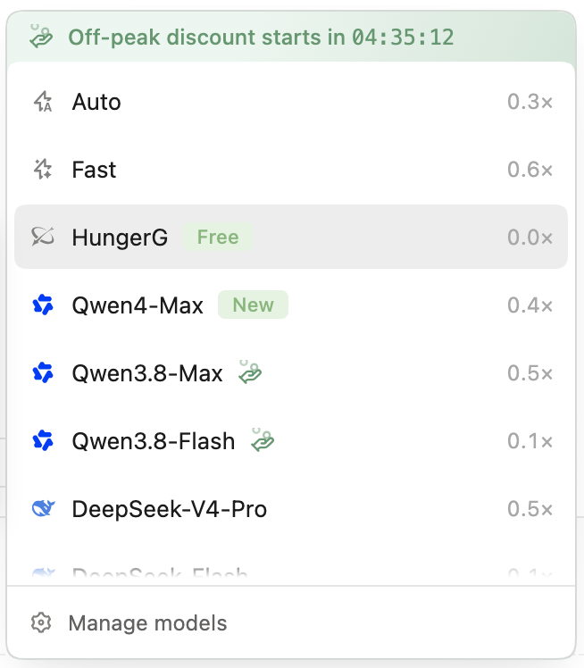
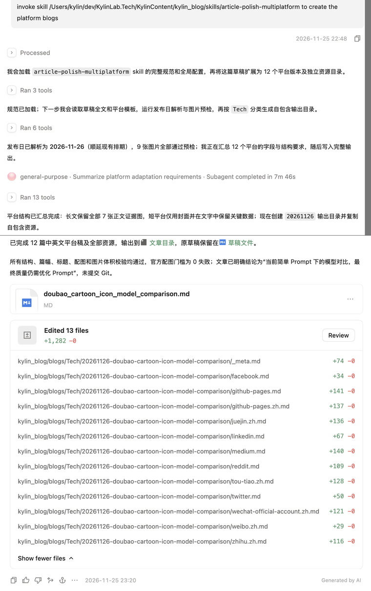
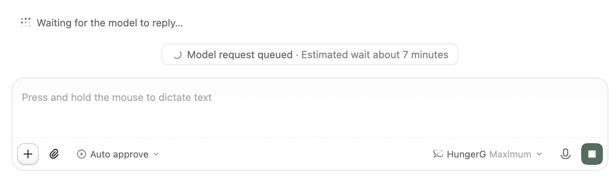
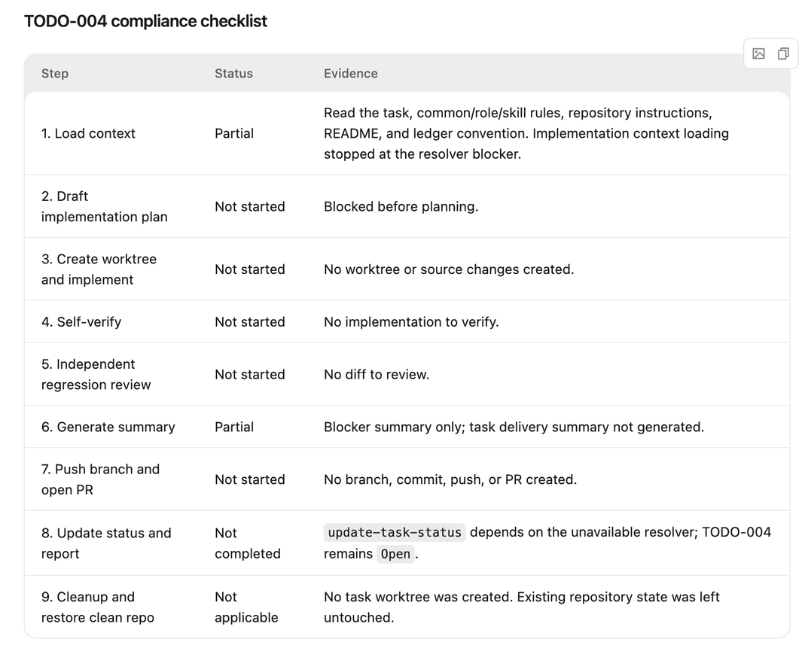
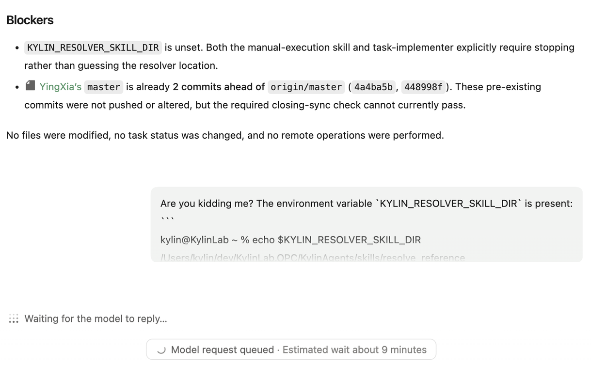
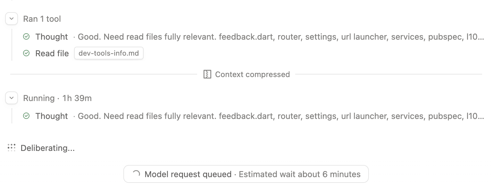
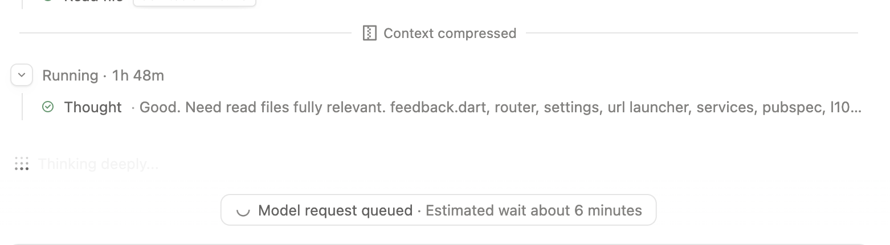

# Qoder HungerG Free Tier Tested: Text Works, Code Doesn't

Last month I tested Qwen3.8-Flash on Qoder's free tier and wrote a post concluding that it was not ready for serious work. This month Qoder introduced a new free model, `HungerG`. The question was simple: would it repeat the same failure pattern? This review covers only the two tasks I ran on `HungerG` free; the earlier test is background, not a rerun, and no benchmark scores are discussed.

## Background and attribution boundary

In the earlier post I argued that the problem may not be the model itself. It is more likely the free-tier limits or the Qoder AI Agent layer: Qwen3.8-Flash has run steadily in other agents. This time I could not switch `HungerG` to another agent for a cross-check, so the sections below report what I observed rather than a final verdict on the model.

Three ideas are worth carrying away: a free tier finishing a task is not the same as it being usable for work; assign failures only after separating model, tier and Agent layer; and use a minimal regression task before trusting a tool with real work.

## Test setup

The model list marks `HungerG` as **Free**, with a **0.0x** multiplier — apparently the cheapest entry point.

| Task | Request | Outcome |
|---|---|---|
| Blog adaptation | Turn one AI draft into platform-specific versions | Content fine; 12 posts in 32 minutes |
| Coding change | In 9 apps, replace browser-jump feedback with an in-app popup | 8 failed, 1 worked; all 9 tasks were a write-off |

I had learned from the previous round and kept the coding request deliberately small. It still failed the hardest.

## Results

### Text: acceptable content, unacceptable throughput

The blog task started from an AI draft and produced versions for different platforms. The output itself had no quality issue, but it took **32 minutes** to produce **12 posts**.

It was evening, and rate limiting was still severe. Queue messages ran around 7 and 9 minutes, so a large slice of the total time elapsed before the model replied.

For text, slow plus a few small problems is survivable. At this throughput, though, the tool does not fit into a normal working day.

### Coding: all nine tasks failed

The request was a small UI change: in 9 apps, change the feedback entry from a browser jump to an in-app popup. Eight apps would not run; one executed normally.

This was the first time I met an Agent that, when calling a task skill, could not read the configuration directory from the system environment. The directory was in the current working directory, reached through a symlink. The task said the environment variable was unset; a terminal check showed it was present.

It also compressed context frequently — a clear sign of a very limited free-tier context window.

The single task that never exited midway ran for **1 hour 48 minutes** and was still in step one, code analysis. All nine tasks failed.

### Comparison

| Dimension | HungerG (Qoder free) | Qwen3.8-Flash (Qoder free) | Qwen3.8-Flash (other agents) |
|---|---|---|---|
| Conclusion | Failed again | Failure recorded last month | Ran steadily |
| Attribution | More likely free tier or Agent layer | Broadly the same judgement | The model itself was not the problem |
| Cross-check | Not possible this time | Verified in other agents | Serves as the comparison |

The comparison is not about which tool is worse. When the same model runs steadily in another Agent, blaming the model alone is unfair — and `HungerG` had no such cross-check here.

## Trade-offs and when not to use it

- Don't use it for code, especially real application changes: 9 out of 9 tasks failed.
- Don't put it on a deadline: 12 posts took 32 minutes, and one task spent 1h48m in step one.
- Don't depend on long, coherent context; repeated compression keeps breaking the thread.
- Don't treat the result as a verdict on `HungerG` itself; another Agent was not available.

To reproduce, keep three things fixed: the same AI draft, the same feedback-entry request, and the same recording sheet.

- Select `HungerG` (Free) in the model list.
- Run the draft through 12 platform versions.
- Run the feedback-entry change across 9 apps.
- Record quality, elapsed time, queue waits, and interruptions or context compressions.

Changing the model or tier and rerunning the same set makes it much easier to see whether the difference comes from the model name or the runtime configuration.

## Conclusion and further reading

Qoder's `HungerG` free model basically cannot carry serious work. It suits text generation such as blog posts. Slow output and small rough edges are acceptable there; for coding, don't count on it.

Before adopting a free model, ask whether you can verify the same model elsewhere if the tier or Agent layer is the real constraint. Measure elapsed time, environment reads and context stability with one minimal task before handing over real work. For the earlier comparison, see the Qwen3.8-Flash free-tier review from last month.
