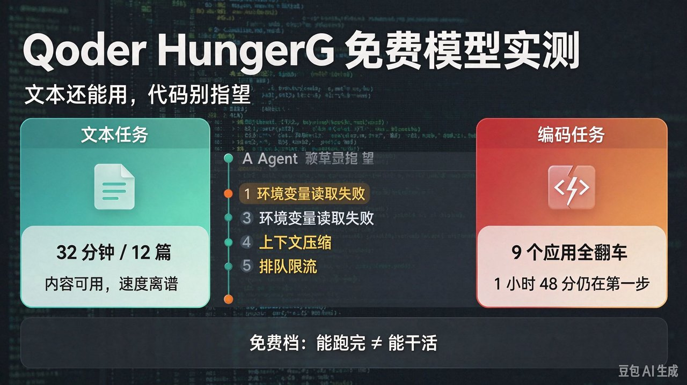
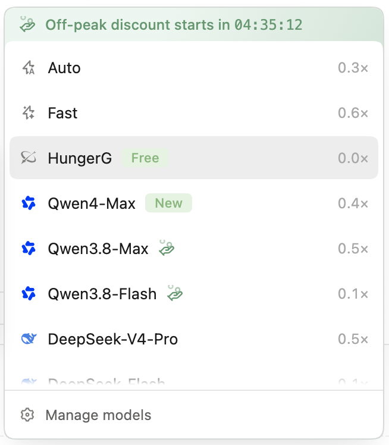
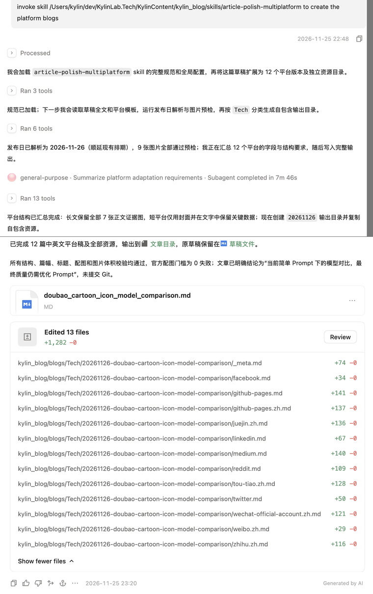
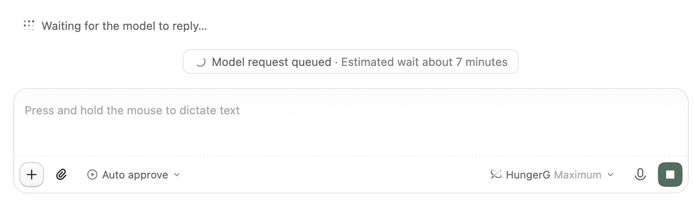
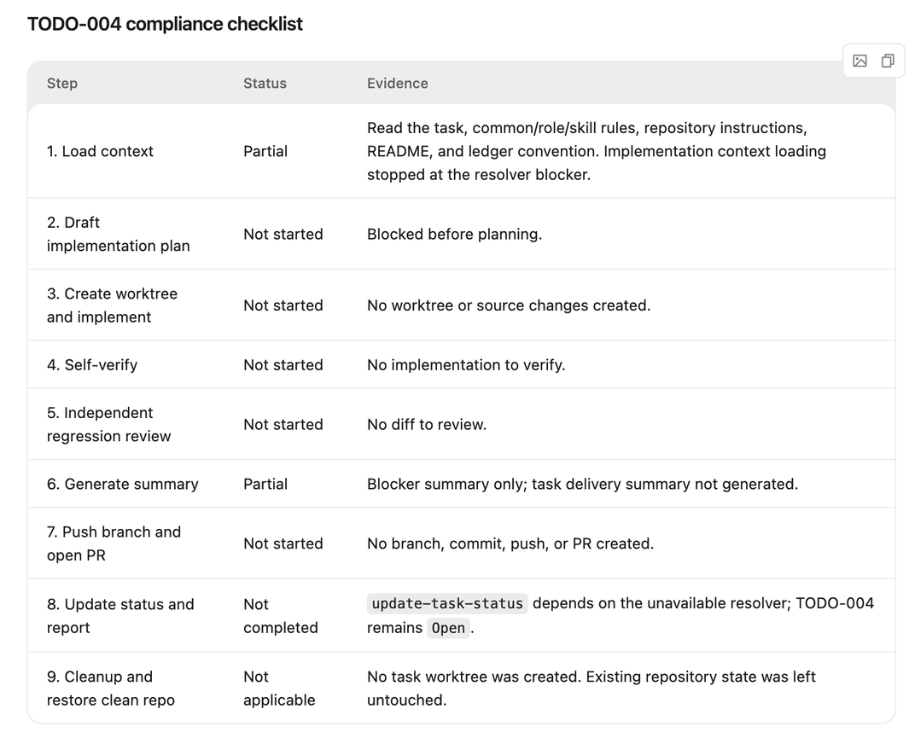
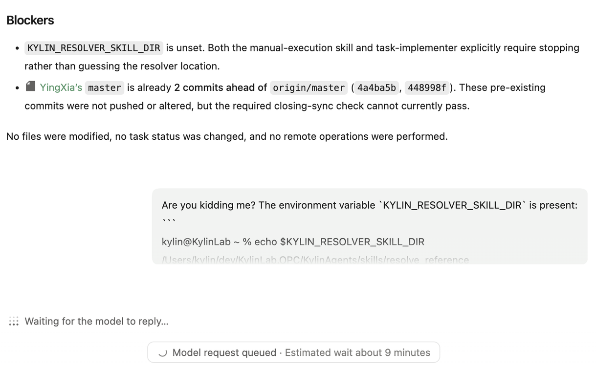
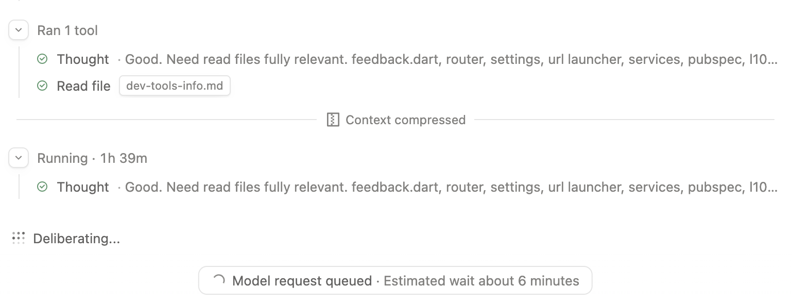
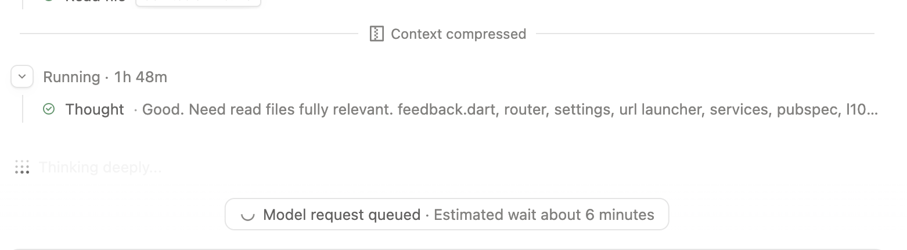

# Qoder HungerG 免费模型实测：文本还能用，代码别指望

上个月我测过 Qoder 免费版的 Qwen3.8-Flash，并发了《Qoder 免费开放 Qwen3.8-Flash，我用它跑了一个任务：结论是别指望它干重活》。这次 Qoder 上新了免费模型 `HungerG`，我想看看它会不会重蹈覆辙。结论是：文本还能用，代码别指望。

本文只记录这次 `HungerG` free 的两项真实任务。上个月那篇博客写的才是 Qwen3.8-Flash free，这里只作背景对照，不复盘完整过程，也不讨论基准跑分。

## 1. 问题与背景

我在上一篇博客里提过，问题不一定是模型本身导致的，更可能是免费档位限制，或 Qoder AI Agent 层的问题——之前 Qwen3.8-Flash 在其他 Agent 里运行得很稳定。

这次我没法换到其他 AI Agent 上验证 `HungerG`，所以只把实测现象摆出来，不去替它下最终判决。你会得到三条原则：**免费档的“能跑完”和“能干活”是两回事；归因要拆开模型、档位、Agent 层；用极简需求做回归测试最省时间。**

## 2. 测试设置

模型列表里 `HungerG` 标着 **Free**，倍率 **0.0x**，看上去是门槛最低的入口。

| 任务 | 内容 | 结果 |
|---|---|---|
| 博客平台化 | 基于一份 AI 初稿，衍生出适配不同平台的版本 | 内容没问题，32 分钟产出 12 篇 |
| 编码改造 | 9 个应用反馈入口：浏览器跳转改为应用内弹窗 | 8 个跑不通，1 个能执行，9 个全翻车 |

有上次踩坑的经验，我特意把编码需求控制得很简单，结果反而是它被卡得最死。

## 3. 结果验证

### 3.1 文本任务：内容合格、吞吐离谱

基于一份 AI 初稿衍生出适配不同平台的版本，输出内容本身没有问题，但整整花了 **32 分钟**才产出 **12 篇**平台博文。

当时是晚间时段，还限流这么严重。界面里排队提示一会儿 7 分钟，一会儿 9 分钟，模型回复前就先耗掉一大截时间。

### 3.2 编码任务：9 个应用全军覆没

需求很简单：把 9 个应用的反馈入口从跳转浏览器改成应用内弹窗，优化交互体验。结果 8 个跑不通，只有一个能正常执行。

这是我第一次碰到这种 AI Agent：调用任务技能时无法读取系统环境里的配置目录。配置目录明明就在当前工作目录下，只是用软链接指向目标路径；任务却报告相关环境变量没有设置，而我在终端里一查，变量明明就在。

另外它还会频繁压缩上下文，足以看出免费版本的上下文窗口非常有限。

唯一一个没有中途中断退出的任务，耗时 **1 小时 48 分钟**，却还停留在第一步的代码分析阶段。9 个任务全翻车了。

### 3.3 与上一轮的对比

| 维度 | HungerG（Qoder 免费档） | Qwen3.8-Flash（Qoder 免费档） | Qwen3.8-Flash（其他 Agent） |
|---|---|---|---|
| 本次结论 | 依旧翻车 | 上月博客已记录翻车 | 运行得很稳定 |
| 归因判断 | 更可能是免费档位或 Agent 层 | 上一轮判断基本相同 | 模型本身不是问题 |
| 能否交叉验证 | 不能，这次没法换其他 Agent | 已在其他 Agent 上验证过 | 作为对照出现 |

关键不是谁更差，而是：同一个模型换个 Agent 就能稳定工作，把锅全甩给模型本身并不公平。`HungerG` 这次没有交叉验证的机会。

从工程视角看，失败发生的位置比失败本身更能说明问题：文本任务完成了，但限流排队把吞吐拖垮；编码任务在环境读取和第一步代码分析就停住。前者更像免费档位问题，后者更像 Agent 执行链路问题。把这两层分开，才不会把宿主层的问题记在模型头上。

复现时建议固定三件事：同一份 AI 初稿、同一个反馈入口需求、同一组记录项。换模型或换档位后再跑一遍，对比耗时、中断次数与上下文压缩情况，就能判断变化来自模型名还是来自运行配置。这也是本文只做现象记录、不给跑分结论的原因；实测数据均来自上述七张截图。

## 4. 坑与取舍

- 要写代码，尤其是涉及真实应用改造的任务，别指望它——9 个应用全翻车。
- 有时间要求的活儿别交给它：12 篇博文要 32 分钟，一个任务能跑到 1 小时 48 分还没出第一步。
- 需要长上下文连贯推进的任务别上，频繁压缩上下文会不断打断思路。
- 想据此判断 `HungerG` 模型本身的真实能力，也别急——这次无法在其他 Agent 上验证。

复现这次测试：在模型列表选中 `HungerG`（Free）；用同一份 AI 初稿跑 12 个平台博文；用同一个反馈入口需求跑 9 个应用；分别记录质量、耗时、限流排队和中断/压缩次数。

## 5. 总结与延伸阅读

总的来说，Qoder 的 `HungerG` 免费模型基本没法承担正经工作，只适合生成博客这类文本内容。哪怕速度极慢、附带一些小问题都尚能接受，但写代码就完全不用指望。

采用前先问自己一句：这件事如果卡在免费档位或 Agent 层，我有没有换工具验证的余地？下结论前，先用一个最小任务量一量它的耗时、环境读取和上下文稳定性，再决定要不要把真正的活儿放进去。

这两项任务的记录都来自同一位使用者的单次实测，样本有限，适合作为选型前的最小参考，而不是普遍结论；遇到不同时间段、不同负载，结果也可能变化。

如果你也在评估免费 AI 模型，建议先读一读上个月的 Qwen3.8-Flash 复盘，再对照本文的两项任务，判断“模型名”和“实际体验”之间到底差了几层。
