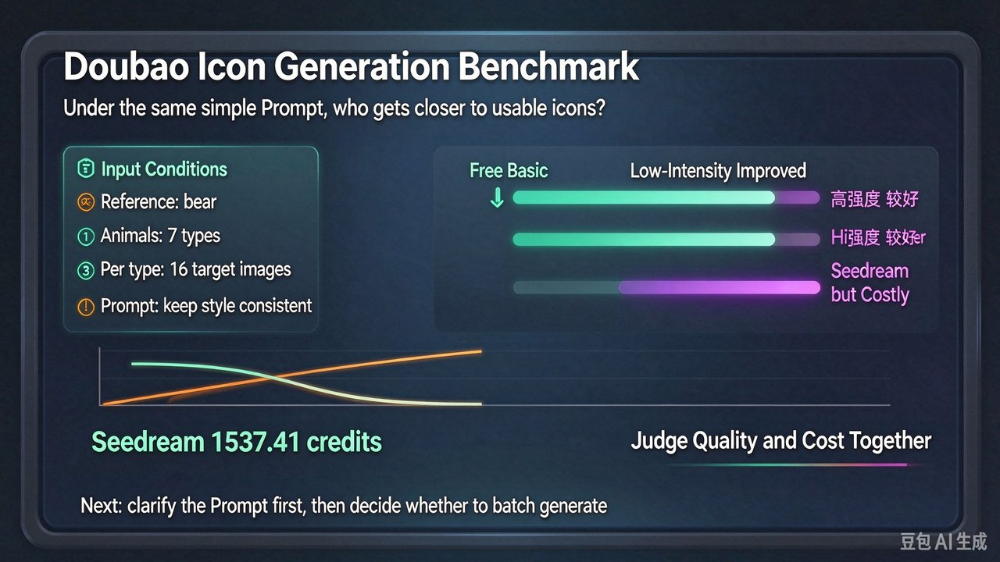
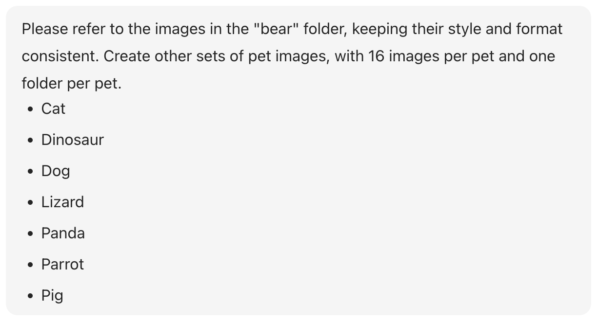
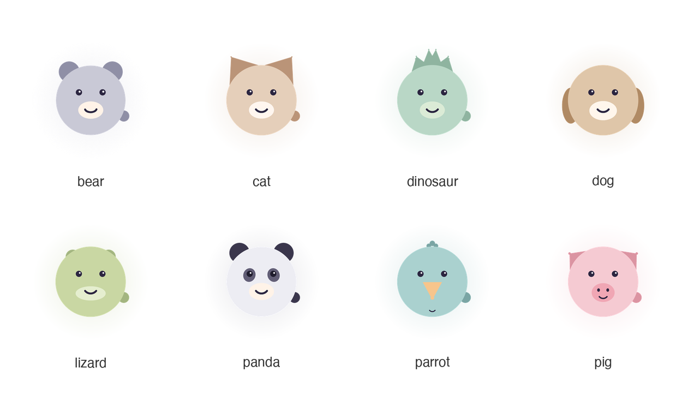
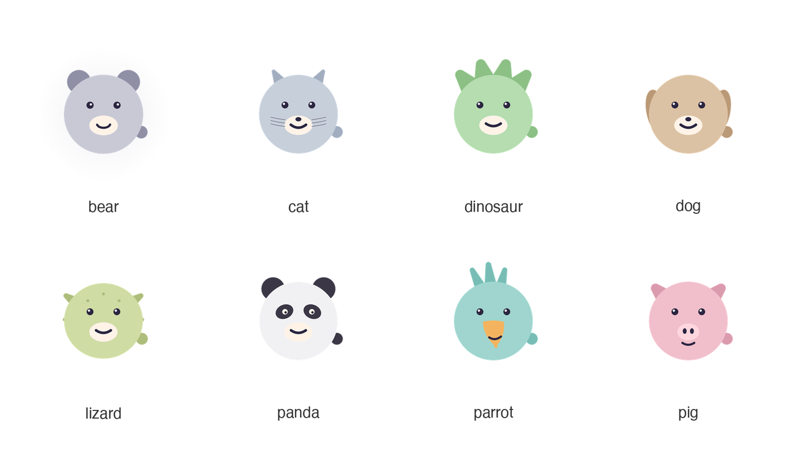
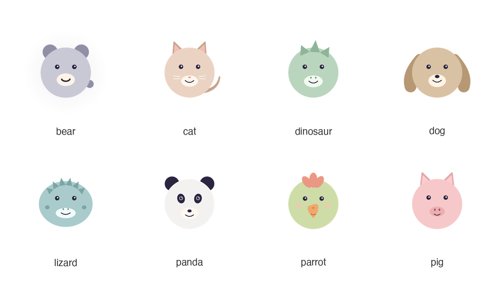
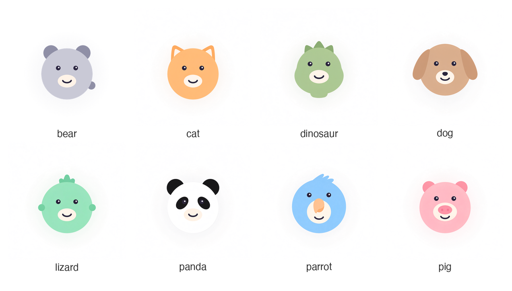
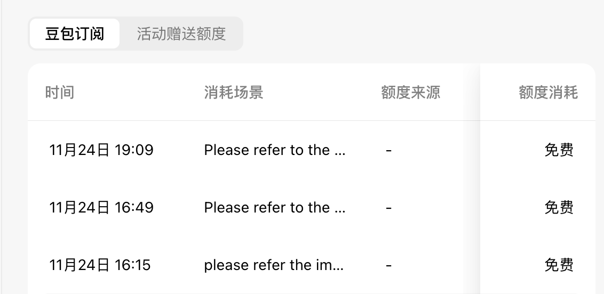
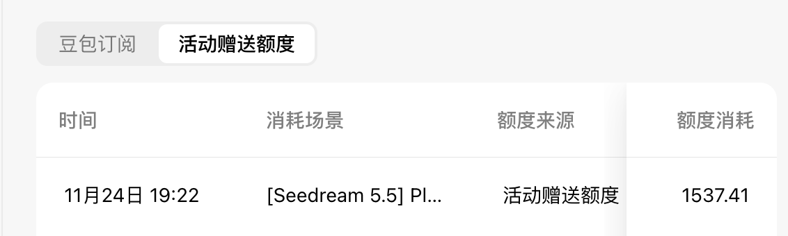

# Doubao Icon Generation Test: Four Options, One Costly Surprise

A code-generated bear icon set needed seven more animal families: Cat, Dinosaur, Dog, Lizard, Panda, Parrot, and Pig. The requirement was 16 images per animal, or 112 target images.

I compared Doubao Free, DeepSeek-Flash Low, DeepSeek-Flash High, and Seedream using the same bear reference, the same animal list, and the same simple prompt. The goal was to isolate the model variable and see whether the output difference justified the cost.

**The result: High and Seedream were better first drafts, but neither met the delivery target. Seedream also consumed 1,537.41 credits in one recorded run.** This is a model test under a simple prompt, not the final quality ceiling. For more on turning vague requirements into executable instructions, see [The Free AI Era Is Ending: A Logo-Generation Experiment and Plan B](https://kylinlabai.github.io/knowledge/free-ai-era-gone.html).

## Method and scope

The prompt was:

> Please refer to the images in the "bear" folder, keeping their style and format consistent. Create other sets of pet images, with 16 images per pet and one folder per pet.

The evaluation covered six dimensions: reference-style consistency, animal recognition, detail completion, set-wide uniformity, readiness for use, and credit visibility.

The evidence below consists of preview sheets. It does not replace a per-image audit of all 112 targets, and a strong preview can still hide inconsistencies across the full set.

## Four-option comparison

| Dimension | Free | DeepSeek-Flash Low | DeepSeek-Flash High | Seedream |
|---|---|---|---|---|
| Reference style | Rounded, conservative | More detail | Closer to target, uneven | Fuller, bolder color |
| Recognition | Clear | Clearer whiskers and spikes | Stronger ears, tails, crests | Stronger beaks and muzzles |
| Uniformity | Somewhat generic | Improved, needs curation | Local shape and color drift | Palette differs from reference |
| Result | Not impressive | Better, still ordinary | Better, below target | Better, below target |
| Credits | Free in records | No explicit figure | No explicit figure | 1,537.41 per run |

### Free

Free produced clear silhouettes and recognizable animals. It was useful for direction-finding, but the set felt generic and lacked memorable differences between animals.

### DeepSeek-Flash Low

Low intensity added more explicit details. Recognition improved, but the set still needed curation and manual unification.

### DeepSeek-Flash High

High intensity produced more complete tails, crests, and identifying features. It was closer to the target, but local silhouettes, colors, and overall temperament still varied.

### Seedream

Seedream had stronger facial features and higher visual completion. It was among the better results, but some colors moved away from the restrained bear reference and the set still fell short.

## Credit accounting

The free records showed three generations marked “Free.” DeepSeek-Flash Low and High did not display explicit consumption numbers, so they are recorded as “no explicit figure,” not “zero cost.”

Seedream's November 24, 19:22 record showed `[Seedream 5.5 Pl...]` consuming **1,537.41 activity-gifted credits**.

Using 68 CNY for 9,000 credits as a rough reference:

| Item | Value |
|---|---:|
| Seedream run | 1,537.41 credits |
| Nominal monthly plan | 68 CNY / 9,000 credits |
| Runs supported | `9,000 ÷ 1,537.41 ≈ 5.85` |
| Rough cost per run | `68 ÷ 5.85 ≈ 11.6 CNY` |

This is a nominal-plan conversion, not a platform quote. The actual record used gifted credits. Even under that calculation, 9,000 credits would not cover six runs.

Before batch generation, confirm which quota is consumed and multiply per-run cost by planned iterations. When the visual direction is still uncertain, generate a small sample first.

## Prompt refinement is the next experiment

The simple prompt made the model comparison clean, but it did not explain what “same style” meant. Composition, line weight, palette, whitespace, poses, expressions, and viewpoints were all unspecified.

The next round should:

1. Translate the reference style into explicit composition, line, color, and spacing rules.
2. Define the pose, expression, and viewpoint for each of the 16 images per animal.
3. Fix the model and validate the revised prompt on a small sample before comparing models again or scaling.

> Better model selection cannot compensate for requirements the prompt never states.

## How to validate the revised prompt

1. **Turn the reference style into explicit rules.** Record subject scale, composition, line treatment, palette, background, whitespace, and file structure instead of relying on “consistent style.”
2. **Keep the model fixed for a small sample.** Test two or three poses and viewpoints for two animals, then check silhouette, color, and recognition against the same acceptance criteria.
3. **Compare models and scale only after the sample passes.** Keep the prompt and animal list unchanged during the model retest; expand to all 16 poses after the direction is stable.

Save the prompt version, model option, quota type, actual credits, and manual corrections for each round. A revised prompt succeeds when it reduces missing requirements and rework under the same criteria—not merely when one output looks prettier.

## Selection guide

| Need | Choice | Reason |
|---|---|---|
| Explore icon direction | Free, then Low | Check shapes and recognition first |
| Better first draft | High or Seedream | Closer to the target under this prompt |
| Production-ready set | Refine prompt, then sample | Current prompt leaves requirements ambiguous |
| Credit-sensitive batch | Avoid immediate Seedream scaling | 1,537.41 credits per recorded run |

## Conclusion

Under this simple prompt, DeepSeek-Flash High and Seedream were better first-draft candidates. They were not final icon sets. Model choice, prompt clarity, manual finishing, and credit cost all remain separate decisions.

The next step is to clarify the prompt before deciding whether to pay for a full batch.

One final note: even when free AI models are no longer available, high-quality prompts and selecting the right model for each task will still matter; otherwise, repeated reruns will keep driving costs higher.

More AI-generation and indie-development notes are available in the [KylinLab knowledge base](https://kylinlabai.github.io/knowledge). How do you sequence prompt refinement versus model testing for large asset sets?
