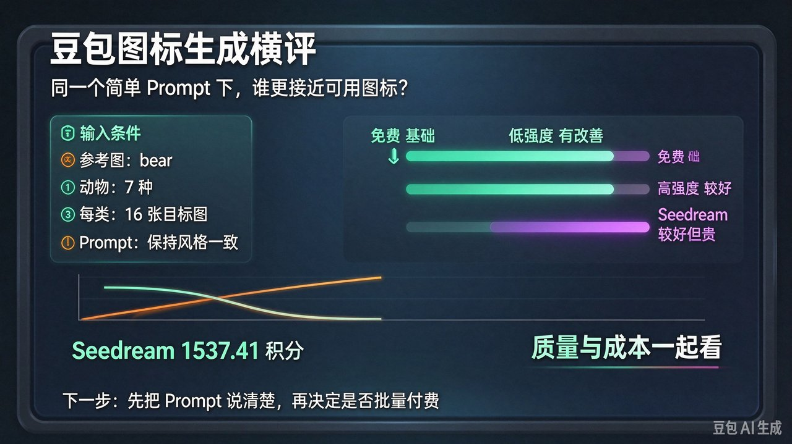
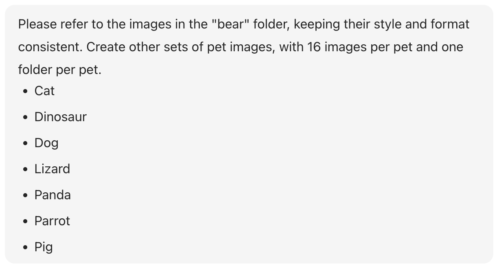
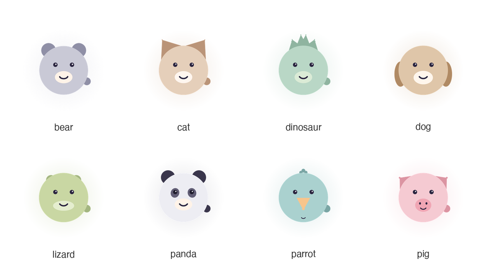
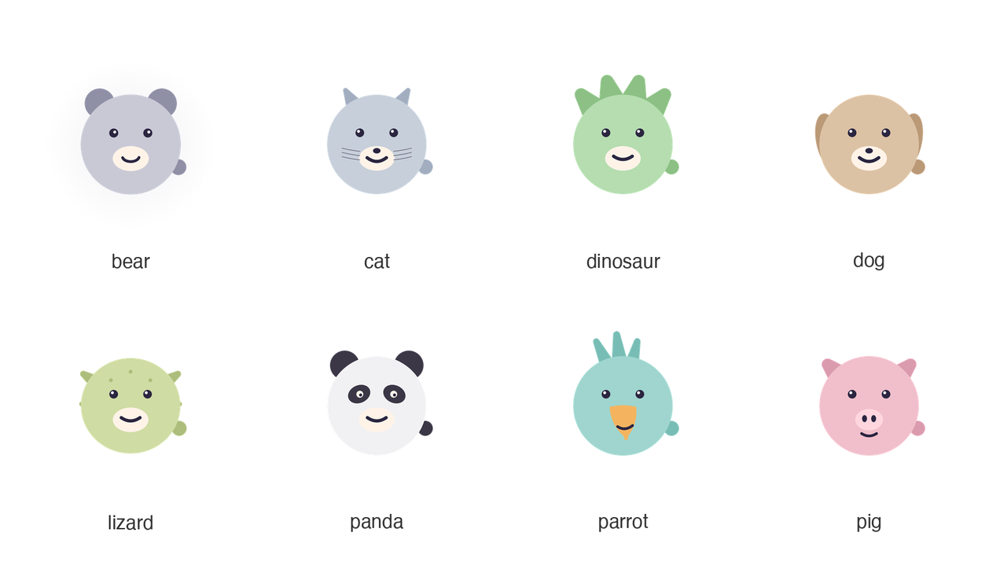
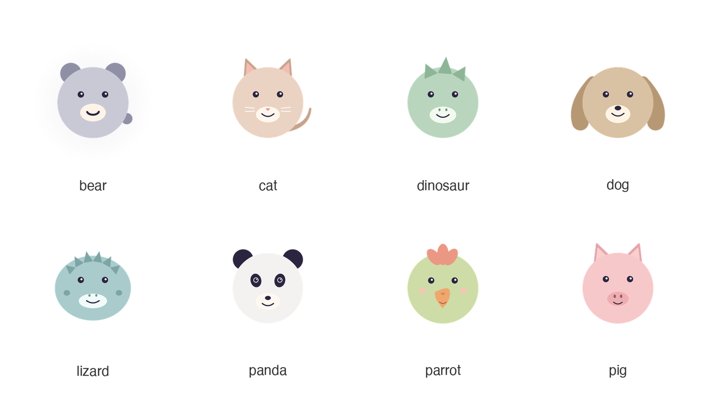
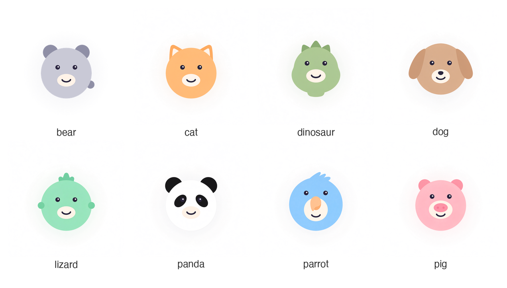
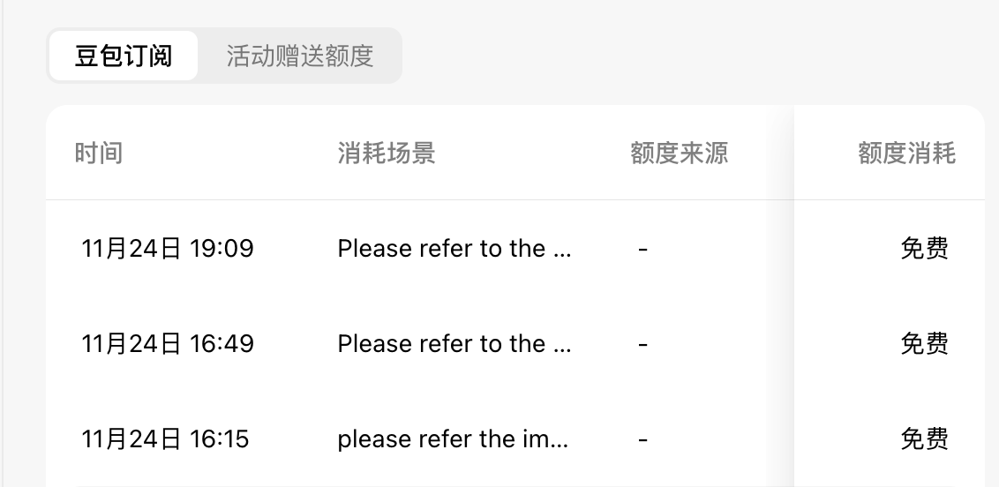
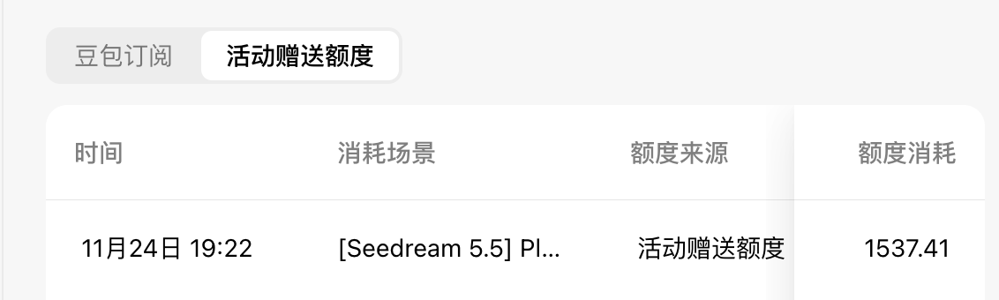

# 豆包动物图标生成横评：四种组合与积分成本

给一个 App 做卡通图标时，代码已经生成了一套 bear。接下来要把同样风格扩展到 Cat、Dinosaur、Dog、Lizard、Panda、Parrot、Pig，我用同一句简单 Prompt 对比了豆包免费、DeepSeek-Flash 低强度、DeepSeek-Flash 高强度和 Seedream。

**结论是：当前 Prompt 下，DeepSeek-Flash 高强度和 Seedream 更好一点，但仍没达到预期。** 这次只控制模型变量，不能代表最终效果上限；Seedream 单次消耗 1537.41 积分，成本也比结果更让人吃惊。若想先理解如何把模糊需求变清晰，可延伸阅读 [Prompt 前置精炼](https://kylinlabai.github.io/zh/knowledge/ai-prompt-prerefinement.html)。

## 测试方法与边界

四种组合使用同一套 bear 参考图、同一句提示词和同一组动物。

> Please refer to the images in the "bear" folder, keeping their style and format consistent. Create other sets of pet images, with 16 images per pet and one folder per pet.

需求规模是 `7 × 16 = 112` 张目标图。本文只评估截图中的整套预览，不把预览图当成每套 16 张图的逐张验收。

评估维度：参考风格一致性、动物辨识度、细节完成度、套件统一性、可用程度、积分可见性。

## 四种组合横向对比

| 维度 | 免费 | DeepSeek-Flash 低强度 | DeepSeek-Flash 高强度 | Seedream |
|---|---|---|---|---|
| 参考风格 | 圆润可爱，偏保守 | 延续基础风格，细节增加 | 更接近预期，局部仍跳脱 | 完成度较高，配色更鲜明 |
| 动物辨识度 | 基本清楚 | 猫胡须、恐龙背鳍更明确 | 耳、尾、冠羽更完整 | 耳、喙、鼻吻更鲜明 |
| 套件统一性 | 偏模板化 | 有改善，仍需人工统一 | 局部轮廓与配色不统一 | 造型完整，配色不完全沿用参考 |
| 最终结论 | 不够惊艳 | 有改善，但仍一般 | 较好，未达预期 | 较好，未达预期 |
| 积分可见性 | 记录显示免费 | 未看到明确消耗数字 | 未看到明确消耗数字 | 单次 1537.41 活动赠送积分 |

### 免费模式

基础轮廓和动物特征清楚，适合快速探索；整体偏保守，缺少记忆点。

### DeepSeek-Flash 低强度

胡须、背鳍等细节更明确，但细节增加不等于套件更协调。

### DeepSeek-Flash 高强度

猫尾、恐龙冠饰、蜥蜴背鳍、鹦鹉冠羽更完整，是四种里更接近预期的一组；局部轮廓和配色仍不统一。

### Seedream

动物轮廓和脸部特征更鲜明，完成度较高；但部分配色不完全沿用 bear 参考，结果仍没让我完全满意。

## 积分成本核算

免费记录显示三次生成“免费”；DeepSeek-Flash 低强度和高强度未展示明确消耗数字，因此只记录“未看到明确积分”。

Seedream 在 11 月 24 日 19:22 消耗了 **1537.41 活动赠送额度**。

| 项目 | 数值 |
|---|---:|
| 本次消耗 | 1537.41 积分 |
| 月度订阅 | 68 元 / 9000 积分 |
| 可支持次数 | `9000 ÷ 1537.41 ≈ 5.85 次` |
| 粗略单次成本 | `68 ÷ 5.85 ≈ 11.6 元` |

这是按标称订阅额度换算，不是平台报价；本次实际消耗的是活动赠送额度。即便按订阅积分估算，9000 积分也不够跑满 6 次。

批量生成前，先确认消耗哪一类额度，再用“单次消耗 × 计划轮次”估算总成本。方向未定时先跑小样，不要直接整批扩展。

## 下一轮 Prompt 优化

本次实验只回答“同一个简单 Prompt 下，哪种组合更好”，不能回答“需求说清楚后，最终能生成多好”。

1. **拆解参考风格**：把“style and format consistent”展开成构图、线条、配色、留白规则。
2. **补齐动作与表情**：明确每种动物 16 张图的动作、表情和视角。
3. **先固定模型验证 Prompt**：先用高强度和 Seedream 跑小样，确认需求表达有效后，再比较模型和批量生成。

## 复测时如何验证 Prompt 优化有效

1. **把参考风格写成规则**：从 bear 图中整理主体占比、构图、线条、配色、背景、留白和文件结构，避免继续使用“风格一致”这类无法逐项检查的描述。
2. **固定模型做小样**：选择两种动物，每种测试两三个动作与视角；在同一验收标准下检查轮廓、配色和动物特征是否稳定。
3. **再比较模型并扩展**：小样通过后，保持 Prompt 和动物列表不变，重新比较模型；确认方向后再补齐 16 个动作并批量生成。

每轮保存 Prompt 版本、模型组合、额度类型、实际积分和人工修改项。Prompt 是否有效，应看相同标准下缺失要求是否减少、返工是否下降，而不是只看单张结果是否更漂亮。

建议把验收拆成单张与整套两层：单张检查主体完整性、动物辨识度、动作和表情；整套检查构图、配色、线条与重复项。预览阶段先排除明显方向错误，批量阶段再逐项核对，避免把“看起来更完整”误当成“已经能交付”。

如果小样没有通过，先记录失败属于构图、配色、动作还是文件结构，再针对对应规则修改。一次只调整一个主要问题，才能判断改动是否有效；否则即使下一张图更好，也说不清原因。同时保留失败样本，便于定位仍未满足的约束。

## 选型建议

| 需求 | 建议 | 原因 |
|---|---|---|
| 快速探索图标方向 | 先用免费，再看低强度 | 先判断动物特征和大致风格 |
| 质量更好的初稿 | 优先看高强度或 Seedream | 这两种组合更接近预期 |
| 直接交付整套图标 | 先优化 Prompt，再跑小样 | 当前 Prompt 没说清需求，四种组合都未达预期 |
| 对积分敏感 | 不直接批量跑 Seedream | 单次 1537.41 积分，扩展轮次成本需提前算 |

## 总结

当前简单 Prompt 下，高强度和 Seedream 是更好的初稿候选，但还不是最终图标。模型和 Prompt 都要优化，积分成本也要提前算。

**最后补一句：** 即使免费 AI 模型有一天不再可用，高质量 Prompt 和按任务选择合适的 AI 模型仍然不能省；否则反复重跑，只会让成本越来越高。

**这次只测模型；下一步先把 Prompt 说清楚，再决定要不要为整套图标继续付费。**

更多 AI 生成与独立开发实践可见 [KylinLab 知识库](https://kylinlab.pages.dev/zh/knowledge)。你在生成整套图标时，会先优化 Prompt，还是先多试几个模型？欢迎留言讨论。
